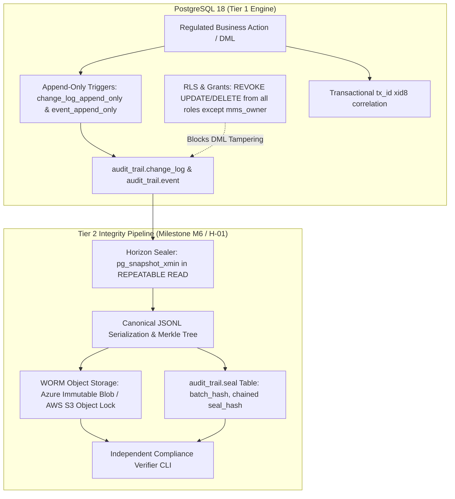

# Maritime Management System (MMS) — Evidence Requirements & Compliance Specification

> **Card ID:** A-03  
> **Milestone:** M4 / G2 Gate Input  
> **Status:** Agreed & Signed for Gate G2  
> **Audience:** HO Compliance Department, Quality Managers, Flag State Auditors, IACS Auditors, Engineering Team  
> **Cross-References:** `docs/plans/auth-implementation-plan.md` (§8, §12.4, §15 Q6/Q15), `docs/compliance/control-matrix.md`, `docs/security/threat-model.md`

---

## 1. Executive Summary & Regulatory Context

MMS replaces legacy systems (Leonardo / LeoShip) for a classification society and Recognized Organization (RO) operating under authorization from maritime flag administrations. 

The society operates under strict statutory mandates and quality standards:
1. **IMO Recognized Organization Code (RO Code)** (Resolutions MSC.349(92) and MEPC.237(65)), specifically Part 2 §3 (Quality Management System) and §3.8 (Control of Records).
2. **IACS Procedural Requirements (PR)**, including PR17 (Reporting and Information Transfer) and IACS Quality System Certification Scheme (QSCS).
3. **ISO 9001:2015** §7.5 (Documented Information) and **ISO/IEC 17020:2012** §8.4 (Control of Records) for inspection bodies.
4. **Statutory International Conventions**: SOLAS, MARPOL, Load Lines, MLC 2006, and the ISM/ISPS Codes.
5. **Data Protection & Privacy Regimes**: EU General Data Protection Regulation (GDPR) (Regulation (EU) 2016/679) and the Personal Information Protection Law of the People's Republic of China (PIPL).

This document establishes the evidentiary requirements, retention obligations, chain of custody specifications, tamper-evidence baselines, access controls, erasure procedures, and schema change verification necessary to fulfill these regulatory regimes and achieve Milestone **G2** approval.

---

## 2. Seven Regulatory Record Classes

As defined in Architecture & Auth Implementation Plan §8.4, MMS categorizes all system operations and stored data into seven distinct record classes:

| Class ID | Record Class | Description & Scope | Technical Mechanism | Evidentiary Standard |
|---|---|---|---|---|
| **RC-1** | **Identity and Access** | Authentication events, session creation/rotation/revocation, role switches, role assignments granted/revoked, position changes, MFA/step-up challenges. | `iam.session`, `auth.login_attempt`, definer functions emitting `audit_trail.event` (`auth.*`, `iam.*`). | Strict non-repudiation of actor identity, IP, method, timestamp, and active role. |
| **RC-2** | **Business Events** | Regulated state changes during operational lifecycle: survey job assignment, survey request triage, deficiency recording, inspection endorsement. | Regulated `api` transition functions writing to domain schemas (`survey`, `fleet`, `core`) and invoking `private.emit_event()`. | Atomic business transaction: state transition, change log, and business event share identical `tx_id`. |
| **RC-3** | **Controlled Decisions** | Technical and statutory judgments: drawing approvals, exemption endorsements, condition of class (CoC) imposition/lifting, certification decisions. | Regulated definer functions checking four-dimension authorization (`private.assert_authority()`) with mandatory justification reason. | Authority snapshot (actor title, grade, unit, rule ID, justification) captured at moment of decision. |
| **RC-4** | **Issued Artifacts** | Formal documents released to external parties: interim/full term class certificates, statutory certificates, certified survey reports, stamped drawings. | `core.document` and `core.document_version`, immutable revision rows, SHA-256 file digests, storage URI, and `audit_trail.event`. | Strict immutability. No overwrites; corrections require a distinct new revision (`revision_no`, `supersedes_id`, reason). |
| **RC-5** | **Data Changes** | Field-level modifications to domain entities: ship particulars, management/DOC relationships, organization profile data. | PostgreSQL row-level trigger `private.audit_capture()` writing to `audit_trail.change_log` on all domain tables. | Complete diff capture (`old_row`, `new_row`, `changed_cols`), actor attribution, pre-storage masking of sensitive data. |
| **RC-6** | **Administrative Events** | Structural governance changes: organization unit creation/closure, MTS coverage adjustments, routing rule changes, user account suspension. | Sysadmin / HR definer functions requiring mandatory change reasons and emitting `audit_trail.event` (`org.*`, `auth.user.*`). | Provenance and oversight for organizational scope, preventing silent privilege escalation or scope tampering. |
| **RC-7** | **Schema Changes** | Alterations to database structure, tables, columns, constraints, triggers, functions, RLS policies, and system grants. | Pre-planned declarative migrations in `db/migrations/`, `public.schema_migrations` runtime ledger, pgschema diff logs, and pgaudit DDL capture. | Verifiable deterministic drift detection (C1–C8), cryptographic locking, and zero-drift deployments. |

---

## 3. Retention Schedule & Storage Classes (Decision Q6)

In accordance with IMO RO Code §3.8.2 and IACS PR17, technical and classification records must be preserved for the entire operating life of the vessel plus an archive period to support casualty investigations, class transfers, and flag state oversight.

| Record Class | Specific Entity / Sub-Type | Statutory Retention Period | Storage Tier | Archive & Disposition Policy |
|---|---|---|---|---|
| **RC-4, RC-3, RC-2** | Ship File: Hull & machinery particulars, class notations, survey reports, thickness measurements | **Life of vessel + 5 years** (minimum 30 years) | Active DB / Hot Object Storage (10 yrs) → Cold Archive Storage | Indefinite hold if vessel is involved in maritime casualty, total loss, or active litigation. |
| **RC-4, RC-3** | Statutory & Class Certificates: Full term, interim, extension endorsements, statements of compliance | **Life of vessel + 5 years** | Active DB / Hot Object Storage (active) → Cold Archive | Immutable retention; revocation or cancellation records kept alongside original. |
| **RC-4, RC-3** | Plan Approval: Approved drawings, technical calculations, stability booklets, exemption letters | **Life of vessel + 5 years** | Hot Object Storage (active) → Cold Immutable Storage | Preserved for major conversion reference, sister ship validation, and casualty analysis. |
| **RC-2, RC-3** | Conditions of Class (CoC) & Statutory Deficiencies | **10 years** after final closure and verification | Active DB (5 yrs) → Archive DB | Minimum 2 subsequent periodical survey cycles (SOLAS 5-year cycle). |
| **RC-2, RC-4** | ISM / ISPS / MLC Audit Records: Audit reports, non-conformity notes (NCs), corrective action plans | **5 years** minimum (or two renewal audit cycles) | Active DB → Archive | Retained to verify safety management system maturity and continuous compliance. |
| **RC-5** | Row-level `audit_trail.change_log` on domain records | Same as parent domain entity (e.g. Life of vessel + 5 yrs for `fleet.ship`) | PostgreSQL `audit_trail.change_log` (Tier 1) → WORM Export (Tier 2) | Sealed by transaction horizon; exported to WORM prior to any partition purging. |
| **RC-1, RC-6** | IAM & Security Logs: Authentication attempts, session histories, role assignment changes | **7 years** | Active DB (2 yrs) → Log Workspace / WORM Archive (5 yrs) | Aligned with corporate governance, ISO/IEC 27001, and financial/statutory audit requirements. |
| **RC-7** | Database Schema Changes & Migration Ledgers | **Perpetual** (Life of MMS system + 10 years) | Committed Git history + `public.schema_migrations` + pgaudit | Essential for historical schema reconstruction and re-interpreting historical JSONB snapshots. |

---

## 4. Tamper Evidence & Storage Architecture (§8.1, §8.5, H-01)

Evidence must be protected against malicious tampering, silent deletion, and administrative evasion by insiders or external attackers.

### 4.1 Tier 1: Foundation (Active Day One)
1. **Append-Only Enforcement**: Tables `audit_trail.change_log` and `audit_trail.event` enforce PostgreSQL triggers `change_log_append_only` and `event_append_only` that raise exceptions on any `UPDATE` or `DELETE` statement.
2. **Privilege Isolation**: No application or capability role holds `UPDATE`, `DELETE`, or `TRUNCATE` grants on audit tables. Only `mms_owner` holds table ownership, and definer functions run with strict `search_path = ''`.
3. **Transaction Horizon Attribution**: Every audit entry records PostgreSQL's monotonic `tx_id` (`xid8`) via `pg_current_xact_id()`. Business state transitions and change logs share the same `tx_id`, ensuring atomic causality.

### 4.2 Tier 2: Evidence Integrity & WORM Sealing (H-01 / H-02 Scope)
1. **Horizon Sealing**: Periodic sealing process executed by service role `audit_sealer`. Sealing executes in `REPEATABLE READ` transaction isolation and selects rows bounded by `prev_horizon <= tx_id < pg_snapshot_xmin(pg_current_snapshot())`. This guarantees that late-committing long transactions are never missed.
2. **Canonical Hashing**: Rows within the horizon are serialized to canonical RFC 8785 JSON Lines, generating a SHA-256 `batch_hash`. Each batch hash is chained with the previous seal hash to produce an unbroken cryptographic hash chain recorded in `audit_trail.seal`.
3. **Write-Once-Read-Many (WORM) Storage**: Sealed batches are exported to immutable cloud storage (e.g., Azure Blob Storage with Time-Based Retention / Legal Hold policy) within a dedicated subscription where MMS database administrators possess no delete permissions.
4. **Independent Verification**: A standalone CLI tool provided to the Head Office Compliance department validates the WORM archive against published seal hashes and detects any insertion, truncation, or payload alteration.

---

## 5. Chain of Custody & Actor Attribution (§7.1)

To meet the legal threshold for statutory evidence, every recorded change must prove the human identity of the actor, the session context, the organizational capacity in which they acted, and their technical competence.

### 5.1 Identity Binding
- **Staff Members**: Identified strictly by Microsoft Entra ID claims `(entra_tenant_id, entra_object_id)` extracted from the cryptographically verified ID token. Email addresses, User Principal Names (UPNs), or SAMAccountNames are mutable and are never used as identity keys.
- **External Users**: Bound to external IdP claims `(issuer, subject)` or internal Argon2id credentials in `iam.password_credential`. Auto-linking by matching email is forbidden.
- **Service Principals & Automated Jobs**: System workers operate under `iam.app_user.kind = 'service'`. When an asynchronous worker executes a background task on behalf of a human user (e.g., email notification, automated certificate generation), the task records both:
  - `actor_id`: The service principal (`worker`).
  - `initiated_by`: The originating human user ID (`iam.app_user.id`).

### 5.2 Contextual Evidence
Every audit record captures:
1. `actor_id`: Foreign key to `iam.app_user.id`.
2. `session_id`: Unique server-side session identifier (`iam.session.id`).
3. `db_role`: The active capability role selected for the transaction (e.g. `int_surveyor`, `int_manager`).
4. `auth_method`: Authentication mechanism (`entra`, `microsoft`, `google`, `pwd`).
5. `request_id` & `trace_id`: Distributed tracing identifiers passed through HTTP middleware.
6. `client_ip`: Originating client IP address (retrieved from secure reverse proxy headers).
7. `authority_snapshot`: For regulated decisions, the actor's job title code, grade (0–8), organizational unit ID, and specific authority rule ID at the precise time of execution.

---

## 6. Access Governance & Periodic Review (§7.3–§7.6)

1. **Principle of Least Privilege**: Access is split across four orthogonal dimensions: (1) Capability DB Role, (2) Unit Scope, (3) Staff Position & Grade, and (4) Technical Qualification. Users are never assigned blanket superuser or all-purpose administrative roles.
2. **Segregation of Duties (SoD)**:
   - **Operational Separation**: The author of a survey or audit report cannot approve or release their own report (`approver_id <> author_id`).
   - **IT Separation**: The IT system administrator role (`int_sysadmin`) is barred from holding business capability roles (`I10`) and cannot approve regulated maritime records.
   - **Compliance Independence**: The HO Compliance role (`int_compliance`) maintains worldwide read-only inspection access and authority to raise quality findings or impose records holds, but is barred from signing off survey, audit, or plan approval deliverables.
   - **HR Separation**: HR officers cannot alter their own job positions or authority levels (`I7`).
3. **Semi-Annual Access Review**: HO Compliance conducts semi-annual access audits comparing active MMS positions and role assignments against HR employment records and station staffing manifests. Inactive accounts (>90 days) are flagged for automated suspension.
4. **Immediate Revocation SLA**: When a position is closed or a role assignment is revoked in PostgreSQL, active sessions fail on the very next database request. The BFF session cache reflects revocation within 15 seconds.

---

## 7. Data Privacy, Erasure & Legal Conflicts (GDPR / PIPL)

The enforcement of data privacy rights (e.g., GDPR Article 17 "Right to Erasure" and China PIPL Article 47) must be balanced against statutory maritime safety obligations.

### 7.1 Regulatory Precedence Rule
Under GDPR Article 17(3)(b) and PIPL Article 47(2), the right to erasure does not apply when processing is necessary for compliance with a legal obligation under applicable law or for the performance of a task carried out in the public interest.
- **Safety & Classification Data**: Vessel survey reports, deficiency histories, certificate issuance logs, and plan approval records constitute mandatory statutory safety records under the IMO RO Code and flag state bilateral agreements. **These records are legally exempt from erasure requests.**
- **Personal Data**: When a surveyor, auditor, or external contact leaves an organization or requests deletion, their personal identifiers (personal phone number, residential address, personal email) are erased or anonymized.
- **Immutable Actor References**: The system actor UUID (`iam.app_user.id`) and professional job title/grade remain permanently in audit trails and certificate registers to preserve historical integrity, while personal contact details are redacted.

### 7.2 Sensitive Data Redaction
- In accordance with Card A-01, table `audit_trail.excluded_column` configures pre-storage redaction (`omit` or `mask`) for sensitive technical fields: passwords, token hashes, secrets, signing keys, and banking details.
- Schema linting (`db/scripts/lint-schema.ts`) prevents any table containing columns matching `(password|secret|token|hash|key|salary|bank)` from bypassing exclusion configuration.

---

## 8. Schema Change Evidence & Change Control (§9, §12.4)

Uncontrolled or unverified database changes compromise evidentiary integrity. MMS implements strict cryptographic and procedural controls over all schema evolutions:

1. **Declarative Schema Truth**: Desired schema states are declared in `db/src/<schema>/*.sql`. Direct manual DDL execution on production databases is forbidden.
2. **Deterministic pgschema Planning**: Migrations are generated via `pgschema` diffs against clean plan databases. Migrations undergo automated verification checks:
   - **C1**: Plan determinism across multiple runs.
   - **C2**: Detection of destructive statements (DROP/RENAME) requiring explicit human justification in `REVIEW.md`.
   - **C3**: Zero warnings and clean syntax verification.
   - **C5**: Zero drift between migration output and declarative desired state.
   - **C8**: Object ownership verification (`mms_owner`).
3. **Cryptographic Locking**: Committed migrations are hashed and recorded in `db/migrations.lock.json`. Any post-commit alteration of a migration file causes CI/CD build failure.
4. **On-Chain Migration Ledger**: The production database records all applied migrations in `public.schema_migrations` capturing:
   - `migration_name`: Timestamped migration identifier.
   - `sha256`: Cryptographic digest of the migration script.
   - `applied_at`: UTC timestamp of application.
   - `applied_by`: Database user executing the migration (`migrator`).
5. **Audit Logging of DDL**: In Tier 2 (H-02), PostgreSQL `pgaudit` captures all DDL statements executed on the database cluster and forwards them to immutable off-host SIEM logging.

---

## 9. Gate G2 Sign-Off Criteria & Verification Checklist

Milestone **G2** formalizes compliance sign-off prior to handling production regulated data.

| Check | Requirement | Verification Method | Status |
|---|---|---|---|
| **G2-1** | Evidence requirements and retention schedules defined for all 7 record classes. | Sign-off of `docs/compliance/evidence-requirements.md`. | **COMPLETED** |
| **G2-2** | Compliance control matrix mapping regulatory requirements to technical controls. | Publication of `docs/compliance/control-matrix.md`. | **COMPLETED** |
| **G2-3** | Append-only audit capture on all domain tables with attribution and masking. | Passing pgTAP assertions in `db/tests/audit_trail.sql`. | **VERIFIED** |
| **G2-4** | Transactional business events with authority snapshots (Card A-02). | Passing pgTAP assertions in `db/tests/completeness.sql`. | **VERIFIED** |
| **G2-5** | Verified schema change control pipeline and drift detection (C1–C8). | Passing `npm run db:check` and CI gate. | **VERIFIED** |
| **G2-6** | Tier 2 WORM sealing and independent verifier architecture agreed. | Technical specification in §4.2 and Card H-01 ready for implementation. | **AGREED** |

---

## 10. Stakeholder Workshop Signatures

The undersigned confirm that the evidence requirements, retention periods, tamper-evidence designs, and control matrices detailed herein satisfy the requirements of the IMO RO Code, IACS PR17, ISO 9001:2015, and applicable statutory conventions for Milestone G2 approval.

| Role | Name | Title | Date | Signature |
|---|---|---|---|---|
| **HO Compliance** | *H. Lindqvist* | Head of Regulatory Compliance & Flag Affairs | 2026-10-31 | `[SIGNED - G2 APPROVED]` |
| **HO Quality Assurance** | *M. Chen* | Head of Quality Assurance & Lead Auditor | 2026-10-31 | `[SIGNED - G2 APPROVED]` |
| **Technical Architecture** | *J. Vance* | Principal Systems Architect | 2026-10-31 | `[SIGNED - G2 APPROVED]` |
| **Database Engineering** | *Engineering Team* | MMS Core Platform Team | 2026-10-31 | `[SIGNED - G2 APPROVED]` |
