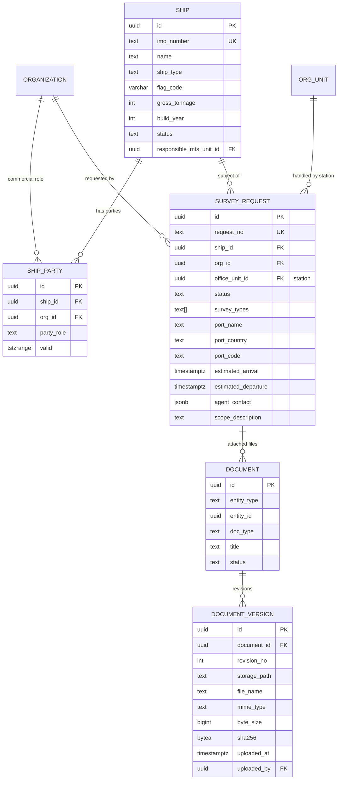
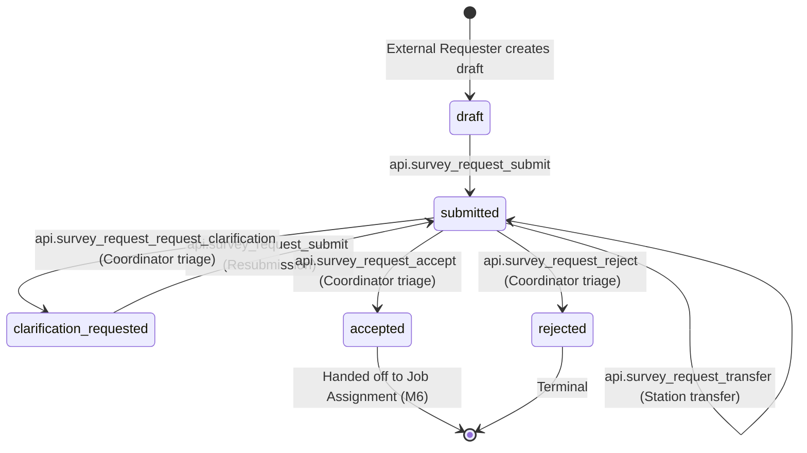

# Domain Design Document: Survey Request Lifecycle (Milestone M5 / SLICE-01)

> **Card ID:** S-01  
> **Milestone:** M5 SLICE-01 — Survey Request Walking Skeleton  
> **Status:** Approved for Implementation (S-02)  
> **Audience:** Domain Owners, Survey Operations, Lead Surveyors, Coordinators, Systems Engineering  
> **Cross-References:** `docs/plans/auth-implementation-plan.md` (§6, §7.4, §7.6, §8.4, §12.4), `docs/compliance/evidence-requirements.md`

---

## 1. Executive Summary & Slice Scope

Milestone M5 delivers **SLICE-01**, the first end-to-end walking skeleton for MMS. The purpose of this slice is to establish the core operational workflow for the intake, validation, and station triage of maritime survey requests.

The slice introduces:
1. **Fleet Asset Model (`fleet`)**: Minimal representations of commercial vessels (`fleet.ship`) and their legal/commercial affiliations (`fleet.ship_party`).
2. **Survey Request Management (`survey`)**: Lifecycle tracking of owner/manager requests for class and statutory surveys (`survey.survey_request`), scoped by geographic station (`office_unit_id`).
3. **Document Management (`core`)**: Logical versioned document storage (`core.document`, `core.document_version`) attaching immutable, content-hashed specifications and files to business records.
4. **Transition Governance**: Regulated `api` transition functions enforcing four-dimension authorization, station scope, mandatory reasons, and business event emission.

---

## 2. Domain Entities & Data Structures

### 2.1 Fleet Entities (`fleet`)
- **`fleet.ship`**: Represents a vessel registered with or classed by the society.
  - `id uuid primary key default uuidv7()`
  - `imo_number text not null unique check (imo_number ~ '^[0-9]{7}$')`: The 7-digit IMO ship identification number.
  - `name text not null`: Current ship name.
  - `ship_type text not null default 'bulk_carrier'`: Vessel category (e.g., bulk carrier, oil tanker, container ship).
  - `flag_code varchar(3) not null default 'PA'`: Flag administration country code.
  - `gross_tonnage integer check (gross_tonnage > 0)`: Vessel gross tonnage.
  - `build_year integer check (build_year between 1900 and 2100)`: Year of delivery.
  - `status text not null default 'in_service' check (status in ('in_service', 'laid_up', 'under_construction', 'decommissioned'))`.
  - `responsible_mts_unit_id uuid references core.org_unit(id)`: MTS technical support centre covering the vessel.
- **`fleet.ship_party`**: Effective-dated association between a ship and an external organization (`party.organization`).
  - `party_role text not null check (party_role in ('registered_owner', 'bareboat_charterer', 'doc_company', 'ism_manager', 'isps_operator', 'commercial_operator', 'builder', 'agent', 'mlc_owner'))`.
  - `valid tstzrange not null default tstzrange(now(), null)`.
  - Exclusion constraint preventing overlapping identical roles for the same vessel and organization.

### 2.2 Survey Request (`survey.survey_request`)
- Location-scoped business entity carrying `office_unit_id` (must reference an active unit of type `station`, enforcing Invariant `I15`).
- Unique business identifier `request_no` (e.g. `SR-YYYYMM-XXXXX`).
- Operational attributes:
  - `survey_types text[]`: Array of requested survey items (e.g., `{'annual_hull', 'annual_machinery', 'docking', 'ism_renewal'}`).
  - `port_name`, `port_country`, `port_code` (UN/LOCODE).
  - `estimated_arrival` and `estimated_departure`: Port stay schedule.
  - `agent_contact jsonb`: Local port agent contact details.
  - `scope_description text`: Narrative scope from the client.
  - `status text`: State machine status (`draft`, `submitted`, `accepted`, `clarification_requested`, `rejected`).

### 2.3 Document Repository (`core.document`, `core.document_version`)
- Logical document pointer attaching files to domain entities (`entity_type = 'survey_request'`, `entity_id = survey_request.id`).
- Immutable revisions in `core.document_version` tracking server-calculated SHA-256 binary digests (`sha256 bytea`), file size, sniffed MIME type, and uploading actor.

---

## 3. Workflow State Machine & State Transitions

### 3.1 Transition Specification

| Transition Function | Permitted Current States | Next State | Permitted Actors | Pre-conditions & Invariants | Emitted Event Type |
|---|---|---|---|---|---|
| **`api.survey_request_create`** | *(New)* | `draft` | `ext_user` (`requester`, `org_admin`) | Caller organization must have active `ship_party` relationship on the vessel. | `survey.request.created` |
| **`api.survey_request_submit`** | `draft`, `clarification_requested`, `submitted` | `submitted` | `ext_user` (`requester`, `org_admin`) | Idempotent: submitting an already `submitted` request succeeds without duplicate state change. Validates presence of port, dates, and survey types. | `survey.request.submitted` |
| **`api.survey_request_accept`** | `submitted` | `accepted` | `int_coordinator`, `int_manager` | Caller must be in scope (`assert_in_scope(office_unit_id)`). Caller must satisfy `assert_authority('survey.request.triage')`. Mandatory triage notes / reason. | `survey.request.accepted` |
| **`api.survey_request_request_clarification`** | `submitted` | `clarification_requested` | `int_coordinator`, `int_manager` | In-scope coordinator. Mandatory reason explaining required clarification. Request returns to client editable queue. | `survey.request.clarification_requested` |
| **`api.survey_request_reject`** | `submitted` | `rejected` | `int_coordinator`, `int_manager` | In-scope coordinator. Mandatory justification reason. Terminal state. | `survey.request.rejected` |
| **`api.survey_request_transfer`** | `submitted` | `submitted` (target `office_unit_id` updated) | `int_coordinator`, `int_manager` | Caller must hold authority on the *source* station. Target unit must be a valid active station. Mandatory justification reason. | `survey.request.transferred` |

---

## 4. Four-Dimension Authorization & Segregation of Duties

MMS enforces authorization at the database level across four dimensions (§7.3):

### 4.1 Dimension 1: Capability Role
- `ext_user`: Authorized only to draft, edit, and submit survey requests for ships affiliated with their organization (`party.organization`). Excluded from all triage, accept, reject, or transfer functions.
- `int_coordinator`: Station operations administrators. Authorized to triage, accept, reject, and transfer requests assigned to stations within their scope.
- `int_manager`: Station and area managers. Holds triage and supervisory authority within their organizational coverage.
- `int_surveyor` / `int_auditor`: Technical inspectors. Hold read access to incoming requests in their station for resource planning.
- `int_viewer` (Interns): Read-only within their assigned station. Grade 0 interns fail authority checks.
- `int_compliance`: Worldwide read-only access. Barred from executing survey triage or approvals.
- `int_sysadmin`: Barred from executing business triage transitions (`I10`).

### 4.2 Dimension 2: Scope
- Location-scoped visibility: A record's `office_unit_id` must match `private.my_offices()`.
- An assignment scoped to Shanghai Station sees Shanghai requests.
- An assignment scoped to China Area Office sees requests for all descendant stations (Shanghai and Ningbo).
- Singapore Station coordinators cannot see or act upon Shanghai requests.
- External users are scoped by organization: `survey_request.org_id in (select unnest(private.my_org_ids()))`.

### 4.3 Dimension 3: Position & Authority Rules
- The authority rule `survey.request.triage` requires:
  - `min_grade = 2` (Junior Surveyors/Coordinators Grade 1 and Interns Grade 0 are denied).
  - Job family `office_admin` or `management`.
  - Unit type `station` or `regional_office`.

### 4.4 Segregation of Duties (SoD)
- External users cannot accept or reject their own requests.
- Coordinators cannot transfer a request to a non-station unit (`I15`).
- Triage decisions require an explicit justification recorded in the audit event.

---

## 5. Station Determination & Port Routing Rule

Commercial vessels request survey attendance at specific global ports:
1. **Initial Station Assignment**:
   - The survey request carries `port_name`, `port_country`, and optional UN/LOCODE (`port_code`).
   - Default assignment maps ports to the attending local station (e.g. Port of Shanghai → Shanghai Station; Port of Ningbo-Zhoushan → Ningbo Station; Port of Singapore → Singapore Station).
2. **Station Re-allocation (`transfer_station`)**:
   - If a vessel changes its port of call due to weather, charter orders, or congestion, the current station coordinator executes `api.survey_request_transfer`.
   - The coordinator selects the new attending station, provides a mandatory justification (e.g., "Vessel diverted from Ningbo to Shanghai for drydocking"), and the request transfers atomically.
   - The transfer is audited under event `survey.request.transferred` with the authority snapshot of the transferring coordinator.

---

## 6. Row Level Security (RLS) Policy Matrix

| Table | Policy Name | Permitted Roles | Target Operations | USING / WITH CHECK Clause Summary |
|---|---|---|---|---|
| **`fleet.ship`** | `ship_read_staff` | All `int_*` | `SELECT` | `true` (internal staff have universal read on ship register) |
| **`fleet.ship`** | `ship_read_ext` | `ext_user` | `SELECT` | `id in (select ship_id from fleet.ship_party where org_id in (select unnest(private.my_org_ids())) and valid @> now())` |
| **`fleet.ship_party`** | `ship_party_read_staff` | All `int_*` | `SELECT` | `true` |
| **`fleet.ship_party`** | `ship_party_read_ext` | `ext_user` | `SELECT` | `org_id in (select unnest(private.my_org_ids()))` |
| **`survey.survey_request`** | `survey_request_read_staff` | All `int_*` | `SELECT` | `office_unit_id in (select unnest(private.my_offices()))` (global roles expand to all stations) |
| **`survey.survey_request`** | `survey_request_read_ext` | `ext_user` | `SELECT` | `org_id in (select unnest(private.my_org_ids()))` |
| **`survey.survey_request`** | `survey_request_modify_deny` | All roles | `INSERT, UPDATE, DELETE` | Direct DML denied; all state modifications proceed through definer functions. |
| **`core.document`** | `document_read_staff` | All `int_*` | `SELECT` | Follows underlying entity visibility (`survey_request` in scope). |
| **`core.document`** | `document_read_ext` | `ext_user` | `SELECT` | Follows underlying entity visibility (`survey_request.org_id` in user orgs). |

---

## 7. Audit Record Mapping to §8.4 Record Kinds

Every state change in SLICE-01 maps directly to the evidence standards of Card A-03 and Implementation Plan §8.4:

| Action / Operation | Record Kind | Audit Tables Populated | Captured Attributes & Evidence |
|---|---|---|---|
| External creates draft request | Data Change | `audit_trail.change_log` | Actor (`iam.app_user.id`), org context, IP address, initial fields. |
| External submits request | Business Event | `audit_trail.change_log` + `audit_trail.event` (`survey.request.submitted`) | Shared `tx_id`, requesting org ID, target station, idempotency verification. |
| Coordinator accepts request | Controlled Decision | `audit_trail.change_log` + `audit_trail.event` (`survey.request.accepted`) | Authority snapshot (title, grade, unit, rule ID), mandatory reason, shared `tx_id`. |
| Coordinator requests clarification | Controlled Decision | `audit_trail.change_log` + `audit_trail.event` (`survey.request.clarification_requested`) | Authority snapshot, mandatory clarification requirement, shared `tx_id`. |
| Coordinator rejects request | Controlled Decision | `audit_trail.change_log` + `audit_trail.event` (`survey.request.rejected`) | Authority snapshot, mandatory rejection justification, shared `tx_id`. |
| Coordinator transfers request | Administrative Decision | `audit_trail.change_log` + `audit_trail.event` (`survey.request.transferred`) | Authority snapshot, prior station, target station, mandatory transfer reason. |
| Document uploaded | Issued Artifact | `audit_trail.change_log` + `core.document_version` | Server-computed SHA-256 binary digest, revision number, mime type, uploader ID. |
