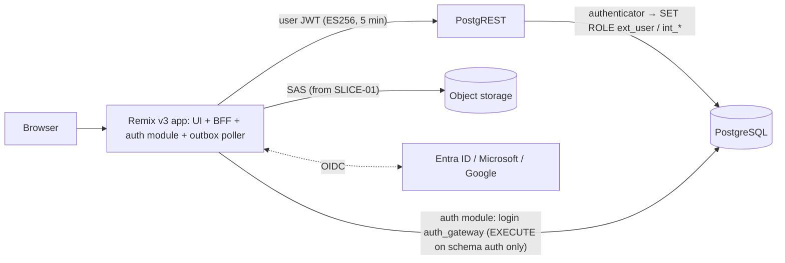

# MMS Unified Implementation Plan — Part 1: Target Architecture & Auth Foundation

> **Master Plan:** [MMS Unified Implementation Plan (docs/plans/README.md)](README.md)  
> **Audience:** Coding agents, systems engineers, and human reviewers.  
> **Scope:**  
> 1. The long-term *target architecture* (§1–§11): bounded schemas, BFF patterns, DB conventions, and audit model.  
> 2. The *foundational delivery stream* (§12): critical-path cards across Foundation (`F-`), Organization (`O-`), Authority (`A-`), Identity (`I-`), Survey Request Walking Skeleton (`S-`), and Hardening Backlog (`H-`).

---

## 0. Rules for agents

1. Read §2 (decisions), §5 (DB conventions), §7 (identity, organisation, roles and trust boundaries), §8 (audit) and §9 (schema workflow) first.
2. Work on **one** task card from §12 at a time, and only if its milestone gate is open. Stop when its *Acceptance criteria* (AC) pass.
3. **Card IDs in §12 (F-, O-, A-, I-, S-, H-) are the only valid IDs.** ADRs, commits and PRs must cite them. Object and schema names must match this plan exactly (e.g. `private.stamp()`, not `core.stamp()`). If your working copy of the plan uses other names or mentions psqldef, get the current one before continuing.
4. **Build only what the current card needs.** Do not create schemas, tables, roles, services, partitions or scaffolding for future modules or hardening items in advance.
5. Do not invent conventions. If something is missing, add `docs/adr/NNNN-title.md` with status `proposed` and stop for human review.
6. Never hand-edit merged files in `db/migrations/`.
7. Remix v3 changes quickly. Import paths moved during 2026 (e.g. `remix/fetch-router` → `remix/router`). **The installed, pinned `remix` package is canonical: read `node_modules/remix/INDEX.md`, its guides and the READMEs before using an API. Use `api.remix.run` only as a secondary reference, and never assume an online API exists in the pinned release.** Code in this plan is illustrative.
8. `npm run check` must stay green: lint, typecheck, unit tests, pgTAP, the migration checks C1–C8 (§9.5) and the schema lint (§5.3). Until F-01 creates that script, run `npm run typecheck && npm test`; do not claim the full gate before it exists.
9. Changes to any of the following need the `security-review` label and two reviewers (CODEOWNERS):
   - grants, policies or `SECURITY DEFINER` functions
   - the `auth` schema
   - authority or default-role rules
   - the token signer
   - `db/bootstrap/**`, `db/.pgschemaignore`, `db/schemas.txt`, `db/scripts/migrate*`, `db/src/_repeatable/**`
10. **Never create a database role per job title, seniority level or organisational unit.** Titles, grades and units are data (§7.3–§7.5).
11. **Four kinds of statements** appear in this plan. Treat them differently:
    - **Decisions** (untagged): conventions every module follows. Change them only through an ADR.
    - **`[VERIFIED: ADR-nnnn]`**: tool behaviour proven against the pinned versions. Rely on it. A version-bump PR must re-run the spike suite.
    - **`[VERIFY: card]`**: tool behaviour not yet proven. The named card must prove it **before** anything depends on it. If the proof fails, stop and write an ADR; do not work around it silently.
    - **`[Qn]` / `[ASSUMPTION]`**: business, compliance or operational inputs from the decision register (§15). Implement the stated default and keep it easy to change.

---

## 1. Context, goals, non-goals

**Context.** MMS replaces Leonardo / LeoShip for a classification society. Long-term scope:
- ship and company/DOC status, class notations, ship breakdown
- survey requests, survey/audit jobs, in-service and newbuilding reporting, deficiencies
- certificates
- material/component certification and service suppliers
- drawing approval
- surveyor/auditor qualification and training
- billing, CRM, timesheets and the public website

**Organisation:**

| Unit | What it does |
|---|---|
| **Stations** (local offices) | The station manager oversees both surveyors and auditors at that office. Audits are run by stations; there is no cross-office audit department. |
| **Regional / area offices** | Oversee groups of stations. |
| **Plan approval centres** (a few) | Drawing approval is **centralised**. Submissions are routed to one of these centres, never handled by stations. |
| **MTS centres** (a few; Marine Technical Support) | Each covers one or several regions/areas, and therefore all stations in them. |
| **HO compliance department** | At head office. Oversees **all** offices, MTS centres and plan approval centres worldwide. |

**Goals**
- **Reconstructable operating history.** For every regulated item, show who requested, reviewed, performed, approved, issued, amended, suspended or withdrew it, plus when, which revision, which session, the person's job title, grade and unit, and why.
- **Authorization and invariants live in PostgreSQL**: grants, RLS, constraints and transition functions. Remix route guards are only for UX.
- **Maintainability over 10+ years.** Modular monolith, declarative schema, reviewed migrations, ADRs, framework isolation.
- **External users** (owners, managers, yards, manufacturers, suppliers): accounts are provisioned by staff. They sign in with a password or a linked Microsoft/Google account.
- **Staff** sign in through Microsoft Entra ID only.

**Non-goals for now:** self-registration, a mobile/offline app, microservices, support for databases other than PostgreSQL, and building future modules or production evidence infrastructure before their requirements are confirmed.

---

## 2. Key decisions

| # | Decision | Why |
|---|---|---|
| D1 | **Modular monolith in an npm workspaces monorepo**: `apps/web`, `db/`, `packages/*`, `infra/`. | Atomic changes. Module boundaries are schemas and folders, not deployments. |
| D2 | **Pinned versions:** PostgreSQL **18.x**, **pgschema 1.13.X** (release binary verified against its published SHA-256), PostgREST **16.x** (exact patch pinned in F-01), Remix **3.2.0** (exact; the `^` range is removed in F-01). Hosting compatibility confirmed at G0/G3. Version bumps are their own PR and re-run the F-03 spike suite. | Tool behaviour this plan depends on is version-specific. |
| D3 | PostgREST exposes **only the `api` schema** (views + functions). | Stable contract. |
| D4 | **The browser never calls PostgREST.** The BFF mints a JWT (≤ 5 min, ES256) for **human capability roles only**. PostgREST holds public keys only and sits on a private network. | — |
| D5 | **Authorization has four dimensions** (§7.3): (1) **capability role** per job family (the DB role); (2) **scope** in organisational units; (3) **position**: job title → family + grade; (4) **qualifications** (`qual` module). One active capability role per session, chosen deliberately and re-validated by the DB on every request. | Fits a station + regional + centralised-centre organisation without per-title or per-unit DB roles. |
| D6 | **The audit actor is `iam.app_user.id`.** Staff are bound by Entra `(tid, oid)` **from the validated ID token**; external identities by `(issuer, subject)`. Email is never an identity key. | — |
| D7 | **Audit is tiered** (§8). **Tier 1, always:** row history, transactional business events, append-only storage. **Tier 2, as Compliance requires, before production:** sealing, WORM, verification, pgaudit, partitioning. `tx_id` is recorded from day one. | — |
| D8 | **Declarative schema** in `db/src` (one folder per schema). **pgschema** diffs it, one schema at a time, against a database built from the previous release, and the output is committed as a **reviewed migration** under `db/migrations/`. Production applies only reviewed migrations, in one transaction, through our own runner. pgschema is a diff generator and drift detector, **never** an approval mechanism. | PostgreSQL-only lets us use a PostgreSQL-native tool that covers policies, function and column grants, views and triggers. Reviewed, immutable migration files keep regulated change control. |
| D9 | **Server-side sessions** in `iam.session`, with an opaque signed cookie. | Instant revocation. |
| D10 | **Files in object storage**; metadata and SHA-256 in PostgreSQL. Released versions are immutable. | — |
| D11 | **The reference deployment is a proposal** (Azure), confirmed at G3. Platform specifics sit behind adapters. | Portability (Azure China, on-prem). |
| D12 | **Framework isolation.** Domain logic lives in `packages/domain`; Remix code stays in `apps/web`. | — |
| D13 | **Walking skeleton first:** SLICE-01, the survey request end to end. | — |
| D14 | **Regulated state changes go only through transition functions**, which check scope, authority, qualification and SoD and emit the business event in the same transaction. | Audit completeness by construction. |
| D15 | **Privileged auth code does not use PostgREST.** A direct DB login, `auth_gateway`, has `EXECUTE` on the `auth` schema only. Background jobs use the `worker` login. | No privileged JWTs exist. |
| D16 | **A schema exists only for a domain, an access boundary or a separate lifecycle.** Domain schemas are created when their module starts. | — |
| D17 | **Two data-scoping patterns** (§7.4): **location-scoped** records carry `office_unit_id` (a station); **routed** records carry `handling_unit_id` (a centre). RLS uses one or the other, never both. | Centralised plan approval and MTS work don't belong to a station. |

---

## 3. Architecture

### 3.1 Initial footprint (M1–M5)



- Runtime components: web, PostgREST and PostgreSQL. Object storage from SLICE-01.
- Local compose adds a mock OIDC server, a **plan database** for pgschema (§9.3) and, from SLICE-01, Azurite.
- Mail runs as an outbox poller inside the web process under its own DB login (`worker`).

### 3.2 Target additions (backlog cards, §12.5)

A separate worker process; audit sealing and a separately administered WORM evidence store; a log workspace with pgaudit and alerting; a non-exportable signing key; malware scanning; HR/Entra position proposals; audit partitioning (only if G2 volumes require it).

### 3.3 Request flow

1. The browser sends a request with the `__mms_sid` cookie.
2. Middleware: static files → request id/trace → logger → security headers → COP → session (via `auth_gateway`) → form-data → CSRF → `render({ assets })` → auth (principal + active role) → PostgREST client. `csrf()` requires `session()` and `formData()` to run first; `cop()` is tokenless and runs before both.
3. The BFF calls PostgREST with the JWT plus `X-Request-Id`, `traceparent`, `X-Client-Ip` and optional `Idempotency-Key`. Inbound copies of these headers are stripped first. Reasons and "on behalf of" are **not** headers; they are validated arguments of transition functions (§8.3).
4. PostgREST verifies the JWT, runs `SET LOCAL ROLE`, then calls `private.pre_request()` (§10.1).
5. RLS, grants and transition functions enforce the rules. Triggers record row changes.

---

## 4. Repository layout (initial; grows per module)

```
mms/
├─ package.json  package-lock.json              # npm workspaces: apps/*, packages/*; root scripts
├─ AGENTS.md  CODEOWNERS  .tool-versions        # pins: postgres 18.6, pgschema 1.14.1, postgrest 16.x, node (npm bundled)
├─ docs/
│  ├─ adr/  security/ (threat-model.md, trust-boundaries.md)
│  ├─ domain/          # per-module design docs (state machines, SoD, authority rules, RLS matrix)
│  ├─ org/             # org-units.md, job-title-mapping.md, default-role-rules.md, authorization-matrix.md
│  └─ compliance/      # evidence-requirements.md (input to G2), control-matrix.md
├─ apps/web/
│  ├─ package.json     # workspace manifest (moved starter scripts)
│  ├─ server.ts        # server entry (moved from the starter root)
│  ├─ hmr.ts           # HMR entry (moved from the starter root)
│  ├─ public/          # static files served unchanged
│  └─ app/
│     ├─ router.ts routes.ts assets.ts
│     ├─ actions/      # route controllers (createController maps; nested route maps)
│     ├─ middleware/   # request-id, logger, headers, session, auth, pgrst
│     ├─ auth/         # providers, guards, token-signer.ts, gateway-client.ts
│     ├─ jobs/         # outbox poller (worker login)
│     ├─ features/<module>/
│     └─ ui/
├─ packages/
│  ├─ domain/          # validation, workflow state machines (framework-agnostic)
│  ├─ pgrst-client/    # typed PostgREST wrapper + generated types
│  └─ test-utils/      # mock OIDC, fixtures
├─ db/
│  ├─ bootstrap/       # roles, schemas, extensions, global default privileges (idempotent, not pgschema) — §9.2
│  ├─ schemas.txt      # managed schemas in APPLY ORDER — the only schema list (§9.2)
│  ├─ .pgschemaignore  # objects pgschema must not manage (expected near-empty) — §9.2
│  ├─ src/             # declarative desired schema, one folder per schema — §9.2
│  │  ├─ private/  core/  party/  iam/  audit/  auth/  api/   # each with main.sql (\i includes)
│  │  └─ _repeatable/  # escape hatch for anything pgschema can't manage (expected empty) — §9.4
│  ├─ migrations/      # pgschema-generated + hand-written pre/post, human-reviewed, immutable after merge
│  ├─ seed/            # reference data (applied after migrations)
│  ├─ fixtures/        # dev/test data (org units etc.)
│  ├─ tests/           # pgTAP, incl. db/tests/pgschema/ spike suite
│  └─ scripts/         # build-plan-db, db:plan/check/verify/reset, migrate runner, lint
└─ infra/              # compose.yaml now; IaC when hosting is confirmed (G3)
```

**Workspace root.** The root `package.json` is private and declares `workspaces` for `apps/*` and `packages/*`; `package-lock.json` is committed and CI uses `npm ci`. `apps/web` is the only deployable workspace and keeps its own `package.json`; `packages/*` are libraries with their own manifests. `db/` and `infra/` are script/data directories, not workspaces.

**Remix wiring:** every page and endpoint — including `/login`, `/choose-role`, `/session/role`, `/invite/:token` and the `/auth/*` callbacks — is declared in `apps/web/app/routes.ts` with the typed `route()` helpers and mapped to a controller in `apps/web/app/actions/` via `createController`; use `routes.<name>.href()` for links. `apps/web/hmr.ts` remains the HMR entry. Run `remix doctor` after the F-01 move and after any structural change; it is a gate, not advice.

**Module boundary rule:** each domain module owns one schema plus `features/<module>`. Cross-module access goes only through `api` objects or documented `private` functions.

---

## 5. Database conventions

### 5.1 Schemas

| Schema | Created in | Kind | Who can use it |
|---|---|---|---|
| `iam` | M3 | Domain: users, identities, credentials, sessions, positions, job titles, role assignments, default-role and authority rules, memberships | `USAGE` + **column-level `SELECT`** for the capability roles whose `api` views read it (invoker views, §10.2) + RLS. No direct DML; writes only via definer functions. |
| `audit` | M3 | Domain: change history, business/security events | `USAGE` + column `SELECT` for roles that read `api.audit_*` / `api.my_activity` + RLS (§8.2). `INSERT` only via definer functions. Nobody but the owner can `UPDATE`/`DELETE`. |
| `core` | M3 (kept small) | Shared: organisational units and their coverage, regions, outbox, idempotency keys, code lists; documents from SLICE-01 | Per object |
| `party` | M3 (minimal `organization`) | Domain: external organizations and contacts (CRM later) | Per object |
| `api` | M2 | **Exposed** surface: views + functions | Capability roles (PostgREST) |
| `private` | M2 | **Not exposed**: `pre_request`, RLS/scope helpers, authority checks, trigger functions, shared checks | `USAGE` for capability roles and `worker`; `EXECUTE` granted per function |
| `auth` | M3 | **Distinct access boundary**: function-only gateway for the `auth_gateway` login | `auth_gateway` only |
| `extensions` | M1 (bootstrap) | **Not managed by pgschema.** Extension objects (`btree_gist`; `pgtap` in dev/CI only) | `USAGE` for all roles |
| `survey`, `fleet`, `plan`, `qual`, … | When the module starts (S-02 adds minimal `survey` + `fleet`) | Domain | Per module design |

- All internal functions live in **one** `private` schema. `auth` is separate only because a different login role uses it. Do not create per-module private schemas.
- `public` is unused: `CREATE` and `USAGE` are revoked from `PUBLIC`, and no object may be created there (lint).
- **FK layering:** `core` ← `party` ← `iam` ← `audit` ← module schemas. A foreign key may only point to the same schema or a schema to its left. Actor columns in `core`/`party` (e.g. `org_unit_coverage.set_by`) are plain `uuid`s without an FK.
- A new non-domain schema needs an ADR naming the access boundary it enforces.

### 5.2 Table and column conventions

| Topic | Rule |
|---|---|
| Naming | `snake_case`. Singular table names. FKs `<entity>_id`. Constraints `<table>_<cols>_<pk/fk/uk/ck/ex>`. Every constraint and index is **explicitly named** (pgschema diffs by name). |
| Qualification | Every object reference in `db/src` is **schema-qualified** (`iam.app_user`, `private.stamp()`), including inside function bodies and policy expressions. pgschema plans one schema at a time, so unqualified cross-schema references are ambiguous. |
| Trigger naming | `<table>_<purpose>` (e.g. `app_user_stamp`, `app_user_audit`), unique across the database. Only `ENABLE`/`DISABLE` trigger states are used (pgschema 1.13.0 did not compare `ENABLE REPLICA`/`ALWAYS`; lint forbids them). |
| Keys | `id uuid primary key default uuidv7()`. Business numbers (IMO, certificate no., job no.) are separate unique columns. |
| Time | `timestamptz` (UTC). `date` for calendar dates. `tstzrange` + exclusion constraint for validity periods. |
| Standard columns | `created_at`, `created_by`, `updated_at`, `updated_by`, `row_version`, filled by the `private.stamp()` trigger. |
| Deletion | No hard deletes of business records. `DELETE` is not granted on regulated tables. |
| History | Changing relationships (ownership, management, DOC holder, class status, staff position, unit coverage) are effective-dated rows. "Current" is a derived view. |
| Scope columns | Location-scoped records carry `office_unit_id` (a station). Routed records carry `handling_unit_id` (a centre). Set only by transition functions; every change is audited (D17). |
| Workflow | Status, ownership, scope and released columns are excluded from column `UPDATE` grants and change only through transition functions (D14). |
| Issued records | Released reports, issued certificates and approved drawings are immutable. A correction is a new revision (`revision_no`, `supersedes_id`, `reason`). |
| Authority & SoD | Checked inside transition functions **on the person**: scope, then grade (`private.assert_authority`), then qualification (`qual`), then SoD (e.g. `approver_id <> author_id`). |
| Authority evidence | Regulated events record the actor's job title, grade and unit *at the time of the action*. |
| Idempotency / concurrency | `Idempotency-Key` → `core.idempotency_key`. `expected_version` → `PT409`. |
| Code lists | Reference tables or `CHECK`. No PG `ENUM`. |
| Money | `numeric(18,2)` + `currency char(3)`. |
| Emails / login names | Plain `text`, lower-cased by the BFF and enforced by `check (x = lower(x))`. No `citext` (its operators depend on `search_path`, which is empty in definer functions). |
| Renames | pgschema does not support `RENAME` (it would plan DROP + CREATE). Renames are **hand-written** in the migration's `pre.sql` (§9.3). |

### 5.3 Ownership, RLS and privileged functions

1. **`mms_owner` (NOLOGIN) owns all objects.** pgschema does not manage owners; objects belong to the role that creates them. The runner and the migration generator therefore always execute DDL as `mms_owner` (§9.3), and check C8 verifies ownership.
2. **RLS is `ENABLE`d on every domain table. Do not use `FORCE ROW LEVEL SECURITY`**: it would apply RLS to the owner, so owner-run definer functions would see no rows. Because the owner bypasses RLS, definer functions must authorize explicitly (rule 5).
3. **No function uses `SET row_security = off`.** Owner-run definer functions already bypass RLS (rule 2).
4. **`SECURITY INVOKER` is the default**; every view sets `security_invoker = true`.
5. **`SECURITY DEFINER` is allowed in `api`, `private` and `auth`.** Every definer function must:
   - be listed in `db/security-definer.txt` with a justification
   - set `SET search_path = ''` and use fully qualified names
   - **start with an explicit authorization call** (`private.assert_in_scope`, `private.assert_org_member`, `private.assert_assignment`, `private.assert_authority`)
   - have pgTAP tests showing it denies a wrong org, unit, role or grade
6. **Every function in `db/src` is followed by `REVOKE ALL ON FUNCTION … FROM PUBLIC;` and its explicit `GRANT EXECUTE … TO …` lines** (lint-enforced). The desired state must state privileges explicitly, because the plan database creates objects with PostgreSQL's default `PUBLIC` EXECUTE grant `[VERIFY: F-03]`.
7. Typical use: `api` views and reads → invoker; `api` transitions → definer; RLS helpers → definer; `auth.*` → definer.
8. **Schema lint** (`db/scripts/lint-schema.ts`, CI) checks that:
   - every domain table has `ENABLE ROW LEVEL SECURITY` in its schema's `policies.sql`
   - the audit trigger is present (or the table is listed in `db/audit-exclusions.txt` with a reason), and every audited table has a single-column `id uuid` primary key
   - every view sets `security_invoker = true`
   - definer functions are on the allowlist with a fixed `search_path`; no function sets `row_security`; `current_user` does not appear in `private`, `api` or `auth` function bodies (use `private.active_role()`)
   - every function has `REVOKE ALL … FROM PUBLIC` and explicit `GRANT EXECUTE` lines
   - no `RENAME`, `OWNER TO`, `CREATE SCHEMA`, `CREATE ROLE`, `CREATE EXTENSION`, global `ALTER DEFAULT PRIVILEGES` or `ENABLE REPLICA/ALWAYS TRIGGER` appears in `db/src`
   - every object reference is schema-qualified; every constraint and index is named
   - trigger names follow `<table>_<purpose>` and are unique
   - no object is created in `public`; no FK points "rightwards" in the layering
   - no DB role exists outside `iam.db_role` and the owner/login roles of §7.2
   - `db/schemas.txt`, `02_schemas.sql`, the `db/src` folders and the schemas in the DB all match (`extensions`, `public` excluded)
   - every table with `office_unit_id` or `handling_unit_id` has a scope policy using the matching helper

---

## 6. Domain module map (target; each module gets a design doc before implementation)

| Module | Key entities (indicative) | When |
|---|---|---|
| `iam`, `audit`, `core` (incl. org units), `party` (min) | §12.1, §8 | M3 |
| `survey` (min), `fleet` (min) | `survey_request` (location-scoped), `ship` + `ship_party` | SLICE-01 |
| `qual` | Surveyor/auditor/engineer qualifications, authorization by survey/audit/plan type and ship type, training | Before any sign-off workflow |
| `fleet`, `company` | Status/ownership/management history, class notations, ship breakdown [Q10], ISM company, DOC status, responsible MTS unit per ship | Later |
| `survey` (full), `cert` | Jobs, reports, deficiencies, conditions of class, due dates, certificates and revisions | Later |
| `plan` | Drawing submissions (routed to a plan approval centre), reviews, comments, approvals | Later |
| `compliance` | Internal audits, quality findings, CAPA, complaints/appeals, record holds [Q24] | Later |
| `party` (CRM), `hr`, `nb`, `mat`, `supplier`, `billing`, `time` | — | Later |

**Domain modelling rules (apply to every module design doc):**
- **History over state.** Class status, class notations, ownership/management/DOC-holder relationships, certificate status and deficiency status are effective-dated history. "Current" is a derived view. A single `status` column is never the only record.
- **Four distinct concepts** never share one column: (1) operational workflow state; (2) technical or managerial approval; (3) the effective state of the official record; (4) the immutable issued version of a report or certificate (content + hash + revision).
- **Documents are versioned from SLICE-01:** logical document, immutable versions, SHA-256, actor and time, linked business record, status. An issued artifact keeps its exact bytes.
- **Legacy migration is designed in.** `core.legacy_ref(entity, id, legacy_system, legacy_key)` and `core.migration_run` / `migration_issue` are created with the first module that imports Leonardo/LeoShip data (expected: `fleet`). Every import has source-count reconciliation and a relationship check report.

---

## 7. Identity, organisation, roles, trust boundaries

### 7.1 Actor ID

**Every audit row records `iam.app_user.id`.**

| User | Binding (unique) |
|---|---|
| Staff | `app_user(entra_tenant_id, entra_object_id)`. Both are required. |
| External, Microsoft/Google | `user_identity(issuer, subject)` |
| External, password | `password_credential.user_id` (the login name can change) |
| Service (`worker`, later the sealer) | `app_user(kind = 'service', service_name)` |

Audit rows also carry `session_id`, `db_role`, `auth_method`, `request_id`, `trace_id`, `source`, `client_ip`, `on_behalf_of` (the external organization a staff member acts for), `initiated_by` (the human who caused a background job; the job's own service principal is `actor_id`) and `reason`. Regulated events also carry the actor's title, grade and unit. Users are never deleted, and changes to `iam` are audited.

### 7.2 Database roles

**Capability roles** (NOLOGIN). One per **job family**, never one per title, grade or unit.

| Role | Kind | Who | Purpose |
|---|---|---|---|
| `web_anon` | anon | Public | Website, e.g. certificate verification (later). |
| `ext_user` | external | All external users | Org-internal rights come from `org_membership.member_role` + RLS. |
| `int_viewer` | internal | All staff (baseline) and interns | Read-only within scope. No regulated actions. |
| `int_surveyor` | internal | Station surveyors | Survey jobs, reports and findings for assigned work. |
| `int_auditor` | internal | Station auditors (ISM/ISPS/MLC) | Audit jobs, reports and NCs for assigned work. |
| `int_coordinator` | internal | Office administration | Request intake/triage, scheduling, certificate preparation and dispatch, external-account administration. |
| `int_manager` | internal | Line management at any unit | Oversight, assignment, approvals and reporting within the unit's coverage. |
| `int_plan` | internal | Plan approval centre engineers | Drawing review/approval for submissions routed to their centre. Created in H-16. |
| `int_mts` | internal | MTS engineers | Technical review and support for stations in the MTS centre's coverage [Q25]. Created in H-15. |
| `int_compliance` | internal | HO compliance department | **Worldwide read** of location-scoped and routed records plus audit trails. Compliance actions (findings, CAPA, holds) via authority rules. **No approval of survey, audit, MTS or plan content.** |
| `int_hr` | internal | HR | Positions, personnel and training records. |
| `int_finance` | internal | Finance | Quotations, billing, invoices, credit notes. |
| `int_sysadmin` | internal | IT (explicit grant only) | Role assignments, org units and reference data. No business approvals, no BYPASSRLS. Cannot be combined with a business role. |

**Owner and login roles**

| Role | Login | Can |
|---|---|---|
| `mms_owner` | no | Owns every object. Member of nothing; only `migrator` is a member of it. |
| `migrator` | yes | Member of `mms_owner`. CI/CD deployments and migration generation only; always executes DDL after `SET ROLE mms_owner`. |
| `authenticator` | yes | `NOINHERIT`. Member of the capability roles **that have been created**. |
| `auth_gateway` | yes | `USAGE` on `auth` + `EXECUTE` on `auth.*`. Nothing else. |
| `worker` | yes | `USAGE` on `private` + `EXECUTE` on listed `private.job_*` functions. |
| `audit_sealer` | yes | `SELECT` on `audit_trail.change_log`/`audit_trail.event`, `INSERT` on `audit_trail.seal`. Created only in H-01. |

**Role lifecycle.** Roles are cluster-level objects, which pgschema does not manage; they live in bootstrap. A role exists only once a card needs it. The card that adds a capability role completes **all four** steps in the same PR:
1. `CREATE ROLE … NOLOGIN` + `GRANT … TO authenticator` in `db/bootstrap/01_roles.sql`.
2. The `iam.db_role` seed row.
3. Its `default_role_rule` / `authority_rule` rows (FKs to `iam.db_role` make it impossible to seed rules for a role that doesn't exist).
4. Its grants in `db/src/<schema>/grants.sql` (schema `USAGE`, table, column and function grants — all declarative, §9.2).

| Role | Created by card | `db_role` seed | Rules seeded |
|---|---|---|---|
| `mms_owner`, `migrator`, `authenticator`, `auth_gateway`, `worker` | F-02 | — (login roles are not in `db_role`) | — |
| `web_anon`, `ext_user`, `int_viewer`, `int_coordinator`, `int_manager`, `int_surveyor`, `int_auditor`, `int_compliance`, `int_hr`, `int_finance`, `int_sysadmin` | F-02 | I-01 | I-01 |
| `int_mts` | H-15 | H-15 | H-15 |
| `int_plan` | H-16 | H-16 | H-16 |
| `audit_sealer` | H-01 | — | — |

`iam.db_role(role_name, kind, description)` lists **capability roles only**. pgTAP checks both directions: every row exists in `pg_roles` as NOLOGIN with `authenticator` a member; every role in `pg_roles` (other than `pg_*` and the superuser) is in `db_role` or one of the owner/login roles above.

**Membership graph (exhaustive; pgTAP asserts it exactly):**

| Member | Is a member of |
|---|---|
| `authenticator` | every created capability role |
| `migrator` | `mms_owner` |
| capability roles, `auth_gateway`, `worker`, `audit_sealer`, `mms_owner` | **nothing** |

No capability role inherits from another. Common privileges are granted **explicitly** to each role. An application role can therefore never `SET ROLE` to another; pgTAP checks every pair.

### 7.3 Four authorization dimensions

| Dimension | Answers | Where |
|---|---|---|
| **Capability role** | *What kind of operation?* (GRANTs and RLS) | `iam.role_assignment` + the session's active role |
| **Scope** | *Which rows?* Org units the assignment covers, expanded through unit coverage | `role_assignment.scope_unit_id` / `global`, plus `core.org_unit_coverage` |
| **Position** | *How much authority?* Title → family + grade, line manager, home unit | `iam.staff_position`, `iam.job_title`, `iam.authority_rule` |
| **Qualification** | *Competent for this survey, audit or plan type?* | `qual` module (H-14). Until then, functions that need it carry `-- TODO(qual)`. |

A regulated action requires all four plus SoD on the person. **Line management** (timesheets, direct reports' training) uses `staff_position.line_manager_id` via `private.my_reports()`, independent of scope.

### 7.4 Organisational units and scope

**Units** (`core.org_unit`) form a tree with typed nodes. Scope is always a unit (or `global`).

| `unit_type` | Examples | Covers |
|---|---|---|
| `head_office` | HO | Everything (global) |
| `ho_department` | HO Compliance, HO Finance, HO HR, HO IT | Global for its function |
| `regional_office` | China Area, SE Asia Area | Its child stations |
| `station` | Shanghai, Ningbo, Singapore | Itself (owner of location-scoped work) |
| `plan_approval_centre` | e.g. Shanghai PA Centre | **Routed** submissions assigned to it |
| `mts_centre` | e.g. Asia MTS | Stations in the regions/areas it covers, plus routed MTS cases |

**Coverage:** `core.org_unit_coverage(unit_id, covered_unit_id, valid)`, effective-dated, maintained by `int_sysadmin` with a reason, audited. A regional office covers its stations through the tree. An MTS centre covers regional offices (and their stations) through coverage rows. A plan approval centre covers nothing by location.

**Two scoping patterns (D17):**

| Pattern | Row carries | Visible to an assignment scoped to unit U if… | Used by |
|---|---|---|---|
| **Location-scoped** | `office_unit_id` | `office_unit_id ∈ private.my_offices()` (U if a station, U's descendants, stations in U's coverage; all stations if global) | Survey requests, jobs, reports, deficiencies, station certificates, timesheets, station billing |
| **Routed** | `handling_unit_id` | `handling_unit_id ∈ private.my_units()` (U and descendants; all units if global) | Plan submissions and approval; MTS cases |

- **Routing:** `handling_unit_id` is set by a routing function (e.g. `plan.route_submission`), defaulting from `core.routing_rule(work_type, region_code → handling_unit_id)`. Re-routing by the receiving centre needs a reason and is a regulated event.
- **Ship file / responsible MTS:** `fleet.ship.responsible_mts_unit_id` (added with `fleet`, [Q26]).
- **Global scope** (HO compliance, HO management) covers all stations and all units. Write actions are still limited by authority rules.
- **Cross-boundary work:** an MTS engineer reads station reports through coverage, but writes only through MTS transitions.

### 7.5 Positions, job titles and default roles

**Grades** (`iam.job_grade`): 0 intern · 1 junior · 2 officer/engineer · 3 senior · 4 principal/manager · 5 senior manager · 6 director · 7 senior director · 8 managing director.

**Job titles** (`iam.job_title`). Family-neutral titles take their family from the unit type of the position.

| Job title code (label) | Family | Grade |
|---|---|---|
| `interns` | from unit | 0 |
| `junior_surveyors` (source: *jonor_surveyors*) | survey | 1 |
| `surveyors` / `senior_surveyors` | survey | 2 / 3 |
| `principal_surveyors` (source: *principle_surveyors*) | survey | 4 |
| `auditors` / `senior_auditors` | audit | 2 / 3 |
| `principal_auditors` (source: *principle_auditors*) | audit | 4 |
| `junior_engineers` / `engineers` / `senior_engineers` / `principal_engineers` [Q22] | from unit (plan / mts) | 1 / 2 / 3 / 4 |
| `compliance_officers` / `senior_compliance_officers` [Q22] | compliance | 2 / 3 |
| `managers` / `senior_managers` / `directors` / `senior_directors` / `managing_directors` | management | 4 / 5 / 6 / 7 / 8 |
| `hr` / `senior_hr` / `hr_executives` [Q20] / `hr_managers` / `hr_directors` | hr | 2 / 3 / 2 / 4 / 6 |
| `finance` / `senior_finance` / `finance_executives` [Q20] / `finance_managers` / `finance_directors` | finance | 2 / 3 / 2 / 4 / 6 |
| `admins` / `senior_admins` / `admin_managers` / `admin_directors` [Q19] | office_admin | 2 / 3 / 4 / 6 |

Unit default family: `station` → set by HR (interns: `office_admin`); `plan_approval_centre` → `plan`; `mts_centre` → `mts`; `ho_department` → its function. HR may override (validated against the unit type).

**Default-role rules** (`iam.default_role_rule`, seed reviewed in `docs/org/default-role-rules.md`). A rule matches `unit_type` × `job_family` × grade range → `db_role` + scope target (`own_unit`, `parent_unit`, `global`).

| unit_type | family | grade | → role | scope |
|---|---|---|---|---|
| *any* | *any* | 0–8 | `int_viewer` | own_unit (HO units: global) |
| station | survey | 1–3 | `int_surveyor` | own_unit |
| station | survey | 4 | `int_surveyor` | parent_unit |
| station | audit | 2–3 | `int_auditor` | own_unit |
| station | audit | 4 | `int_auditor` | parent_unit |
| station | management | 4–5 | `int_manager` | own_unit (station manager: surveyors + auditors) |
| station | office_admin | 2–6 | `int_coordinator` | own_unit |
| regional_office | management | 4–8 | `int_manager` | own_unit |
| regional_office | office_admin | 2–6 | `int_coordinator` | own_unit |
| plan_approval_centre | plan | 1–4 | `int_plan` *(H-16)* | own_unit |
| plan_approval_centre | management | 4–6 | `int_manager` (+ `int_plan` from H-16) | own_unit |
| plan_approval_centre | office_admin | 2–4 | `int_coordinator` | own_unit |
| mts_centre | mts | 1–4 | `int_mts` *(H-15)* | own_unit |
| mts_centre | management | 4–6 | `int_manager` (+ `int_mts` from H-15) | own_unit |
| ho_department (compliance) | compliance, management | 2–8 | `int_compliance` | global |
| ho_department / any | hr | 2–6 | `int_hr` | own_unit (HO: global) |
| ho_department / any | finance | 2–6 | `int_finance` | own_unit (HO: global) |
| head_office | management | 6–8 | `int_manager` | global |

Rows marked H-15/H-16 are documentation until those cards; they cannot be seeded earlier (role lifecycle, §7.2).

Notes:
- Managers who still survey get a *manual* `int_surveyor` assignment and switch roles.
- Interns get only `int_viewer`; every authority rule has `min_grade ≥ 1`.
- "Admins" [Q19] means office administration. IT administrators get `int_sysadmin` by explicit grant only.
- Colleagues see title and unit. Grade and line manager are visible only to self, their managers and HR.

**Position change.** `api.staff_position_set(user, title, unit, family_override, line_manager, valid_from, reason)` (`int_hr` + `hr.position.set`; never one's own position) in one transaction: closes the old position, revokes `source='position'` assignments, evaluates default-role rules, grants the new assignments, emits `iam.position.changed`. Manual assignments (`source='manual'`, by `int_sysadmin`, with a reason) survive. Closing a position with no remaining manual assignment suspends the user (I9). **Coverage changes** take effect on the next request; no reassignment is needed.

### 7.6 Authority rules

`iam.authority_rule(action_code, db_role, job_family?, unit_type?, min_grade ≥ 1, max_amount, currency, requires_qualification, valid)` is seeded data; changes need `security-review`.

`private.assert_authority(action_code, amount default null)` (definer):
1. Loads the caller's **current** position (title, family, grade, unit, unit type).
2. Finds a valid rule with `db_role = private.active_role()`, matching family/unit type where set, `grade ≥ min_grade`, `amount ≤ max_amount`.
3. None → `PT403 insufficient_authority` + a `denied` event.
4. Returns `{rule_id, title, grade, unit}` for `emit_event`.

`private.assert_in_scope(office_unit_id | handling_unit_id)` runs first, so authority never applies outside scope.

Illustrative seeds (actual values from authorization matrix v1, Q1):

| action_code | db_role | unit_type / family | min_grade | limit | qual |
|---|---|---|---|---|---|
| `survey.request.triage` | `int_coordinator` | station / office_admin | 2 | — | no |
| `survey.job.assign` | `int_manager` | station, regional_office | 4 | — | no |
| `survey.report.release` | `int_surveyor` | station / survey | 2 | — | yes |
| `survey.report.countersign` | `int_surveyor` | station / survey | 3 | — | yes |
| `audit_trail.report.release` | `int_auditor` | station / audit | 2 | — | yes |
| `mts.report.technical_review` | `int_mts` | mts_centre / mts | 2 | — | yes |
| `mts.condition_of_class.approve` | `int_mts` | mts_centre / mts | 3 | — | yes |
| `plan.drawing.approve` | `int_plan` | plan_approval_centre / plan | 2 | — | yes |
| `plan.submission.reroute` | `int_manager` | plan_approval_centre | 4 | — | no |
| `compliance.finding.raise` | `int_compliance` | ho_department / compliance | 2 | — | no |
| `compliance.record.hold` | `int_compliance` | ho_department / compliance | 3 | — | no |
| `billing.credit_note.approve` | `int_finance` | — / finance | 4 / 6 | 10 000 USD / unlimited | no |
| `hr.position.set` | `int_hr` | — / hr | 3 | — | no |
| `iam.external_user.create` | `int_coordinator` | — / office_admin | 2 | — | no |
| `audit_trail.trail.read` | `int_compliance`, `int_manager` | — | 2 / 4 | — | no |

### 7.7 Staff authorization flow

- **Access gate:** the Entra app role `MMS.User` (an IT-managed group).
- **Active role:** one assignment → automatic. Several → `/choose-role`, switch with `POST /session/role`. The browser names only one of the user's own assignments; the DB validates it, the session rotates and an event is recorded. "Highest role wins" is never applied.
- **Re-validation:** `private.pre_request` checks on every request that the active role still has a current assignment.
- **Backlog:** H-04 (Entra deprovisioning sync, completed 2026-11-01); H-13 (position proposals from Entra/HR; HR confirms).

### 7.8 External organizations

- `iam.org_membership(user_id, org_id → party.organization, member_role in ('org_admin','requester','viewer'), valid, granted_by, revoked_*)`. Users can belong to several orgs; RLS grants the union. The "acting for" selector only filters the UI.
- External customer categories (owner, manager, yard, manufacturer, supplier) are `party.organization.org_type`, **never** DB roles.
- **Provisioning** is staff-only (`int_coordinator` + `iam.external_user.create`, or `int_sysadmin`). Delegated org-admin provisioning is H-08 [Q4]; if built, it is enforced by definer functions and RLS, not UI.
- Access to a resource comes from the domain relationship (e.g. `fleet.ship_party`). A caller-supplied `org_id` is checked against memberships.

### 7.9 User JWT

```json
{ "iss": "mms-bff", "aud": "mms-api", "sub": "<app_user.id>", "sid": "<session.id>",
  "role": "<session.active_role>", "amr": ["entra"], "src": "web", "name": "WANG Jian",
  "iat": 0, "exp": 0, "jti": "…", "kid": "user-2026-10" }
```
- Only `apps/web/app/auth/token-signer.ts` creates it, from the server-side session record. A lint rule blocks other imports of the key or sign API.
- ES256; key in a secret store for the MVP, non-exportable Key Vault key from H-06. PostgREST holds the JWKS and `jwt-aud=mms-api`.
- Cached per session, dropped on role switch, never sent to the browser.
- Title, grade, unit and scope are **not** in the JWT; the DB reads them live.

### 7.10 Trust-boundary invariants (each has a named test)

| ID | Invariant | Milestone |
|---|---|---|
| T1 | No JWT can activate a login role or `mms_owner`; `pre_request` rejects roles not in `iam.db_role`. | M3 |
| T2 | `auth_gateway`, `worker` and every capability role hold exactly the expected privileges — table, column, function and schema — checked against the catalog. | M3 |
| T3 | `auth.*` accepts only validated provider facts, or acts on the session's own user. | M3 |
| T4 | `auth_gateway` credentials are reachable only from `apps/web/app/auth/**` and the session middleware. | M3 |
| T5 | The browser never decides `sub`, `sid`, `role`, `org_id`, unit, title or grade. | M3 |
| T6 | An inconsistent `sub`/`sid`/`role` combination is rejected on every request. | M3 |
| T7 | The dev login stub exists only when `MMS_ENV=local`. | M3 |
| T8 | Nobody changes their own position, assignments or their own unit's coverage; `int_sysadmin` holds no business role. | M3 |
| T9 | Routed and location scope cannot be confused; scope columns change only through routing/transfer functions. | M3 / SLICE-01 |

STRIDE threat model: `docs/security/threat-model.md` (first pass M1, refreshed before G3).

### 7.11 Helpers

```sql
create function private.claims() returns jsonb language sql stable set search_path = '' as $$
  select coalesce(nullif(current_setting('request.jwt.claims', true), ''), '{}')::jsonb $$;
create function private.uid() returns uuid language sql stable set search_path = '' as $$
  select nullif(private.claims() ->> 'sub', '')::uuid $$;
-- The caller's ACTIVE capability role. Never use current_user for this: inside a
-- SECURITY DEFINER function current_user is the owner (mms_owner).
create function private.active_role() returns text language sql stable set search_path = '' as $$
  select nullif(private.claims() ->> 'role', '') $$;

-- Scope of the ACTIVE role's current assignments
create function private.my_scope() returns table(is_global boolean, unit_ids uuid[])
language sql stable security definer set search_path = '' as $$
  select coalesce(bool_or(a.scope_type = 'global'), false),
         coalesce(array_agg(a.scope_unit_id) filter (where a.scope_type = 'unit'), '{}')
  from iam.role_assignment a
  where a.user_id = private.uid() and a.db_role = private.active_role()
    and a.revoked_at is null and a.valid @> now() $$;

-- ROUTED records: scope units + descendants; global => all units
create function private.my_units() returns uuid[]
language sql stable security definer set search_path = '' as $$
  select case when s.is_global then
           (select coalesce(array_agg(u.id), '{}') from core.org_unit u where u.active)
         else
           (select coalesce(array_agg(distinct d.id), '{}') from core.org_unit_descendants(s.unit_ids) d)
         end
  from private.my_scope() s $$;

-- LOCATION-scoped records: stations under scope units and under their coverage; global => all stations
create function private.my_offices() returns uuid[]
language sql stable security definer set search_path = '' as $$
  with s as (select * from private.my_scope()),
  roots as (
    select unnest(s.unit_ids) as id from s
    union
    select c.covered_unit_id from s join core.org_unit_coverage c on c.unit_id = any (s.unit_ids)
     where c.valid @> now())
  select case when (select is_global from s) then
           (select coalesce(array_agg(id), '{}') from core.org_unit where unit_type = 'station' and active)
         else
           (select coalesce(array_agg(distinct d.id), '{}')
              from core.org_unit_descendants(array(select id from roots)) d
              where d.unit_type = 'station')
         end $$;

create function private.my_org_ids() returns uuid[]
language sql stable security definer set search_path = '' as $$
  select coalesce(array_agg(m.org_id), '{}') from iam.org_membership m
  where m.user_id = private.uid() and m.revoked_at is null and m.valid @> now() $$;

create function private.my_position() returns table(job_title_code text, job_family text, grade int,
                                                     unit_id uuid, unit_type text)
language sql stable security definer set search_path = '' as $$
  select p.job_title_code, p.job_family, t.grade, p.unit_id, u.unit_type
  from iam.staff_position p join iam.job_title t on t.code = p.job_title_code
  join core.org_unit u on u.id = p.unit_id
  where p.user_id = private.uid() and p.valid @> now() $$;

create function private.my_reports() returns setof uuid
language sql stable security definer set search_path = '' as $$
  with recursive r as (
    select p.user_id from iam.staff_position p
    where p.line_manager_id = private.uid() and p.valid @> now()
    union
    select p.user_id from iam.staff_position p join r on p.line_manager_id = r.user_id
    where p.valid @> now())
  select user_id from r $$;
```

- Every function above is followed in `db/src` by `REVOKE ALL ON FUNCTION … FROM PUBLIC` and its explicit grants (§5.3 rule 6).
- Policy pattern: location-scoped `using (office_unit_id = any ((select private.my_offices())))`; routed `using (handling_unit_id = any ((select private.my_units())))`.
- `core.org_unit_descendants(uuid[])` is a recursive SQL function over `parent_id`; a closure table can replace it if profiling requires.
- Claims are trusted only because `pre_request` has validated them. **Never use `current_user` to identify the caller's role inside a definer function** — use `private.active_role()` (lint-checked).
- **Service context.** The `worker` login can't send JWT claims. It calls `private.job_begin(job_id)` (definer, `EXECUTE` for `worker` only), which loads the `core.outbox` row and sets `request.jwt.claims` to the worker's service principal (`src='job'`) and `mms.initiated_by` from the row's `enqueued_by` (recorded from `private.uid()` when the job was enqueued in the user's transaction). A worker cannot choose its identity or impersonate staff.

---

## 8. Audit (tiered)

### 8.1 Tiers

| Tier | Content | When |
|---|---|---|
| **Tier 1 — Foundation (always)** | Actor, session and request attribution. Row-change history on domain tables. **Transactional business events** with an authority snapshot (title, grade, unit, rule). Append-only enforcement. A sensitive-column exclusion list. Completeness and atomicity tests. `tx_id` on every row. **Ordinary (non-partitioned) tables.** | M3 (capture) + M4 (events/tests), before SLICE-01 |
| **Tier 2 — Evidence integrity** | Sealing by transaction-ID horizon, WORM export, independent anchors and verifier, pgaudit, off-DB forwarding and alerts, retention per record class, optional signatures, crypto-shredding, and **partitioning only if G2 volumes require it** (H-03, with its own pgschema spike). | **Scope set by G2.** Built before regulated data is used in production |

If Compliance confirms that tamper-evident, independently retained evidence is mandatory, §8.5 is the baseline and production is blocked until it is in place.

### 8.2 Tier 1 tables

```sql
create table audit_trail.change_log (
  id           bigint generated always as identity,
  occurred_at  timestamptz not null default clock_timestamp(),
  tx_id        xid8 not null default pg_current_xact_id(),
  schema_name  text not null, table_name text not null,
  op           char(1) not null,
  row_id       uuid,
  old_row      jsonb, new_row jsonb, changed_cols text[],
  actor_id     uuid, actor_label text,
  db_role      text not null,                        -- written by the trigger from the validated claim
  session_id   uuid, auth_method text, on_behalf_of uuid, initiated_by uuid,
  request_id   text, trace_id text,
  source       text not null,
  client_ip    inet, reason text,
  constraint change_log_pk primary key (id),
  constraint change_log_op_ck check (op in ('I','U','D')),
  constraint change_log_source_ck check (source in ('web','job','import','integration','dba'))
);
create index change_log_subject_ix on audit_trail.change_log (schema_name, table_name, row_id);
create index change_log_tx_ix on audit_trail.change_log (tx_id);

create table audit_trail.event_type (
  code text, description text not null,
  regulated boolean not null, reason_required boolean not null default false,
  constraint event_type_pk primary key (code)
);

create table audit_trail.event (
  id           bigint generated always as identity,
  occurred_at  timestamptz not null default clock_timestamp(),
  tx_id        xid8 not null default pg_current_xact_id(),
  event_type   text not null,
  outcome      text not null,
  actor_id     uuid, session_id uuid, db_role text not null, auth_method text,
  on_behalf_of uuid, initiated_by uuid,
  actor_title  text, actor_grade int, actor_unit_id uuid, authority_rule_id uuid,   -- authority evidence
  subject_type text, subject_id uuid, subject_revision int,
  scope_unit_id uuid,                     -- office_unit_id or handling_unit_id of the subject
  request_id   text, trace_id text, source text not null, client_ip inet, user_agent text,
  reason       text,
  detail       jsonb not null default '{}',
  constraint event_pk primary key (id),
  constraint event_type_fk foreign key (event_type) references audit_trail.event_type (code),
  constraint event_outcome_ck check (outcome in ('success','failure','denied')),
  constraint event_detail_size_ck check (pg_column_size(detail) < 8192)
);
create index event_subject_ix on audit_trail.event (subject_type, subject_id);
create index event_scope_ix on audit_trail.event (scope_unit_id, occurred_at);
create index event_tx_ix on audit_trail.event (tx_id);

create table audit_trail.excluded_column (
  schema_name text, table_name text, column_name text,
  mode text not null, reason text not null,
  constraint excluded_column_pk primary key (schema_name, table_name, column_name),
  constraint excluded_column_mode_ck check (mode in ('omit','mask'))
);
```
- **Not partitioned.** The append-only triggers (`change_log_append_only`, `event_append_only`) are ordinary declarative triggers. Partitioning is H-03 only, with its own spike.
- **Append-only:** only `mms_owner` holds `UPDATE`/`DELETE`/`TRUNCATE`, and a `BEFORE UPDATE OR DELETE` trigger raises an exception.
- **Read access** (RLS in `audit/policies.sql`): `int_compliance` reads everything; `int_manager` reads events whose `scope_unit_id` is in `my_offices()`/`my_units()` (`audit_trail.trail.read`); `int_sysadmin` reads for technical diagnostics; everyone gets `api.my_activity` (own `actor_id`).

### 8.3 Row capture

**Key contract.** Every audited table has a single-column primary key `id uuid` (lint-enforced). A table that can't follow it gets a surrogate `id`, or is excluded and audited through business events.

**Deletes.** Regulated tables have no `DELETE` grant. The trigger still captures `D` for drafts and for **exceptional** deletions (e.g. privacy erasure), which run only through a dedicated definer function that emits its own regulated event with a reason.

**Context sources:**
- **claims** — validated by `pre_request`
- **`request.headers`** — `x-request-id`, `traceparent`, `x-client-ip` only (set by the BFF; PostgREST is private; inbound copies stripped)
- **transaction-local settings** `mms.reason`, `mms.on_behalf_of`, `mms.initiated_by` — set by definer functions (`private.set_change_context`, `private.job_begin`) **after validation**, overwriting anything a caller pre-set.
  - **Limit:** a capability role *can* `set_config('mms.reason', …)` before an invoker draft write. The `reason` / `on_behalf_of` / `initiated_by` in `change_log` are therefore **informational**. The **authoritative** values are in `audit_trail.event`, written by `emit_event` from validated function arguments. Every regulated change runs inside a definer transition function, so every regulated change has an authoritative event.

```sql
create function private.audit_capture() returns trigger
language plpgsql security definer set search_path = '' as $$
declare
  c     jsonb := private.claims();
  h     jsonb := coalesce(nullif(current_setting('request.headers', true), ''), '{}')::jsonb;
  raw_o jsonb := case when tg_op in ('UPDATE','DELETE') then to_jsonb(old) end;
  raw_n jsonb := case when tg_op in ('INSERT','UPDATE') then to_jsonb(new) end;
  cols  text[];
begin
  if tg_op = 'UPDATE' then
    select array_agg(k.key order by k.key) into cols
    from jsonb_object_keys(raw_n) as k(key)
    where raw_n -> k.key is distinct from raw_o -> k.key
      and k.key not in ('updated_at', 'row_version');
    if cols is null then return null; end if;                    -- no-op update: nothing recorded
  end if;

  insert into audit_trail.change_log(schema_name, table_name, op, row_id, old_row, new_row, changed_cols,
         actor_id, actor_label, db_role, session_id, auth_method, on_behalf_of, initiated_by,
         request_id, trace_id, source, client_ip, reason)
  values (tg_table_schema, tg_table_name, left(tg_op, 1),
          coalesce(raw_n ->> 'id', raw_o ->> 'id')::uuid,
          private.audit_redact(tg_table_schema, tg_table_name, raw_o),   -- masking BEFORE persistence
          private.audit_redact(tg_table_schema, tg_table_name, raw_n),
          cols,
          nullif(c ->> 'sub', '')::uuid, c ->> 'name',
          coalesce(nullif(c ->> 'role', ''), session_user),              -- the role the request ran as
          nullif(c ->> 'sid', '')::uuid, c -> 'amr' ->> 0,
          nullif(current_setting('mms.on_behalf_of', true), '')::uuid,
          nullif(current_setting('mms.initiated_by', true), '')::uuid,
          h ->> 'x-request-id', split_part(h ->> 'traceparent', '-', 2),
          coalesce(c ->> 'src', case when c = '{}'::jsonb then 'dba' else 'web' end),
          nullif(h ->> 'x-client-ip', '')::inet,
          nullif(current_setting('mms.reason', true), ''));
  return null;
end $$;
revoke all on function private.audit_capture() from public;
```

- Inside a definer function `current_user` is the owner, so the caller's role comes from the validated `role` claim (or `session_user` for direct logins such as `worker`/`migrator`).
- `private.audit_redact()` applies `audit_trail.excluded_column` to the row image **before** insertion; `changed_cols` still records that a masked column changed.
- Errors are **not** swallowed: a failing capture aborts the business transaction. Alert on capture errors.
- Default scope: all domain tables. Operational tables (outbox, login attempts, session touches) are listed in `db/audit-exclusions.txt` with a reason; a **regulated** table can't be excluded without an ADR.
- **Lint:** any audited column matching `(password|secret|token|hash|key|salary|bank)` must have an `excluded_column` row.
- **pgTAP (A-01):** insert/update/delete each write one correctly attributed row; a no-op update writes nothing; masked/omitted values never appear but the changed flag does; a capture failure rolls back the business change; a value pre-set with `set_config('mms.reason', …)` is overwritten inside a transition function and the event carries the validated argument.

### 8.4 Business events: completeness by construction

1. Each regulated action is an `api` transition function (D14). In one transaction it:
   - checks scope (`assert_in_scope`), authority (`assert_authority`) and SoD
   - checks that the transition and reason are valid
   - calls `private.set_change_context(reason, on_behalf_of)` (validates both; reason required per `event_type`)
   - writes the change and its history
   - calls `private.emit_event(...)` with the authority snapshot, the subject's scope unit and the validated arguments

   If any step fails, everything rolls back.
2. No capability role can update controlled columns (status, scope, released) directly.
3. **Tests (M4):** every regulated function emits exactly its event, with the same `tx_id` as its `change_log` rows and a non-null authority snapshot; a failure forced after the event leaves nothing behind; a direct `UPDATE` of a controlled column is denied; out-of-scope → `denied` event; insufficient grade → `insufficient_authority` + `denied` event.
4. Daily reconciliation (controlled-column changes without a matching event) is Tier 2.

**Audit record kinds** (each module design doc maps its actions to these):

| Kind | Example | Mechanism |
|---|---|---|
| Identity and access | Sign-in, role switch, assignment revoked | `audit_trail.event` (`auth.*`, `iam.*`) |
| Business event | Survey job assigned, deficiency closed | Transition function → `audit_trail.event` |
| Controlled decision | Drawing approved, certificate amended | Transition function + authority snapshot + required reason |
| Issued artifact | Certificate/report issued at revision N | Immutable revision row + document version (hash) + event |
| Data change | Ship status or DOC status changed | `audit_trail.change_log` + (if regulated) event |
| Administrative event | Customer suspended, coverage changed | Definer function → `audit_trail.event` |
| **Schema change** | A migration applied to production | `public.schema_migrations` (file, SHA-256, applied_by, result) + pgaudit DDL log (H-02) |

### 8.5 Tier 2 design baseline (H-01/H-02, when G2 confirms)

- **Seal by transaction-ID horizon, not by ID range:** in `REPEATABLE READ`, take `h = pg_snapshot_xmin(pg_current_snapshot())`; seal `prev_h ≤ tx_id < h`, ordered by `(tx_id, id)`. Late-committing rows are never missed; monitor the lag that long transactions cause.
- Canonical JSON Lines → `batch_hash` → chained `seal_hash` → `audit_trail.seal`. Export to WORM storage that DB admins **do not** administer; write anchors to the log workspace. HO Compliance runs the verifier.
- Sealing runs as a job under `audit_sealer`. A separate deployment only if Compliance requires independent administration.
- **Protocol to specify in H-01 before coding:** manifest format, versioned canonical serialisation, horizon boundaries and verification algorithm; idempotent, resumable export (WORM object written before its `audit_trail.seal` row commits; re-runs detect an identical object); gap detection (each seal starts at the previous `to_xid`; missed batches are re-sealed, never skipped); alerts for lag, export and verification failures; tamper tests including a privileged operator altering rows **before** sealing (detected only by pgaudit/off-DB logs — stated residual risk).
- **Integrity does not rest on the DB alone:** permissions stop application roles; hash chains detect changes to sealed ranges; WORM exports under a separate boundary preserve independent evidence; the verifier proves exports still match.

### 8.6 Auth, IAM and organisation events (Tier 1)

`auth.login.success|failure`, `auth.logout`, `auth.session.created|revoked`, `auth.role.switched`, `auth.role_assignment.granted|revoked`, `iam.position.changed|closed`, `org.unit.created|changed|closed`, `org.coverage.granted|ended`, `org.routing_rule.changed`, `auth.identity.linked|unlinked`, `auth.password.set|changed|reset_requested|reset_completed`, `auth.invite.created|accepted|expired`, `auth.membership.granted|revoked`, `auth.user.created|suspended|reactivated`, `auth.lockout`, `auth.stepup.success|failure`, `authz.denied.out_of_scope`, `authz.denied.insufficient_authority`.

---

## 9. Declarative schema & migrations (pgschema)

**Tool:** pgschema 1.14.1 — a PostgreSQL-only, Terraform-style `dump → plan → apply` tool that diffs one schema at a time and orders statements by dependency. It covers tables, constraints, indexes, views, functions, procedures, triggers, sequences, types, domains, RLS policies, and table/column/function/type privileges and comments. It does **not** manage roles, schemas, extensions, object owners, renames or global default privileges.

**How we use it:** pgschema **generates** migrations and **detects drift**. It does not approve or deploy anything. Reviewed migration files plus our own runner deploy to every environment, so that:
- every production schema change is a reviewed, immutable, checksummed file (regulated change control)
- multi-schema changes run in **one transaction**
- objects are always created as `mms_owner`

### 9.1 What lives where (one owner per object type)

| Object | Owner | Location | pgschema's role |
|---|---|---|---|
| Roles, memberships, role settings | Bootstrap | `db/bootstrap/01_roles.sql`, `04_role_settings.sql` | none (cluster level) |
| Schemas (create, owner), `public` lockdown | Bootstrap | `db/bootstrap/02_schemas.sql` | none (`CREATE SCHEMA` unsupported) |
| Extensions (`btree_gist`; `pgtap` in dev/CI), `WITH SCHEMA extensions` | Bootstrap | `db/bootstrap/02_schemas.sql` | none (unsupported; `extensions` is never in `db/schemas.txt`) |
| Global default privileges (`ALTER DEFAULT PRIVILEGES FOR ROLE mms_owner REVOKE EXECUTE ON FUNCTIONS FROM PUBLIC`) | Bootstrap | `db/bootstrap/03_privileges.sql` | none (global form unsupported) |
| Object ownership | The runner, which always executes as `mms_owner` | `db/scripts/migrate.ts` | none (owners are not compared); verified by C8 |
| Tables, columns, constraints, indexes, views, functions (incl. definer), triggers, RLS enablement, policies, comments | `db/src` | `db/src/<schema>/*.sql` | diffs them |
| Table, **column**, **function** and schema `USAGE` grants; per-function `REVOKE … FROM PUBLIC` | `db/src` | `db/src/<schema>/grants.sql` and next to each function | diffs them, including REVOKE `[VERIFY: F-03]` (schema `USAGE`: falls back to bootstrap if not tracked) |
| Renames, data preparation | **Hand-written** `pre.sql` of the migration | `db/migrations/<id>/pre.sql` | none (`RENAME` unsupported) |
| Backfills / data migrations | **Hand-written** `post.sql` of the migration | `db/migrations/<id>/post.sql` | none |
| Reference data | Seeds (idempotent upserts, after migrations) | `db/seed/*.sql` | none |
| Org data (units, coverage, routing rules) | App (`int_sysadmin`, audited); fixtures for dev/test | `db/fixtures/org.sql` | none |
| Anything F-03 proves pgschema can't manage | `_repeatable` (expected empty) | `db/src/_repeatable/` | none (§9.4) |
| Audit partitions | Not used until H-03 | — | — |

### 9.2 Files and configuration

**Bootstrap** (run in order by `db/scripts/bootstrap.ts`; as admin in dev/CI, by the platform admin elsewhere; always **before** the migrations of the same release):

```
db/bootstrap/
├─ 01_roles.sql          # §7.2 lifecycle table: CREATE ROLE (idempotent DO blocks), memberships, NOINHERIT, no BYPASSRLS
├─ 02_schemas.sql        # schemas in db/schemas.txt (AUTHORIZATION mms_owner) + `extensions` schema + extensions
├─ 03_privileges.sql     # REVOKE ALL ON SCHEMA public FROM PUBLIC; global default privileges;
│                        #   schema USAGE grants ONLY if F-03 shows pgschema doesn't track them
└─ 04_role_settings.sql  # ALTER ROLE … SET statement_timeout / idle_in_transaction_session_timeout / search_path = ''
```

**`db/schemas.txt` — the only schema list, in apply order:**

```
# managed schemas, in the order migrations apply them (each line = one pgschema plan)
private    # functions first: policies and triggers in later schemas call them
core
party
iam
audit
auth
api        # S-02 inserts `fleet` and `survey` before `api`
```
- `private` comes first because policies and triggers in every other schema reference its functions. Its SQL-language functions reference tables in later schemas, so the runner and the plan database run with `check_function_bodies = off`. Bodies are validated afterwards by pgTAP, which calls every function.
- The schema lint checks that `db/schemas.txt`, `02_schemas.sql`, the `db/src` folders and the database all agree.

**Schema `USAGE` matrix** (in `db/src/<schema>/grants.sql`, or bootstrap if F-03 shows pgschema doesn't track schema privileges):

| Schema | `USAGE` granted to | Why |
|---|---|---|
| `api` | `web_anon`, `ext_user`, all `int_*` | Exposed surface. |
| `private` | all capability roles, `worker` | RLS policies and invoker functions call `private` helpers as the caller. |
| `core`, `party`, `iam`, `audit` (and module schemas) | capability roles that read them through invoker views | Invoker views check base-table privileges (§10.2). |
| `auth` | `auth_gateway` only | Distinct boundary (T2). |
| `extensions` | `PUBLIC` (bootstrap) | Extension types/operators. |
| `public` | nobody (bootstrap) | Unused. |

**Adding a schema (module start)**, in one PR: add it to `02_schemas.sql`, insert it into `db/schemas.txt` at the right position, create `db/src/<schema>/main.sql`, add its USAGE grants, and update the FK layering (§5.1).

**Desired schema layout.** One folder per schema. Each folder has a `main.sql` that includes its files with `\i` (pgschema resolves include directives). pgschema orders statements by dependency within a schema, so file order inside a schema is for readability only.

```
db/src/
├─ private/  main.sql  functions.sql  scope.sql  authority.sql  trigger_functions.sql  pre_request.sql  grants.sql
├─ core/     main.sql  tables.sql  functions.sql  triggers.sql  grants.sql  policies.sql
├─ party/    main.sql  tables.sql  triggers.sql  grants.sql  policies.sql
├─ iam/      main.sql  tables.sql  triggers.sql  grants.sql  policies.sql
├─ audit/    main.sql  tables.sql  triggers.sql  grants.sql  policies.sql
├─ auth/     main.sql  functions.sql  grants.sql
├─ api/      main.sql  views.sql  functions_self.sql  functions_hr.sql  functions_sysadmin.sql  functions_external.sql  grants.sql
└─ _repeatable/        # expected empty (§9.4)
```

```sql
-- db/src/iam/main.sql
\i tables.sql
\i triggers.sql
\i grants.sql
\i policies.sql
```

File-kind rules:
- **All trigger functions live in `private/trigger_functions.sql`.** A schema's `triggers.sql` contains only `CREATE TRIGGER`, named `<table>_<purpose>` (§5.2).
- `policies.sql`: `ALTER TABLE … ENABLE ROW LEVEL SECURITY` **and** `CREATE POLICY` for every table in the schema.
- `grants.sql`: schema `USAGE`, table and column grants. Function grants sit **next to the function** (`REVOKE ALL … FROM PUBLIC` + `GRANT EXECUTE`).
- Every reference is schema-qualified; no `RENAME`, `OWNER TO`, `CREATE SCHEMA/ROLE/EXTENSION` (§5.3 lint).
- Functions never reference views; they read base tables.

**`db/.pgschemaignore`** (TOML, loaded automatically by pgschema). Expected **empty**:

```toml
# Objects listed here are neither created, dropped nor reported as drift by pgschema.
# Every entry needs security-review AND an independent C8 check, because pgschema stops seeing it.
# [tables]
# patterns = []
```

**Plan database.** pgschema plans one schema at a time, but our schemas reference each other (iam policies → `private` functions; `private` functions → `iam` tables; FKs `iam` → `core`/`party`). pgschema validates the desired state in a temporary schema of an **external plan database** (`--plan-host`, `--plan-db`, …), where cross-schema references must resolve. `db/scripts/build-plan-db.ts` creates it fresh for every planning run:
1. Create database `mms_plan`; run bootstrap (roles must exist so grants and policies can reference them).
2. Apply the **full desired state** of every schema in `db/schemas.txt` order (`check_function_bodies = off`).
3. pgschema then plans each schema in `mms_plan`, and references to other schemas resolve to their desired versions `[VERIFY: F-03]`.

The plan database runs the same PostgreSQL 18.6 image as production. It replaces pgschema's embedded default, which bundles a different minor version and has no extensions or roles.

### 9.3 Migration files and the runner

**A migration is a directory**, created by `npm run db:plan -- --name <name>` and reviewed in the PR:

```
db/migrations/20261030T0800Z_add_role_assignment/
├─ pre.sql          # optional, hand-written: renames, data preparation (runs before schema.sql)
├─ schema.sql       # generated: one section per schema in db/schemas.txt order
├─ post.sql         # optional, hand-written: backfills, data migrations
├─ nontx.sql        # generated: statements pgschema marks non-transactional (e.g. CREATE INDEX CONCURRENTLY), one per line
└─ REVIEW.md        # checklist (C6), `allow-destructive` entries, ticket, reviewer
```

`schema.sql` section format (written by the generator):

```sql
-- ===== schema: iam  (pgschema 1.14.1) =====
set local search_path = iam;          -- pgschema output may use unqualified names for the planned schema [VERIFY: F-03]
<pgschema --output-sql for iam>
```

**Generator (`npm run db:plan -- --name <name>`):**
1. **Baseline:** fresh PG 18.6 → bootstrap → runner applies **all committed migrations** (= the previous release's shape).
2. If the developer created `pre.sql`, apply it to the baseline.
3. Build the plan database (§9.2).
4. For each schema in `db/schemas.txt`: `pgschema plan --schema <s> --file db/src/<s>/main.sql` against the baseline, writing `--output-sql`, `--output-json` and `--output-human`. Split non-transactional statements into `nontx.sql`.
5. Write the migration directory. If every plan is empty and there is no `pre`/`post`, write nothing.
6. **Round-trip proof:** apply the new migration with the runner to a fresh baseline, then re-plan every schema; all plans must be empty (C5).

**Runner (`db/scripts/migrate.ts`; used by `db:reset`, `db:test`, `db:check` and production):**
1. Connect as `migrator`; `begin`; `set role mms_owner`; `set local check_function_bodies = off`; `set local lock_timeout = '5s'`.
2. For each pending migration in order: `pre.sql` → `schema.sql` → `post.sql`, then insert into `public.schema_migrations` (directory, SHA-256 of every file, applied_at, applied_by, pgschema version, result).
3. Commit. Any error rolls the whole batch back.
4. Then run each pending `nontx.sql` statement on its own, recording each one. These must never be prerequisites of the transactional part (review check C6).
5. Seeds, in their own transaction.

We do **not** use `pgschema apply` to deploy: it applies one schema per run, can't wrap several schemas in one transaction, and creates objects as the connecting role. Its fingerprint safety check is replaced by the pre-deploy drift check (§9.5, production step 1).

### 9.4 Repeatable objects (escape hatch, expected empty)

If F-03 proves that pgschema cannot diff or round-trip an object type we need (candidates: `security_invoker` view options, schema `USAGE`, exclusion constraints with expressions), that type moves to `db/src/_repeatable/`, recorded in ADR-0010. Repeatables **converge** on every deploy, inside the runner's transaction:
- **Grants:** revoke-then-grant for every managed role, so deleting a line removes the privilege.
- **Views:** a `pre/` file drops them and a `post/` file recreates them with their grants, so a view never blocks a column change.
- The object type is added to `.pgschemaignore` (so pgschema stops reporting it), gets a C8 catalog check, and each file's SHA-256 is recorded in `public.schema_repeatables`.

### 9.5 Checks and production

| # | Check | How | Catches |
|---|---|---|---|
| C1 | **Deterministic generation** | `db:plan` run twice on the same commit produces byte-identical `schema.sql`. | Non-reproducible plans |
| C2 | **Destructive-change gate** | CI scans `schema.sql`/`nontx.sql` for `DROP TABLE`, `DROP COLUMN`, `ALTER … TYPE`, `DROP … CONSTRAINT` on FKs/PKs, `DROP POLICY`, `REVOKE` of a capability role, `DROP FUNCTION` in `api`. Each needs an `allow-destructive: <statement> — <ticket> — <reason>` line in `REVIEW.md`. A DROP + CREATE pair on the same table/column is flagged as a **probable rename** that must move to `pre.sql`. | Accidental data loss, silent renames |
| C3 | **Warning gate** | Fails on **any** pgschema warning (e.g. skipped `OWNER TO`, global default privileges, unknown `.pgschemaignore` keys). | Desired state silently not applied |
| C4 | **Upgrade correctness** | Apply the new migration through the runner to a DB built from the **previous release tag** with representative fixtures; run pgTAP data assertions (row counts, invariants, authority matrix). | Failing or data-losing migrations, broken backfills |
| C5 | **Strict drift** | Clean DB + bootstrap + runner (all migrations), then `pgschema plan` for every schema in `db/schemas.txt` against it: **every plan must be empty**. pgschema plans include drops, so a removal from `db/src` that no migration performed is caught. | `db/src` and migrations disagree |
| C6 | **Human review** | `REVIEW.md` checklist: renames (must be in `pre.sql`), drops, constraint/index changes (large tables: `CONCURRENTLY` in `nontx.sql`, `NOT VALID` then `VALIDATE`), table rewrites and lock duration, data transformations, regulated-data impact, `nontx` independence. | What a schema diff can't prove |
| C7 | **Record** | `schema_migrations` (+ `schema_repeatables` if used). Merged migration directories are hash-locked in CI. | Edited or partially applied migrations |
| C8 | **Independent catalog checks** | pgTAP: every object in managed schemas is owned by `mms_owner`; privileges per role (table, column, function, schema) equal `db/tests/expected/privileges.csv` (T2); no function grants `EXECUTE` to `PUBLIC`; every view is `security_invoker`; membership graph (§7.2); nothing in `public`; `.pgschemaignore`/repeatable-covered objects match expectations. | Anything pgschema doesn't compare (owners) or is told to ignore |

**Commands:**
- `npm run db:plan -- --name <n>` — generate a migration (§9.3)
- `npm run db:check` — C1, C3, C5 on fresh DBs
- `npm run db:verify -- --target <env>` — C5 + C8 against a running database
- `npm run db:reset` — bootstrap + runner + seeds + fixtures from nothing
- `npm run db:dump -- <schema>` — `pgschema dump` for inspection (never committed directly)

**Production deploy:**
1. **Pre-deploy drift check:** run `pgschema plan` with the **previous release's** `db/src` against production. Every plan must be empty; otherwise production has drifted, so stop and investigate.
2. Apply bootstrap changes (e.g. a new role).
3. `migrator` runs the runner with only the reviewed migrations of this release.
4. **Post-deploy drift check:** `db:verify` with this release's `db/src`: every plan is empty and C8 passes. Alert on any difference.

H-07 extends C4 to anonymised production snapshots once legacy data exists.

---

## 10. PostgREST and the API surface

### 10.1 Config and pre-request

```ini
db-uri             = "$(PGRST_DB_URI)"     # authenticator, TLS verify-full
db-schemas         = "api"
db-anon-role       = "web_anon"
db-pre-request     = "private.pre_request"
db-max-rows        = 1000
jwt-secret         = "$(PGRST_JWKS)"       # public keys only
jwt-aud            = "mms-api"
jwt-role-claim-key = "$.role"              # [VERIFY: I-03] against the pinned PostgREST 16 patch
openapi-mode       = "disabled"            # follow-privileges in dev/CI for type generation
```

```sql
create function private.pre_request() returns void
language plpgsql stable security definer set search_path = '' as $$
declare c jsonb := private.claims(); r text := c ->> 'role'; k text;
begin
  select kind into k from iam.db_role where role_name = r;
  if k is null then raise exception using errcode = 'PT403', message = 'role_not_allowed'; end if;  -- T1
  if k = 'anon' then
    if c ? 'sub' then raise exception using errcode = 'PT401', message = 'anon_with_subject'; end if;
    return;
  end if;
  if not exists (                                                                                    -- T6
    select 1 from iam.session s join iam.app_user u on u.id = s.user_id
    where s.id = (c->>'sid')::uuid and s.user_id = (c->>'sub')::uuid and s.active_role = r
      and s.revoked_at is null and now() < s.idle_expires_at and now() < s.expires_at
      and u.status = 'active'
      and ((k = 'external' and u.kind = 'external')
        or (k = 'internal' and u.kind = 'internal' and exists (
              select 1 from iam.role_assignment a
              where a.user_id = u.id and a.db_role = r and a.revoked_at is null and a.valid @> now()))))
  then raise exception using errcode = 'PT401', message = 'session_invalid'; end if;
end $$;
revoke all on function private.pre_request() from public;
grant execute on function private.pre_request() to web_anon, ext_user, int_viewer, int_surveyor, int_auditor,
  int_coordinator, int_manager, int_compliance, int_hr, int_finance, int_sysadmin;
```
- Inside a definer function `current_user` is the owner, so the requested role is read from the validated JWT `role` claim. pgTAP asserts that the claim equals the role PostgREST switched to `[VERIFY: I-03]`.
- Idle **and** absolute expiry are enforced in the DB, independent of the BFF cache.

### 10.2 Exposure rules (proven in F-04)

1. Every view is `security_invoker = true`. Capability roles get `USAGE` on the domain schema plus column-level `SELECT` on exactly the exposed columns; RLS on the base table applies.
2. Writes go through `api` functions: drafts → invoker (RLS + `WITH CHECK`); regulated transitions → definer (§5.3 rule 5). Auto-updatable views are not used for writes unless an ADR allows it.
3. DEFINER (owner-rights) views are forbidden.
4. `api` functions read **base tables**, never views.
5. Internal functions live in `private`, which PostgREST cannot route to.

---

## 11. Remix v3 BFF

- **Packages (verify for the pinned version):** `remix/router`, `remix/routes`; `remix/auth` (credentials + Microsoft/Google/OIDC providers: `verifyCredentials`, `startExternalAuth`, `finishExternalAuth`, `completeAuth`); `remix/middleware/auth`, `remix/middleware/cop`, `remix/middleware/csrf`, `remix/middleware/form-data`, `remix/middleware/logger`, `remix/middleware/session`, `remix/middleware/render`, `remix/middleware/static`; `remix/session` (the `SessionStorage` interface; auth data stays in `iam.session`, so do **not** use `remix/session-storage/cookie` for it); `remix/node-fetch-server`; `remix/component`. **Not** the data-table Postgres package: all user data goes through PostgREST. `[VERIFY: I-04]` every import against the pinned release (`remix@3.2.0`) and its changelog.
- **Middleware order:** static files → request-id/trace → logger (custom format; if headers are logged, redact cookies, tokens and Authorization) → security headers (CSP nonce, HSTS, frame-ancestors none) → COP → session → form-data → CSRF → `render({ assets })` → auth → pgrst. `csrf()` throws unless `session()` runs before it, and its `_csrf` form field needs `formData()`; `cop()` is tokenless and runs before both. The router must also keep `staticFiles('./public', { index: false })` and `render({ assets })` (see `apps/web/app/router.ts`); do not drop them when adding the auth chain.
- **Sessions:** cookie `__mms_sid` (signed, HttpOnly, `Secure` in production, SameSite=Lax); `SessionStorage` over `auth.session_*` via the gateway pool with a 15 s cache; payload `{userId, kind, activeRole, authMethod, authTime, stepUpAt?, linkIntent?, oauthTxn?}`; the storage persists the **entire** `Session.data` — including `__auth` (OAuth transaction) and `_csrf` — not only that payload; timeouts [Q5] staff 60 min idle / 12 h absolute, external 30 min / 8 h; session id rotates on login, link, role switch and step-up. On `regenerateId(true)`, `session.deleteId` is set; the custom `save()` must delete the old row, and a replayed old cookie must fail. Do not force `Secure` on local HTTP; the middleware defaults it from the request protocol.
- **PostgREST client** (`packages/pgrst-client`): token from the signer (input: session record); sets `Authorization`, `X-Request-Id`, `traceparent`, `X-Client-Ip` and optional `Idempotency-Key`; 401 → throw a typed `UnauthorizedError`; `PT403 insufficient_authority` / `out_of_scope` → typed error with a clear message. Cookie clearing and login redirects belong to BFF middleware, not this framework-agnostic package (D12).
- **Browser boundary:** `token-signer.ts` and `gateway-client.ts` are server-only. CI runs `remix assets` and asserts neither module (nor its symbols) appears in browser assets; the lint rule (T4) is not sufficient proof.
- **UI context:** header shows active role and scope (e.g. "Surveyor · Shanghai Station", "MTS · Asia MTS", "Compliance · Worldwide"). `api.my_authorities` and `api.my_scope_units` drive hiding/disabling — UX only; the DB re-checks.
- **Types** generated from a dev PostgREST's OpenAPI output and committed; the diff is reviewed.
- **Storage:** `FileStorage` adapter for Azure Blob (SLICE-01).

---

## 12. Delivery plan

### 12.0 Milestones and gates

| Milestone | Goal | Gate to start |
|---|---|---|
| **M1 Foundation** | Repo, compose, CI, bootstrap roles and schemas, pgschema pipeline + spike suite, migration runner, first-pass threat model | **G0 (light):** dev hosting assumption (Q7, Q12), identity providers (Q3), Entra guests (Q16). Provisional answers allowed. |
| **M2 API security PoC** | Prove the §5.3 / §10.2 privilege model and both scoping patterns against real PostgREST | — |
| **M3 Minimum viable IAM + organisation** | Org units and coverage; logins and sessions; positions, default roles and authority; memberships; Tier-1 row capture | **G1:** F-04 passed. Authorization matrix v1 (Q1). Job-title mapping and default-role rules confirmed (Q19, Q20, Q22). Org unit list for fixtures (Q27). |
| **M4 Audit foundation** | Transactional business events, completeness/atomicity tests, evidence requirements | — (parallel with late M3) |
| **M5 SLICE-01** | Survey request end to end | M3 + M4 done. SLICE-01 design doc reviewed. |
| **M6 Production hardening** | H-cards to the level G2/G3 require | **G2:** Compliance signs `evidence-requirements.md` (Q6, Q15) |
| **Production** | — | **G3:** hosting/region/RPO/RTO/email confirmed (Q7, Q9, Q18). Required H-cards done. Pen test. Restore drill. |
| **M7+ Domain modules** | One plan per module: `qual` first, then `fleet`/`company`, survey/MTS, `plan`, `cert`, … | Module design doc reviewed |

The critical path to a working system is **M1 → M5, about 19 cards**. H-cards are a backlog, not prerequisites for the prototype.

### 12.1 Organisation and IAM schema (M3)

The DDL below is illustrative. In `db/src`, I-01 and O-01 give **every** constraint and index an explicit name (`<table>_<cols>_<pk/fk/uk/ck/ex>`, §5.2), because pgschema diffs constraints by name. Inline checks shown without a name here must be written as named `constraint …` clauses.

```sql
-- core: organisation ---------------------------------------------------------
create table core.region (code text primary key, name text not null);

create table core.org_unit_type (code text primary key,
  scoping text not null check (scoping in ('location','routed','global')),
  default_family text);
  -- seed: head_office(global), ho_department(global), regional_office(location), station(location),
  --       plan_approval_centre(routed,'plan'), mts_centre(location+routed via coverage,'mts')

create table core.org_unit (
  id uuid primary key default uuidv7(),
  code text not null unique,                              -- e.g. 'SHA', 'CN-AREA', 'PA-SHA', 'MTS-ASIA', 'HO-COMP'
  name text not null,
  unit_type text not null references core.org_unit_type(code),
  parent_id uuid references core.org_unit(id),
  region_code text references core.region(code),
  function_code text,                                     -- ho_department only
  active boolean not null default true,
  valid tstzrange not null default tstzrange(now(), null),
  check (parent_id is distinct from id),
  check ((unit_type = 'ho_department') = (function_code is not null))
);
-- trigger org_unit_tree_check: parent/child type rules and no cycles.

create table core.org_unit_coverage (
  id uuid primary key default uuidv7(),
  unit_id uuid not null references core.org_unit(id),
  covered_unit_id uuid not null references core.org_unit(id),
  valid tstzrange not null default tstzrange(now(), null),
  set_by uuid not null, reason text not null,
  check (unit_id <> covered_unit_id),
  constraint org_unit_coverage_ex exclude using gist (unit_id with =, covered_unit_id with =, valid with &&)
);

create table core.routing_rule (
  id uuid primary key default uuidv7(),
  work_type text not null,                                -- 'plan.submission', 'mts.case'
  region_code text references core.region(code),          -- null = fallback
  handling_unit_id uuid not null references core.org_unit(id),
  valid tstzrange not null default tstzrange(now(), null),
  constraint routing_rule_ex exclude using gist (work_type with =, (coalesce(region_code, '*')) with =, valid with &&)
);

-- iam: reference data ---------------------------------------------------------
create table iam.db_role (role_name text primary key,
  kind text not null check (kind in ('anon','external','internal')), description text not null);
create table iam.job_family (code text primary key, label_en text not null, label_zh text);
create table iam.job_grade (grade int primary key check (grade between 0 and 8), label_en text not null);

create table iam.job_title (
  code text primary key, label_en text not null, label_zh text,
  job_family text references iam.job_family(code),        -- null = family-neutral
  grade int not null references iam.job_grade(grade),
  active boolean not null default true
);

create table iam.default_role_rule (
  id uuid primary key default uuidv7(),
  unit_type text references core.org_unit_type(code),
  unit_function text,
  job_family text references iam.job_family(code),
  min_grade int not null, max_grade int not null,
  db_role text not null references iam.db_role(role_name),
  scope_target text not null check (scope_target in ('own_unit','parent_unit','global')),
  check (min_grade <= max_grade)
);

create table iam.authority_rule (
  id uuid primary key default uuidv7(),
  action_code text not null,
  db_role text not null references iam.db_role(role_name),
  job_family text references iam.job_family(code),
  unit_type text references core.org_unit_type(code),
  min_grade int not null check (min_grade >= 1),
  max_amount numeric(18,2), currency char(3),
  requires_qualification boolean not null default false,
  valid tstzrange not null default tstzrange(now(), null),
  note text,
  check ((max_amount is null) = (currency is null))
);
create index authority_rule_action_ix on iam.authority_rule (action_code, db_role);

-- iam: people -----------------------------------------------------------------
create table iam.app_user (
  id uuid primary key default uuidv7(),
  kind text not null check (kind in ('internal','external','service')),
  display_name text not null,
  email text check (email = lower(email)), email_verified_at timestamptz,
  status text not null default 'invited' check (status in ('invited','active','suspended','deactivated')),
  entra_tenant_id uuid, entra_object_id uuid,
  service_name text,
  preferred_locale text not null default 'en',
  created_at timestamptz not null default now(), created_by uuid,
  updated_at timestamptz not null default now(), updated_by uuid, row_version int not null default 1,
  constraint app_user_id_kind_uk unique (id, kind),
  constraint app_user_entra_uk unique (entra_tenant_id, entra_object_id),
  constraint app_user_service_uk unique (service_name),
  constraint app_user_kind_ck check (
       (kind = 'internal' and entra_tenant_id is not null and entra_object_id is not null and service_name is null)
    or (kind = 'external' and entra_tenant_id is null and entra_object_id is null and service_name is null and email is not null)
    or (kind = 'service'  and service_name is not null and entra_tenant_id is null and entra_object_id is null
                          and email is null and status in ('active','deactivated')))
);
create unique index app_user_ext_email_uk on iam.app_user (email) where kind = 'external' and status <> 'deactivated';

create table iam.staff_position (
  id uuid primary key default uuidv7(),
  user_id uuid not null, user_kind text not null default 'internal' check (user_kind = 'internal'),
  job_title_code text not null references iam.job_title(code),
  job_family text not null references iam.job_family(code),
  unit_id uuid not null references core.org_unit(id),
  line_manager_id uuid references iam.app_user(id),
  valid tstzrange not null,
  set_by uuid not null references iam.app_user(id), reason text not null,
  foreign key (user_id, user_kind) references iam.app_user (id, kind),
  check (set_by <> user_id),
  check (line_manager_id is distinct from user_id),
  constraint staff_position_ex exclude using gist (user_id with =, valid with &&)
);

create table iam.role_assignment (
  id uuid primary key default uuidv7(),
  user_id uuid not null, user_kind text not null default 'internal' check (user_kind = 'internal'),
  db_role text not null references iam.db_role(role_name),
  scope_type text not null check (scope_type in ('global','unit')),
  scope_unit_id uuid references core.org_unit(id),
  source text not null check (source in ('position','manual')),
  position_id uuid references iam.staff_position(id),
  valid tstzrange not null default tstzrange(now(), null),
  granted_by uuid not null references iam.app_user(id), grant_reason text not null,
  revoked_at timestamptz, revoked_by uuid references iam.app_user(id), revoke_reason text,
  foreign key (user_id, user_kind) references iam.app_user (id, kind),
  check (granted_by <> user_id),
  check ((scope_type = 'global') = (scope_unit_id is null)),
  check ((source = 'position') = (position_id is not null)),
  constraint role_assignment_ex exclude using gist (user_id with =, db_role with =,
    (coalesce(scope_unit_id, '00000000-0000-0000-0000-000000000000'::uuid)) with =, valid with &&)
    where (revoked_at is null)
);
create index role_assignment_active_ix on iam.role_assignment (user_id, db_role) where revoked_at is null;

create table iam.user_identity (
  id uuid primary key default uuidv7(),
  user_id uuid not null, user_kind text not null default 'external' check (user_kind = 'external'),
  provider text not null check (provider in ('microsoft','google')),
  issuer text not null, subject text not null, tenant_id uuid, object_id uuid,
  email_at_link text check (email_at_link = lower(email_at_link)),
  linked_at timestamptz not null default now(), last_used_at timestamptz, unlinked_at timestamptz,
  foreign key (user_id, user_kind) references iam.app_user (id, kind)
);
create unique index user_identity_active_uk on iam.user_identity (issuer, subject) where unlinked_at is null;

create table iam.password_credential (
  user_id uuid primary key, user_kind text not null default 'external' check (user_kind = 'external'),
  hash text not null, set_at timestamptz not null default now(), must_change boolean not null default false,
  foreign key (user_id, user_kind) references iam.app_user (id, kind)
);

create table iam.one_time_token (
  id uuid primary key default uuidv7(), user_id uuid not null references iam.app_user(id),
  purpose text not null check (purpose in ('invite','password_reset')),
  token_hash bytea not null unique, expires_at timestamptz not null, used_at timestamptz,
  created_by uuid references iam.app_user(id)
);

create table iam.session (
  id uuid primary key default uuidv7(),
  user_id uuid not null, user_kind text not null check (user_kind in ('internal','external')),
  active_role text not null references iam.db_role(role_name),
  auth_method text not null check (auth_method in ('entra','microsoft','google','pwd')),
  data jsonb not null default '{}',
  created_at timestamptz not null default now(), last_seen_at timestamptz not null default now(),
  idle_expires_at timestamptz not null, expires_at timestamptz not null,
  revoked_at timestamptz, revoke_reason text, client_ip inet, user_agent text,
  foreign key (user_id, user_kind) references iam.app_user (id, kind),
  check ((user_kind = 'external') = (active_role = 'ext_user'))
);
create index session_user_active_ix on iam.session (user_id) where revoked_at is null;

create table iam.org_membership (
  id uuid primary key default uuidv7(),
  user_id uuid not null, user_kind text not null default 'external' check (user_kind = 'external'),
  org_id uuid not null references party.organization(id),
  member_role text not null check (member_role in ('org_admin','requester','viewer')),
  valid tstzrange not null default tstzrange(now(), null),
  granted_by uuid not null references iam.app_user(id),
  revoked_at timestamptz, revoked_by uuid references iam.app_user(id),
  foreign key (user_id, user_kind) references iam.app_user (id, kind),
  constraint org_membership_ex exclude using gist (user_id with =, org_id with =, valid with &&) where (revoked_at is null)
);

create table iam.login_attempt (id bigint generated always as identity primary key,
  at timestamptz not null default now(), login_name text check (login_name = lower(login_name)),
  client_ip inet, outcome text not null, reason text);
```
M3 also creates `party.organization(id, name, org_type, status)` and `core.outbox(id, kind, payload, status, attempts, next_at, enqueued_by)`. Extension: `btree_gist` (bootstrap, schema `extensions`). Exclusion constraints with expressions and composite kind-checked FKs are part of the F-03 spike suite.

**Invariants** (each tested in pgTAP):

| # | Invariant |
|---|---|
| I1 | Suspending or deactivating a user revokes all their sessions in the same transaction. |
| I2 | A revoked or expired assignment causes the next request in that role to fail. |
| I3 | Each `(issuer, subject)` has at most one active link. Linking locks the user row; a duplicate is denied. |
| I4 | Unlinking or removing a password is refused if no sign-in method would remain. |
| I5 | Sessions exist only for human users; external users always use `ext_user`. |
| I6 | Staff always have both `tid` and `oid` **in the validated ID token**; the BFF must not rely on userinfo for them. Service users have no identities, credentials, assignments, positions or memberships. |
| I7 | Nobody grants themselves an assignment or sets their own position. Assignments do not overlap. |
| I8 | Revoking a membership ends access on the next request. |
| I9 | A position change replaces `source='position'` assignments atomically using `default_role_rule`. Closing a position with no remaining manual assignments suspends the user. |
| I10 | `int_sysadmin` cannot coexist with any business role. |
| I11 | An authority check uses the position valid **at the moment of the action**; the event stores title, grade, unit and rule. |
| I12 | `iam.db_role` and `pg_roles` match exactly (§7.2). Rules reference only seeded roles (FK). |
| I13 | Org unit tree: valid parent/child types, no cycles. A unit with active positions or assignments cannot be closed. |
| I14 | Coverage and routing changes take effect at the next request, emit events and require `int_sysadmin` with a reason; nobody changes coverage of their own unit. |
| I15 | `office_unit_id` references a `station`; `handling_unit_id` references a routed unit or `mts_centre`. |

### 12.2 `auth` gateway functions (definer; `EXECUTE` for `auth_gateway` only, granted next to each function)

| Function | Notes |
|---|---|
| `resolve_entra(tid, oid, upn, name, app_roles[])` | Requires `tid` = configured tenant **from the validated ID token**, `MMS.User`, not a guest. JIT-creates the user. Returns `{user_id, assignable_roles[]}`. Never grants roles or positions. |
| `resolve_external(provider, issuer, subject)` | `{user_id}` or `not_linked`. |
| `password_lookup(login_name)` | `{user_id, hash, status}`. |
| `is_throttled` / `record_attempt` | Login throttling. |
| `session_create(user_id, method, active_role, ip, ua)` | External → `ext_user`; staff → a current assignment. |
| `session_read` / `touch` / `write(sid)` | `write` may change `data` only. |
| `session_set_role(sid, role)` | Validated against the user's own assignments. |
| `session_revoke(sid)` / `session_revoke_all(sid)` | Own user only. |
| `token_issue(target_user, purpose, by_sid)` / `token_consume(purpose, hash)` | Authorization checked inside; consume is atomic and single-use. |
| `set_password(sid_or_token, hash)` | Own user, or the token's user. |
| `link_identity(sid, …)` / `unlink_identity(sid, id)` | Own user; step-up required. |
| `log_event(…)` | Pre-session failures only. |

**`api` functions** (definer ones follow §5.3):
- **Self-service:** `my_profile`, `my_sessions`, `revoke_my_session`, `my_identities`, `my_assignments`, `my_position`, `my_authorities`, `my_scope_units`.
- **HR** (`int_hr` + `hr.position.set`): `staff_position_set`, `staff_position_close`; view `staff_positions`.
- **Sysadmin:** `role_assignment_grant/revoke`, `org_unit_create/update/close`, `org_coverage_set/end`, `routing_rule_set`, region maintenance.
- **Coordinator** (`iam.external_user.create`) or sysadmin: `create_external_user`, `invite_external_user`, `user_suspend/reactivate`, `membership_grant/revoke`.
- **Views** (`api/views.sql`): `user_directory` (name, title, unit, email; grade and line manager only to self, managers, HR), `org_units` (tree + coverage), `audit_events`, `audit_changes`, `my_activity`.

### 12.3 Flows (M3)

**A. Staff (Entra):** auth code + PKCE against the tenant-specific authority. `remix/auth` builds `state` + PKCE (S256) and validates `state` on return, but it reads the profile from the **userinfo** endpoint: it does not send or validate a `nonce`, and it does not validate the ID token's `iss`, `aud` or signature. Validate the ID token (and bind the nonce) in a custom `mapProfile` or provider before trusting `tid`, `oid` or `roles` `[VERIFY: I-05]`. `resolve_entra`:

| Result | Response |
|---|---|
| No `MMS.User`, or a guest | Denied page + event |
| No assignment | "No access assigned — contact HR" |
| One assignment | Session in that role |
| Several | Session as `int_viewer`, then `/choose-role` (role + scope labels) |

`completeAuth()` rotates the session; redirect only to a same-origin `returnTo`. The built-in Microsoft provider is a thin OIDC wrapper and exposes only userinfo claims, where `tid`/`oid`/`roles` are optional ("when available") — Entra normally puts them in the ID token. Use a custom `mapProfile` that validates the ID token and extracts them, or a custom provider; the generic OIDC fallback has the same userinfo-only limitation, so it does not fix this. Test against a real tenant before `resolve_entra` depends on these claims. MFA via Entra Conditional Access.

**B. Staff onboarding and moves:** IT assigns `MMS.User`; HR sets the position → default roles and scope. Moves replace position-derived roles in one transaction. Leaving: HR closes the position (I9) and IT removes `MMS.User`.

**C. Organisation maintenance:** `int_sysadmin` creates units, sets MTS coverage and routing rules — effective-dated, with a reason, audited.

**D. External users:** `create_external_user` → `invited` + 72 h token + outbox email → `/invite/:token` → set password or link Microsoft/Google → `active`. Password login: throttling, argon2id (dummy verify for unknown users), generic errors. OAuth login: `resolve_external` only, **never matching on email**; our tenant id → staff login.

**E. Link / unlink:** CSRF-protected POST → step-up if > 10 min since auth → session-bound `linkIntent` (10 min) → OAuth → `link_identity` → rotate session, event, notification. Unlink follows I4.

**F. Password reset:** same response whether or not the account exists; 30-min single-use token; sessions revoked after reset.

**G. Role switch, logout, sessions:** `/session/role`; logout (+ Entra end-session); "My sessions" revoke one / all.

### 12.4 Task cards — critical path (M1–M5)

Each card lists *Do* and *AC*. **Bold** cards need `security-review`.

**M1 Foundation**

- **F-01 Repo & tooling.**
  - *Do:* migrate the existing starter into the npm workspaces monorepo of §4: move `app/` (including `assets.ts`), `server.ts`, `hmr.ts`, `public/` and the starter tests under `apps/web/`; add a private root `package.json` with `workspaces` for `apps/*` and `packages/*`, and commit `package-lock.json`; keep the moved starter manifest at `apps/web/package.json` and make the root scripts delegate to the workspace (`dev`, `hmr`, `start`, `test`, `typecheck`) and add `check`, so the existing `remix test` suite still runs; pin `remix` to **3.2.0** exactly (remove the `^`); update `AGENTS.md` with the new layout and commands. Add `.tool-versions` pinning PostgreSQL 18.6, pgschema 1.14.1 (download verified against the release's SHA-256 checksums file), the PostgREST 16 patch, and Node 24.7+ (with its bundled npm); compose with those versions, a **plan database** service and a mock OIDC server; CI using `npm ci`, `npm run check` (wrapping `npm run typecheck`/`npm test` until the migration is complete), AGENTS.md (including the pgschema rules of §5.2–§5.3 and §9), CODEOWNERS; first-pass threat model. Run `remix doctor` after the move and fix its findings.
  - *Do:* ADRs: 0001 monorepo · **0002 Remix version — 3.2.0** · 0003 psqldef spike (**status: superseded by 0010**) · 0004 BFF-JWT · 0005 principal ID · 0006 schema rule D16 · 0007 tiered audit D7 · 0008 four-dimension authorization D5 · 0009 two scoping patterns D17 · **0010 replace psqldef with pgschema (spike results, maintained by F-03)**.
  - *AC:* `npm run dev` serves the existing home page; `npm run hmr` preserves live updates; `npm run check` runs the existing typecheck/test; `remix doctor` is clean; CI is green; `pgschema --version` in CI prints 1.14.1.
- **F-02 Bootstrap.** **(bold)**
  - *Do:* `db/bootstrap/01–04` (§9.2): the F-02 roles of §7.2 (not `int_mts`, `int_plan`, `audit_sealer`), the M3 schemas + `extensions` (with `btree_gist`, `pgtap` in dev/CI), `public` lockdown, global default privileges, role settings; `db/schemas.txt`.
  - *AC:* re-runnable. pgTAP: membership graph exactly as §7.2; `authenticator` can't `SET ROLE` to any login or owner role; no role has BYPASSRLS; no capability role can `SET ROLE` to another.
- **F-03 pgschema pipeline, spike suite & runner.** **(bold)**
  - *Do:* `build-plan-db`, the generator (`db:plan`), the runner (`migrate`), `db:check`, `db:verify`, `db:reset`, `db:dump`, `.pgschemaignore` (empty), checks C1–C8 (§9.5), `lint-schema` (§5.3 rule 8). Remove every psqldef artefact (`db/psqldef.yml`, `psqldef-tolerated.txt`, `classifyDrift()`, `db/src/manifest.txt`, the psqldef-era `_repeatable/` files); objects formerly in repeatables move into `db/src`.
  - *Do:* **spike suite** `db/tests/pgschema/` — one fixture per object type, each doing add → alter → remove against PG 18.6 with pgschema 1.14.1 through the real generator and runner, asserting the **generated SQL** and convergence (re-plan empty). Results go into ADR-0010, stating for each type: managed by pgschema / repeatable / hand-written.
  - *AC* (spike coverage — all must be proven before I-01):

    | Object type / behaviour | Expected owner | Status |
    |---|---|---|
    | Tables, columns, named constraints, indexes (incl. partial and expression) | pgschema | ☑ |
    | **Exclusion constraints with expressions** (`role_assignment_ex`, `routing_rule_ex`) using `btree_gist` from schema `extensions` | pgschema | ☑ |
    | **Composite kind-checked FKs** `(user_id, user_kind)` | pgschema | ☑ |
    | `default uuidv7()`, `default tstzrange(now(), null)`, `default clock_timestamp()` | pgschema | ☑ |
    | RLS enablement + policies calling `private.*` helpers (stable re-plan, no false drift) | pgschema | ☑ |
    | Functions incl. `SECURITY DEFINER … SET search_path = ''`; argument-only signature change | pgschema | ☑ |
    | Triggers (`<table>_<purpose>`, function in `private`) | pgschema | ☑ |
    | Table, **column**, **function** grants converge (removed line → REVOKE) | pgschema | ☑ |
    | `REVOKE ALL ON FUNCTION … FROM PUBLIC` round-trips (plan DB default `PUBLIC` EXECUTE vs target) | pgschema | ☑ |
    | Schema `USAGE` grants | pgschema, else bootstrap | ☑ |
    | **Views with `security_invoker = true`**, their grants, and a view depending on a column that a migration alters | pgschema for views/grants; a column-type change under a view needs a manual migration edit (ADR-0010) | ☐ |
    | **Cross-schema references** via the external plan DB: `iam` policy → `private` function; `private` SQL function → `iam` table; FK `iam` → `core` | plan DB (§9.2); verified with a temporary `core`/`iam`/`private`/`api` migration | ☑ |
    | Generated SQL qualification + the `set local search_path` section header | generator | ☑ |
    | Objects created by the runner are owned by `mms_owner`; C8 fails if one isn't | runner + C8 | ☑ |
    | Rename via `pre.sql` → re-plan empty; a DROP + CREATE rename is flagged by C2 | generator + C2 | ☑ |
    | Non-transactional statements (`CREATE INDEX CONCURRENTLY`) split into `nontx.sql` | generator | ☑ |
    | **C1** determinism; **C3** a skipped `OWNER TO` warning fails CI | CI | ☑ |
    | **C5** a removal from `db/src` not performed by a migration is detected | CI | ☑ |
    | **Fresh database:** `db:reset` from nothing succeeds | runner | ☑ |
    | **Failed deploy rolls back** the whole multi-schema batch | runner | ☑ |
    | `extensions` and `public` are never touched | pgschema | ☑ |

  - *Status (2026-10-30):* C1, C2, C3, C5, C6, C7 and C8 run locally and in the CI `db` job; the `pre.sql` rename and `nontx.sql` paths are exercised. C4 (previous-release upgrade) remains release-gated until a release tag exists. A column-type change under a dependent view is a documented manual-edit case (ADR-0010).
  - *AC (pipeline):* C1–C8 run in CI and the `init` migration passes all of them; pgschema prints **no warnings**; `.pgschemaignore` is empty (or every entry has an ADR-0010 justification and a C8 check); manual drift, an unannotated destructive statement and an edited merged migration each fail CI.

**M2 API security PoC**

- **F-04 Privilege-model PoC.** **(bold)**
  - *Do:* toy tables `party.demo_job(office_unit_id, …)` (location-scoped) and `party.demo_case(handling_unit_id, …)` (routed); a minimal org tree with coverage; `api` views; invoker draft functions; definer transition functions with a toy `assert_authority`; RLS; column grants — all through `db:plan` migrations.
  - *Status (2026-10-30):* PoC complete against local PostgreSQL 18.6 + PostgREST 16.4; results in `docs/adr/0011-privilege-model-poc.md`. The toy objects were removed by `db/migrations/20261030T111600Z_f04-cleanup` (C2-annotated). Station, regional, MTS, plan-centre and global scopes; RLS through `security_invoker` views; column hiding; invoker draft; definer submit with claim-role and scope checks; coverage change at the next request; and an `api`-only OpenAPI all passed.
  - *AC* (against real PostgREST): (1) station scope sees only its station; regional scope all its stations; MTS scope covered stations + its routed cases; plan-centre scope only cases routed to it; global everything. (2) Base tables unreachable; enumeration shows only intended `api` objects. (3) RLS applies through views. (4) Cross-scope writes denied through both function types. (5) Column grants hide unexposed columns. (6) Definer functions deny the wrong unit, role or grade — and use `private.active_role()`, never `current_user`. (7) Coverage change changes visibility at the next request. (8) OpenAPI lists only intended objects. Then remove the toy objects (a reviewed destructive migration) and record the pattern as the template ADR.

**M3 Minimum viable IAM + organisation**

- **A-01 Audit capture (Tier 1).** **(bold)**
  - *Do:* §8.2 tables (not partitioned), `private.audit_capture`, `audit_redact`, `set_change_context`, exclusions + lint, append-only triggers (`change_log_append_only`, `event_append_only`).
  - *AC:* the §8.3 pgTAP list; `db_role` recorded from the claim (not the owner); UPDATE/DELETE on audit tables fails for everyone except the owner.
  - *Status (2026-10-30):* Tier-1 tables, capture trigger, redaction, append-only triggers and read policies are implemented in migration `20261030T111709Z_audit-tier1`; `db/tests/audit_trail.sql` has 15 passing assertions (attribution from the claim, insert/update/delete, no-op, omit/mask, append-only denial, reason validation); the audit-exclusion lint runs in `db:check`. `private.emit_event` and the business-event completeness tests remain A-02.
- **O-01 Organisation model.** **(bold)**
  - *Do:* `core.region`, `org_unit_type` (seed), `org_unit`, `org_unit_coverage`, `routing_rule`, `org_unit_descendants`, sysadmin `api` functions (flow C), `org_units` view, fixtures: HO + HO Compliance/HR/Finance/IT; 2 regional offices × 3 stations; 2 plan approval centres; 2 MTS centres (one covering one area, one covering two).
  - *AC:* I13–I15; tree-type violations, cycles and overlapping coverage rejected; coverage/routing changes emit events.
  - *Status (2026-10-30):* Implemented in `core`/`api` migrations `20261030T112133Z_org-model` and `20261030T112316Z_org-coverage-guard`; `db/tests/org.sql` has 24 passing assertions (tables, seeds, fixture tree, descendants, invalid parent, self-parent, overlapping coverage/routing, sysadmin/non-sysadmin, events, view, close, own-coverage guard). Fixtures are `db/fixtures/org.sql`, applied by `npm run db:fixtures`; seed event types are in `db/seed/010_core_reference.sql`. I14 is enforced in `api.org_coverage_set`; I13 (active positions) and I15 (`office_unit_id` FK) wait for the IAM/party tables in I-01.
- **I-01 IAM schema & seeds.** **(bold)**
  - *Do:* §12.1 IAM tables (all constraints named), helpers (§7.11), `private.stamp`, triggers, default-deny RLS. Seeds: `db_role` (F-02 roles), `job_family`, `job_grade`, all job titles (§7.5), `default_role_rule` (rows for created roles only), authority rules for M3/SLICE-01 actions.
  - *AC:* pgTAP for I1, I5–I7, I10–I12 and every check constraint; seed test compares titles and rules with `docs/org/*.md`.
  - *Status (2026-10-30):* Implemented in migrations `20261030T112648Z_iam-schema` and `20261030T112742Z_iam-invariants` (7 migrations total): 15 IAM tables with default-deny RLS, `party.organization`, `core.outbox`, helpers (`private.my_*`, `private.stamp`, `private.uid`, `private.active_role`), session-revocation and SoD triggers. Seeds `020_iam_reference.sql` (11 roles, 9 families, 9 grades, 33 titles, 17 default rules, 15 authority rules) and `030_audit_exclusions.sql`. `db/tests/iam.sql` has 50 passing assertions covering I1, I5–I7, I10–I12 and representative check constraints. `db:check` compares the seed to `docs/org/job-titles.md` and `docs/org/default-role-rules.md` through `db/scripts/check-org-docs.ts` (`npm run db:docs`). `db:test`, `db:verify`, `db:spike` and `npm run check` pass.
- **I-02 `auth` functions.** **(bold)**
  - *Do:* §12.2, with `REVOKE … FROM PUBLIC` + `GRANT EXECUTE … TO auth_gateway` next to each function.
  - *AC:* T2 (catalog-based) and T3; capability roles denied on `auth.*`; foreign tenant or guest rejected; never grants roles or positions; concurrent `token_consume` → one success; concurrent link → one success, one denied.
  - *Status (2026-10-30):* Implemented in migration `20261030T113311Z_i02-auth-functions` (8 migrations total): `auth.config` singleton tenant/app-role configuration (no direct grants) and 18 definer functions for Entra/external resolution, password lookup, throttling, sessions, tokens, password setting, identity link/unlink and pre-session logging. Every function revokes PUBLIC and grants only `auth_gateway`; `auth` schema usage is limited to that role. `db/tests/auth.sql` has 35 passing assertions covering T2 catalog grants, T3 (foreign tenant, guest, no `MMS.User`, no role/position grants), session role validation, single-use invite/reset tokens, step-up link/unlink and session revocation. True concurrent `token_consume`/`link_identity` races are not yet exercised; they rely on the atomic `UPDATE` and the unique active-link index.
- **I-03 PostgREST, pre_request, signer, client.** **(bold)**
  - *Do:* §10.1, dev JWKS, `token-signer.ts`, `pgrst-client`.
  - *AC:* rejected: wrong `aud`; expired; login or unknown role; `sub` ≠ session user; revoked `sid`; **idle-expired** session; role ≠ active role; revoked assignment; external user with `int_*`; anon token with `sub`. Valid token passes. p95 < 2 ms at 10k sessions. Correct actor and role recorded. `jwt-role-claim-key` and role-claim/`SET ROLE` equivalence verified.
  - *Status (2026-10-30):* Implemented `private.pre_request()` in migrations `20261030T113533Z_i03-pre-request`, `20261030T113708Z_i03-pre-request-authenticator` and `20261030T114006Z_i03-pre-request-role-only` (11 migrations total). `db/tests/pre_request.sql` has 13 passing assertions for anon, anon+subject, unknown/login role, valid internal and external sessions, wrong subject, unknown/revoked sid, idle/absolute expiry, role mismatch, revoked assignment and external user with an internal role. Added `packages/pgrst-client` (`@mms/pgrst-client`) with typed `UnauthorizedError`/`ForbiddenError`, header propagation and 3 unit tests, plus `apps/web/app/auth/token-signer.ts` (ES256, 300 s TTL, `publicJwks()`). Verified against local PostgreSQL 18.6 + PostgREST 16.4 with a generated JWKS: valid token 200; wrong `aud`, expired (beyond the 60 s leeway), bad role, wrong `sub`, revoked `sid`, idle expiry, role mismatch and anon+`sub` rejected. Not yet measured: p95 at 10k sessions. PostgREST's 60 s clock-skew leeway means a token expired by less than 60 s is still accepted; the test uses a 120 s expiry.
- **I-04 BFF skeleton + sessions.**
  - *Do:* §11 middleware, gateway pool, `SessionStorage`, dev stub + boot guard (T7), lint rule (T4); verify every Remix import against the pinned release (`remix@3.2.0`); add the `remix assets` browser-boundary assertion.
  - *AC:* CSRF and cross-origin rejected; logs redacted; session id rotates on login and the old row is deleted (replaying the old cookie fails); the full `Session.data` survives a request (OAuth transaction and `_csrf` work); idle/absolute expiry; revoke takes effect in the BFF within 15 s and at PostgREST immediately; stub refuses to boot outside local.
  - *Status (2026-10-30):* Implemented the BFF skeleton in `/home/joshua/mms/apps/web/app/middleware/` and `/home/joshua/mms/apps/web/app/auth/`: `staticFiles → requestContext → logger → securityHeaders → cop → session → formData → csrf → render → sessionAuth → pgrst`. `DbSessionStorage` persists the full `Session.data` in `iam.session` through `auth.session_touch/write/create/revoke`, caches reads for 15 s, revokes `deleteId` on rotation, and keeps pre-auth sessions process-local until login. Signed `__mms_sid` cookie, dev stub boot guard, `pgrst-client` middleware, and `requireAuth` are in place. Verified: home `200` with security headers and a signed cookie; cross-origin `403`; missing CSRF token `403`; storage tests cover full-data reload, rotation/replay, idle and absolute expiry, and revocation; dev stub refuses production and non-local hosts; `remix assets` reports 235 assets with no `app/auth`/`token-signer`/`gateway-client`; gateway-import lint passes. `npm run check` passes. Not yet exercised: 15 s cache revocation window under a live login and the PostgREST 401/403 redirect path.
- **I-05 Staff login + role selection.**
  - *Do:* flow A, chooser, `/session/role`, guards, profile/position/assignments/authorities pages.
  - *AC (E2E):* ID token with wrong `iss`/`aud`/signature, missing or replayed `nonce`, or `tid`/`oid` taken from userinfo instead of the validated ID token → rejected; wrong tenant, guest, no `MMS.User` → denied; no assignment → info page; one role automatic; several → chooser; tampered role rejected (T5); switch rotates session + event; assignment revoked mid-session fails the next request.
  - *Status (2026-10-30):* Added `apps/web/app/auth/entra.ts`, a custom `createOAuthProvider('microsoft')` that sends `state` + PKCE S256 + `nonce`, exchanges the code at the tenant token endpoint, and validates the ID token's RS256 signature, `iss`, `aud`, `exp`, `nbf`, `tid` and `nonce` before returning `tid`/`oid`/`roles`. Added `/login`, `/login/dev`, `/auth/microsoft/start`, `/auth/microsoft/callback`, `/choose-role`, `/session/role`, `/logout`, `/profile` and `/no-access` routes, pages and actions; `auth.user_roles` migration `20261030T115332Z_i05-user-roles` lets the dev login and chooser list active assignments. Verified: 6 Entra ID-token unit tests (valid, wrong nonce, wrong audience, wrong tenant, expired, bad signature) pass; dev login, chooser (2 roles), role switch (session id rotates) and logout work against local PostgreSQL 18.6; `npm run typecheck`, `npm test`, `db:check` (13 migrations), `db:test` and `db:verify` pass. Not yet exercised: a live/mock Entra authorization-code round trip and `resolve_entra` through the callback; no assignment info page is wired to a real user; the role switch event assertion is in `auth.session_set_role` but not E2E-checked.
- **I-06 Positions, default roles & authority.** **(bold)**
  - *Do:* `staff_position_set/close`, default-role engine (I9), `assert_in_scope`, `assert_authority`, `my_authorities`, `my_scope_units`, `my_reports`, sysadmin manual-assignment UI, HR position UI.
  - *AC (pgTAP + E2E):*

    | Position | Assignments / behaviour |
    |---|---|
    | `senior_surveyors` @ Shanghai station | `int_surveyor`@Shanghai + `int_viewer`@Shanghai |
    | `principal_surveyors` @ Shanghai | `int_surveyor`@China Area |
    | `managers` @ Shanghai station | `int_manager`@Shanghai; sees survey **and** audit demo jobs at Shanghai, none at Ningbo |
    | `managers` @ China Area | all China stations |
    | `engineers` @ Asia MTS | `int_viewer` only (`int_mts` arrives in H-15) |
    | `senior_compliance_officers` @ HO Compliance | `int_compliance` global; reads everything; cannot run any survey/audit/plan transition |

    Plus: a move swaps position-derived roles atomically and keeps manual ones; HR can't set their own position; sysadmin can't self-grant or hold a business role; an intern with a manual `int_surveyor` fails every `assert_authority`; a junior surveyor fails `survey.report.release`; finance grade 4 passes 9,000 USD and fails 20,000 USD, grade 6 passes both; denials emit `authz.denied.*`; closing a position without manual assignments suspends the user.
  - *Status (2026-10-30):* Implemented `staff_position_set/close`, default-role assignment resolution, `assert_in_scope`, `assert_authority`, `my_authorities`, `my_scope_units`, and `my_reports` in `api` and `private` schemas across 22 migrations up through `20261030T155342Z_i06-staff-position-robustness`. Added HR position management (with optional line manager) and sysadmin manual-assignment pages and controllers in `apps/web`. `db/tests/authority.sql` has 36 passing assertions covering position-derived roles and scopes across station, area, MTS, and compliance units; manual assignment survival across moves; HR self-position denial; sysadmin self-grant and business role denial; role eligibility checks; junior vs senior and intern authority denials; finance graded authority limits; null valid_from handling; preceding timestamp rejection; future position scheduling and update; future overlapping manual assignment conflict prevention; denial audit event emission; and automatic suspension on closing a position without manual assignments. `db:check` (22 migrations), `db:test`, `db:verify`, `db:spike`, and `npm run check` all pass.
- **I-07 External accounts: provisioning, invite, password.**
  - *Do:* flow D (provisioning + password), outbox poller (`worker`, `job_begin`, dev mailbox), password policy (12–64+ chars + blocklist), argon2id, throttle/lockout.
  - *AC:* invite → password → logged in; `int_viewer` and grade-1 coordinators can't invite (DB-enforced); lockout event; hash never in audit or logs; outbox jobs are recorded with `actor_id` = worker and `initiated_by` = the inviting staff member.
  - *Status (2026-10-31):* Implemented external user provisioning (`api.create_external_user`, `api.invite_external_user`, `api.external_users`), outbox worker integration (`private.job_poll`, `private.job_begin`, `private.job_complete`), and lockout event emission on throttle threshold in migration `20261030T212441Z_i07-external-provisioning` (23 migrations total). Attached `outbox_audit_capture` to `core.outbox` to capture row-level changes with worker actor and initiating staff attribution across successful and failed jobs. Added native argon2id password hashing and 12–128 character policy with blocklist in `apps/web/app/auth/password.ts`. Built dev mailbox and outbox poller in `apps/web/app/jobs/` with daemon auto-start in `server.ts` and graceful teardown. Fixed worker transaction rollback bug where job failures rolled back `job_begin`, preventing `job_complete` from marking failed jobs. Fixed orphan session leak, timing enumeration on external password login, email whitespace trimming, prior token invalidation on re-invite, and setting `email_verified_at` upon invite acceptance. `db/tests/external_auth.sql` provides 30 passing pgTAP assertions covering DB-enforced invite authority (`int_viewer` and grade-1 coordinator denials, grade-2 coordinator and sysadmin success), single-use invite tokens, outbox enqueue, worker service context (`actor_id = worker`, `initiated_by = coordinator`), concurrent double-claim prevention on non-pending outbox jobs, non-processing job completion rejection, worker/initiator audit attribution on failed jobs, duplicate email registration rejection, active user re-invite rejection, prior token invalidation on re-invite, deactivated user password rejection, invite acceptance activating accounts and setting `email_verified_at`, password hash exclusion from audit logs, and account lockout event emission after 5 failed attempts. `db:check` (23 migrations), `db:test`, `db:verify`, `db:spike`, `npm run check` (19 server tests including full Flow D invite accept and password login), and `npm run doctor` all pass.
- **I-08 External OAuth + link/unlink.**
  - *Do:* OAuth part of flow D, flow E, linking during invite.
  - *AC:* unlinked identity refused; matching email never authenticates; our tenant → staff login; step-up enforced; stale/replayed intent rejected; duplicate link denied; last sign-in method can't be removed.
  - *Status (2026-10-31):* Implemented external OAuth authentication and identity link/unlink in migration `20261030T224120Z_i08-external-oauth` (24 migrations total). Added `auth.link_identity`, `auth.unlink_identity`, `auth.link_identity_by_token`, and `auth.user_identities` functions in the `auth` schema, plus `api.my_identities()` in the `api` schema. Hardened step-up parsing to handle both JSON objects and Remix session array representations in `iam.session.data`, added row-level user locking (`FOR UPDATE`) during link/unlink operations, and emitted `auth.identity.linked` and `auth.identity.unlinked` audit events. In `apps/web`: added custom Google OAuth provider with PKCE and RS256 JWKS verification in `app/auth/google.ts`, standards-compliant token and JWKS endpoints (`https://oauth2.googleapis.com/token`, `https://www.googleapis.com/oauth2/v3/certs`) with fallback for test authorities, and strict ID token issuer validation; added multi-tenant support in Entra provider (`app/auth/entra.ts`), and set-returning query support in `app/auth/gateway-client.ts`. Enforced session ID rotation on step-up (`stepUpSubmit` and `stepUpOAuth`), safe same-origin `returnTo` validation preventing open redirects, and UUID parameter validation on unlinking. Built external OAuth re-authentication step-up flow (`POST /step-up/oauth/:provider`) so external users with linked OAuth identities and no password can step up. Preserved Google login option across all password error branches. Verified: `db/tests/auth.sql` provides 40 passing pgTAP assertions covering gateway access, token-based link activation, single-use token consumption, duplicate link rejection, and identity link/unlink audit events. `apps/web/app/auth/google.test.ts` provides 9 isolated unit tests covering token signature, algorithm, audience, nonce, issuer, expiry, and kid validation. `apps/web/app/actions/oauth.test.ts` provides 16 integration tests exercising real OAuth flows against an in-process mock OIDC server, validating all 7 Card I-08 ACs: unlinked identity refused with 401; matching email never authenticates (no auto-linking); staff tenant routes to staff login and refuses external link; step-up enforced for link and unlink; stale and replayed `linkIntent` rejected with 400/401; duplicate link denied with 409; and last remaining sign-in method cannot be removed; plus session ID rotation on step-up, open-redirect prevention, and OAuth step-up re-authentication. `db:check` (24 migrations, C1, C3, C5, schema lint, org docs), `db:verify` (40 pgTAP assertions in auth.sql and 8 other test suites), `npm run check` (typecheck + 44 server tests + 3 client tests + browser and gateway boundary checks), and `npm run doctor` all pass.
- **I-09 Reset, logout, sessions.**
  - *Do:* flows F and G.
  - *AC:* single-use 30-min token; no enumeration (response content identical; timing is a regression check, not proof); sessions revoked after reset; revoke one / all.
  - *Status (2026-10-31):* Implemented password reset, session management, and logout across migrations `20261030T234655Z_i09-reset-logout-sessions`, `20261031T002223Z_i09-session-audit-fix`, and `20261031T003808Z_i09-session-overload-fix` (27 migrations total). Added `auth.request_password_reset`, `auth.user_sessions`, `auth.session_revoke(actor, target)`, `auth.session_revoke_reason(sid, reason)`, `auth.session_revoke_all(actor, keep_current)` in schema `auth`, and `api.my_sessions()`, `api.revoke_my_session()`, `api.revoke_all_my_sessions()` in schema `api`. Emitted `auth.password.reset_completed`, `auth.session.revoked`, and `auth.logout` audit events. In `apps/web`: added `ForgotPasswordPage` and `ResetPasswordPage` with password policy validation, dev mailbox integration, and outbox worker poller handler for `password_reset_email`. Added self-service active sessions listing and per-session / all-other-sessions revocation buttons to `ProfilePage`. Added Entra end-session endpoint redirection on logout for internal staff sessions. Fixed artificial timing delay side-channel on `POST /forgot-password` by removing unneeded Argon2id dummy hash checks. Fixed audit log pollution where session rotation emitted false `auth.logout` events; distinguished rotation from explicit logout via `auth.session_revoke_reason` with `'rotated'`. Fixed PostgreSQL function overload ambiguity between `session_revoke(uuid, text)` and `session_revoke(uuid, uuid)` where parameter binding chose the text overload and revoked the actor session. Enforced single active token invariant in `auth.token_issue` to invalidate prior unconsumed tokens on re-request. Verified: `db/tests/auth.sql` provides 65 passing pgTAP assertions. `apps/web/app/actions/reset-logout-sessions.test.ts` provides 15 comprehensive integration tests covering all Card I-09 ACs: single-use 30-min tokens via outbox worker; zero enumeration (identical response content and tight timing bound); prior session revocation upon password reset, immediate browser session destruction, and token replay rejection; consecutive reset token invalidation; expired token rejection; self-service session listing and revoke one / revoke all others; denial of revoking other users' sessions; session rotation audit separation; and POST /logout with Entra end-session redirect. `db:check` (27 migrations, C1, C3, C5, schema lint, org docs), `db:verify` (65 pgTAP assertions in auth.sql and 8 other suites), `db:spike`, `npm run check` (typecheck + 59 server tests + 3 client tests + boundary checks), and `npm run doctor` all pass.
- **I-10 IAM/organisation RLS matrix + adversarial tests.** **(bold)**
  - *Do:* CSV-driven matrix: role × scope type × object × operation, including grade/line-manager visibility.
  - *AC:* ID guessing fails; `WITH CHECK` blocks changes to `org_id`, `office_unit_id`, `handling_unit_id`; expired memberships/assignments/positions/coverage denied; a scope from a non-active role unusable; non-HR can't read grade or line manager; T9.
  - *Status (2026-10-31):* Implemented IAM and organisation RLS matrix, adversary protections, and column-level confidentiality across 28 migrations up to `20261031T040022Z_i10-iam-org-rls`. Created CSV-driven matrix `db/tests/rls_matrix.csv` (79 rules) and pgTAP test suite `db/tests/rls_matrix.sql` (144 passing assertions). Enabled RLS on `party.organization`, added `organization_ext_read` (scoped to `private.my_org_ids()`) and `organization_staff_read` policies, and exposed via `api.organizations` view (`security_invoker = true`). Added internal directory policy `app_user_internal_read` and column grants (`id, display_name, email, kind, status`) on `iam.app_user`. Enforced non-HR confidentiality for compensation grade and line manager via two reinforcing layers: 1) direct table column grants where `grade` on `iam.job_title` and `line_manager_id` on `iam.staff_position` are granted strictly to `int_hr` (queries by non-HR or sysadmin fail with `42501`); 2) in `api.user_directory` view (`security_invoker = true`), sensitive columns are evaluated via `private.user_directory_grade(p_user_id)` and `private.user_directory_line_manager(p_user_id)` security definer helpers that reveal the values only to `int_hr`, the user themselves, or their direct line managers, returning NULL for all others; fixed grade oracle exploit by ensuring `private.user_directory_grade` takes only `(p_user_id uuid)` and queries the user's active valid position, preventing non-HR callers from querying arbitrary job title grades. Restricted `api.staff_positions` select grant strictly to `int_hr`. Added `org_membership_ext_read` and `org_membership_staff_read` policies. In `apps/web`: restricted `/positions` route handler to `int_hr` only. Verified: pgTAP tests in `db/tests/rls_matrix.sql` dynamically evaluate all 79 CSV matrix rules and validate all Card I-10 ACs: ID guessing fails on organizations, location jobs, and routed cases; `WITH CHECK` blocks unauthorized inserts and updates tampering with `org_id`, `office_unit_id`, and `handling_unit_id`; expired memberships, assignments, positions, and coverage are immediately denied; switching roles prevents using scopes belonging to non-active roles; non-HR direct column access is rejected and view values are redacted; adversary grade oracle exploit attempts fail; T9 enforces separation of routed vs location scopes and requires authorized transfer functions; and I15 validates station constraints on `office_unit_id` and centre/mts constraints on `handling_unit_id`. `db:check` (28 migrations, C1, C3, C5, schema lint, org docs), `db:verify` (144 pgTAP assertions in rls_matrix.sql and 9 other test suites), `db:spike` (all 10 fixtures managed), `npm run check` (typecheck + 59 server tests + 3 client tests + boundary checks), and `npm run doctor` all pass cleanly.

**M4 Audit foundation**

- **A-02 Business events & completeness.** **(bold)**
  - *Do:* `event_type` seeds, `private.emit_event` (authority snapshot + scope unit + validated reason/on-behalf-of), regulated-function tagging, generated completeness/atomicity tests; apply to IAM, HR and org admin functions.
  - *AC:* §8.4 item 3 tests; Compliance filters events by unit; a station manager sees only their stations' events.
  - *Status (2026-10-31):* Completed Card A-02. Implemented regulated function registry (`audit_trail.regulated_function`), authority snapshot setting in `private.assert_authority` (`mms.authority_rule_id`, `mms.authority_title`, `mms.authority_grade`, `mms.authority_unit_id`), snapshot extraction and transaction-setting cleanup in `private.emit_event`, sysadmin authority attribution in `private.assert_sysadmin()`, mandatory reason enforcement per `audit_trail.event_type.reason_required`, `p_on_behalf_of` organization validation in `private.set_change_context`, station scope check (`private.assert_in_scope`) in `api.staff_position_close`, attached `private.audit_capture()` triggers across all mutable domain tables (`core.org_unit`, `core.org_unit_coverage`, `core.routing_rule`, `party.organization`, `iam.app_user`, `iam.staff_position`, `iam.role_assignment`, `iam.org_membership`, `iam.user_identity`, `iam.password_credential`, `iam.one_time_token`), and unit-scoped event visibility RLS (`private.my_offices()`, `private.my_units()`, `actor_id = private.uid()`) across migrations `20261031T051132Z_a02-business-events` and `20261031T055415Z_a02-domain-audit-and-scope` (30 migrations locked). Added `api.audit_events`, `api.audit_changes`, `api.my_activity` security invoker views and transition functions `api.user_suspend`, `api.user_reactivate`, `api.membership_grant`, `api.membership_revoke`. Seeded 16 regulated functions in `db/seed/040_regulated_functions.sql`. Built `db/tests/completeness.sql` with 71 pgTAP assertions verifying §8.4 item 3 criteria: regulated functions emit events with non-null authority snapshot matching caller grade and title, tx_id matching `audit_trail.change_log` across all domain modifications, rollback atomicity leaving no lingering events, direct UPDATE of controlled columns denied, out-of-scope position close and insufficient grade denials, Compliance unit filtering, and station manager station isolation. All CI gates pass: `db:check`, `db:test` (11 test suites), `db:verify`, `db:spike` (10 fixtures), `npm run check` (59 Remix server tests, 3 pgrst-client tests, boundary checks), and `remix doctor`.
- **A-03 Evidence requirements workshop** (non-code).
  - *Do:* with HO Compliance/Quality, fill `docs/compliance/evidence-requirements.md` (record classes, retention, tamper evidence, custody, access review, erasure, **schema-change evidence**); draft the control matrix.
  - *AC:* signed → **G2**.
  - *Status (2026-10-31):* Completed Card A-03. Produced `docs/compliance/evidence-requirements.md` defining all 7 statutory record classes, statutory retention schedule, dual-tier tamper-evidence architecture (Tier 1 transactional chaining + Tier 2 WORM sealing), actor attribution, bi-annual access review, GDPR/PIPL erasure vs maritime statutory retention conflict resolution policy, CI/CD schema-change evidence ledger, and G2 sign-off template. Created `docs/compliance/control-matrix.md` mapping IMO RO Code, IACS PR17, ISO 9001, ISO/IEC 17020, and GDPR/PIPL to concrete MMS database schemas, RLS policies, BFF middleware, and pgTAP automated test suites.

**M5 SLICE-01 — survey request walking skeleton**

- **S-01 Domain design doc:** states, SoD, authority rules, station-determination rule (port → attending station; coordinators transfer with a reason), RLS matrix, events, mapping to the §8.4 record kinds. Reviewed by the domain owner.
  - *Status (2026-10-31):* Completed Card S-01. Produced `docs/domain/survey-request.md` detailing the survey request lifecycle, state transition invariants, segregation of duties (SoD), four-dimension authorization matrix (db_role, scope_unit, job_title, grade), station determination and transfer rules, RLS enforcement matrix, and audit event mapping.
- **S-02 Schema + API:** add `fleet` and `survey` schemas ("Adding a schema", §9.2; inserted into `db/schemas.txt` before `api`); minimal `fleet.ship` + `ship_party`; `survey.survey_request` (`office_unit_id`), transitions `draft → submitted → accepted | clarification_requested | rejected` and `transfer_station` (idempotent submit, reasons required, `assert_in_scope` + `assert_authority('survey.request.triage')`); `core.document` / `document_version` (server-computed SHA-256, sniffed MIME).
  - *Status (2026-10-31):* Completed Card S-02. Added `fleet` and `survey` schemas across bootstrap, privileges, and schema configuration; implemented `fleet.ship` and `fleet.ship_party` with RLS; `survey.survey_request` with station-constrained `office_unit_id` (Invariant I15); `core.document` and `core.document_version` with server-computed SHA-256, sniffed MIME, and office-scoped RLS policies. Added API transition functions (`survey_request_create`, `survey_request_submit`, `survey_request_accept`, `survey_request_request_clarification`, `survey_request_reject`, `survey_request_transfer`, `document_create_version`) with mandatory reasons, authority enforcement (`survey.request.triage`), scope checks (`assert_in_scope`), state transition invariants, and event emission. Exposed security invoker views `api.ships`, `api.survey_requests` (with `private.org_unit_name` helper), `api.documents`, and `api.document_versions`. Added migrations `20261031T062155Z_s02-survey-fleet-schema`, `20261031T063138Z_s02-survey-view-station`, and `20261031T064644Z_s02-survey-hardening` (33 locked migrations). Added `db/tests/survey_request.sql` with 80 pgTAP assertions verifying all S-02 ACs, document read isolation, cross-station manager isolation, submit survey_types validation, transfer state machine invariants, and authentic cross-station transfers. Verified via `db:lint`, `db:check`, `db:test` (12 test suites, 80 assertions in survey_request.sql), `db:verify`, `db:spike` (10 fixtures), `npm run check` (59 server tests, 3 pgrst-client tests, boundary checks), and `remix doctor`.
- **S-03 Uploads:** short-lived write-only SAS to quarantine → `finalize` → promote. Scanning with H-05; until then uploads stay quarantined outside dev.
  - *Status (2026-10-31):* Completed Card S-03. Implemented secure upload pipeline with short-lived write-only SAS/tokens directly to quarantine storage, preventing unauthorized inspection/deletion. Implemented MIME sniffing via magic bytes (`apps/web/app/storage/sniff.ts`) supporting PDF, JPEG, PNG, GIF, TIFF, ZIP/DOCX/XLSX, legacy Office OLE2 (.doc, .xls, .ppt), WebP, SVG, plain text/CSV, and binary fallbacks, with server-computed SHA-256 digests and file name sanitization. Implemented Azure Blob Storage provider (`apps/web/app/storage/azure-blob.ts`) using HMAC-SHA256 SharedKey authentication for short-lived write-only SAS (`sp=c`), read-only SAS (`sp=r`), and container management, with Azurite emulator in `infra/compose.yaml`. Implemented high-level StorageService (`apps/web/app/storage/service.ts`) with HMAC-signed quarantine upload tokens, verification with timing-safe checks, non-colliding immutable version paths (`documents/{entityType}/{entityId}/{uploadId}/{fileName}`), quarantine file inspection, promotion, and quarantined file lock enforcement. Added migration `20261031T081301Z_s03-document-promote` (34 locked migrations) defining `api.document_version_promote` with station scope enforcement (`assert_in_scope`) and role authorization. Added route contracts in `apps/web/app/routes.ts` (`uploadPrepare`, `uploadQuarantine`, `uploadFinalize`, `documentDownload`, `uploadPromote`) and controller actions in `apps/web/app/actions/uploads/controller.tsx` with role-based authorization (denying read-only/compliance/external roles from promotion and prepare), strict quarantine path validation preventing arbitrary storage tampering, mutation-after-authorization order, PostgREST entity authorization, rejected survey request upload denial, dev immediate promotion, and production quarantine lock (HTTP 423 Locked with `error: quarantined_pending_scan`) until promoted via H-05 scanner route (`POST /api/uploads/promote/:versionId`) with native database updates. In `apps/web/app/router.ts`, preserved strict global CSRF safe methods (`GET`, `HEAD`, `OPTIONS`) while exempting only HMAC-authenticated quarantine uploads. Added comprehensive test suites: `sniff.test.ts` (12 unit tests), `azure-blob.test.ts` (4 unit tests), `uploads.test.ts` (17 integration tests covering authorization, dev promotion, secure downloads, cross-tenant isolation, outside-dev quarantine 423 Locked enforcement, H-05 scanner promotion, path forgery prevention, missing file 400 rejection, same-name revision immutability, and spoofed MIME type correction), and 87 pgTAP assertions in `db/tests/survey_request.sql`. All CI gates pass: `npm run check` (92 Remix server tests, 3 pgrst-client tests, boundary checks), `remix doctor` (0 warnings), `db:check` (34 migrations, clean schemas), `db:verify` (12 pgTAP test suites, 87 assertions in survey_request.sql).
- **S-04 UI:** external create/submit; station triage queue; transfer.
- **AC (whole slice):** full history reconstructable from `audit_trail.*` (who triaged/transferred, title, grade, station); org B, other stations' coordinators, interns and HO Compliance (read-only) can't act; Shanghai station manager and China Area manager see the request, Singapore station manager doesn't; completeness tests cover the new transitions; E2E green.
  - *Status (2026-10-31):* Completed Card S-04 and satisfied all Milestone M5 SLICE-01 Whole-Slice Acceptance Criteria. Added migration `20261031T093754Z_s04-active-stations-for-ext` (35 locked migrations) granting active station selection to `ext_user` (`org_unit_ext_read` policy on `core.org_unit` and grant on `api.org_units`). Added 11 route contracts in `apps/web/app/routes.ts` (`surveys`, `surveyNew`, `surveyCreate`, `surveyDetail`, `surveySubmit`, `triageQueue`, `triageDetail`, `triageAccept`, `triageClarify`, `triageReject`, `triageTransfer`). Built full UI component suite in `apps/web/app/actions/survey-pages.tsx` (`SurveyListPage`, `NewSurveyRequestPage`, `SurveyDetailPage`, `TriageQueuePage`, `TriageDetailPage`). Implemented controller actions in `apps/web/app/actions/survey/controller.tsx` and `apps/web/app/actions/triage/controller.tsx` enforcing strict role-based capability checks (denying external users from triage queue and decisions with 403, denying read-only interns and HO compliance from mutation actions with 403, returning 404 for non-existent triage request UUIDs, returning 403 on multi-tenant draft creation violations, and requiring mandatory reasons on all triage transitions). Added comprehensive integration test suite `apps/web/app/actions/survey.test.ts` (14 integration tests) and extended `db/tests/survey_request.sql` to 98 pgTAP assertions. All Whole-Slice criteria verified: 1) external draft creation and single-step / multi-step submission; 2) station triage queue filtering (`submitted`, `clarification_requested`, `accepted`, `rejected`) with safe fallback for invalid status parameters; 3) station transfer with mandatory justification updating target station to Ningbo and transitioning queue visibility; 4) full operational history reconstructable from `audit_trail.*` (`survey.request.created`, `submitted`, `clarification_requested`, `transferred`, `accepted`, `rejected`) capturing actor ID, job title (`senior_admins`), compensation grade (3), scope unit, and reason, with all `tx_id` matching `audit_trail.change_log`, and verified transition rollback atomicity; 5) multi-tenant RLS isolation preventing Org B from reading or submitting Org A requests (404/403); 6) station scope isolation where Shanghai coordinator, Shanghai station manager, and East China area manager see the request, while Shenzhen station coordinator and manager do not (404/empty queue); 7) segregation of duties where interns (`int_viewer`) and HO compliance (`int_compliance`) can view triage detail with read-only notice but all triage decision POST actions return 403 Forbidden; 8) mandatory reason validation rejecting empty reasons with 400; 9) document upload promotion, quarantine, and download flow verified in survey request context; 10) rejected status verified as terminal. All CI gates pass: `npm run check` (106 Remix server tests, 3 pgrst-client tests, boundary checks), `remix doctor` (0 warnings), `db:check` (35 migrations, clean schemas, C1/C3/C5 passed), `db:test` (12 pgTAP test suites, 98 assertions in survey_request.sql), `db:verify`, and `db:spike` (all 10 fixtures managed).

### 12.5 Hardening backlog (M6) — G2/G3 decide which items are required

| Card | Item | Trigger / required when |
|---|---|---|
| H-01 | Tier-2 sealing (§8.5) + WORM + verifier (HO Compliance) + `audit_sealer` (role lifecycle) + `audit_trail.seal` + late-commit/tamper tests | G2 requires tamper evidence (expected) |
| H-02 | pgaudit (incl. DDL by `migrator`), off-DB log forwarding, alerts, daily event reconciliation | G2 / G3 |
| H-03 | Audit retention classes, crypto-shred; **partitioning only if volumes require it**, with a pgschema spike for partitioned tables, partition indexes and inherited triggers | G2 retention volumes |
| H-04 | Entra deprovisioning sync (worker) | **Before production** |
| H-05 | Malware scanning of uploads | **Before production uploads** |
| H-06 | Non-exportable Key Vault signing key + rotation drill | **Before production** |
| H-07 | Upgrade rehearsal on anonymised production snapshots (C4 extension) | **Before the first production upgrade** |
| H-08 | Delegated org-admin provisioning | Q4 = yes |
| H-09 | External MFA (TOTP) | Q2 = yes |
| H-10 | Break-glass accounts (`int_sysadmin`, global) + runbooks | **Before production** |
| H-11 | Separate worker/sealer deployments | Load, or G2 independence |
| H-12 | Pen test, ZAP, threat-model refresh, DB + storage restore drill | **G3** |
| H-13 | Position proposals from Entra `jobTitle`/`department`/`officeLocation` or the HR system (HR confirms) | Q21 |
| H-14 | `qual` integration: `assert_authority` enforces `requires_qualification` | **Before any sign-off workflow** |
| H-15 | `int_mts` (role lifecycle, §7.2); MTS case routing; `fleet.ship.responsible_mts_unit_id` | First MTS workflow |
| H-16 | `int_plan` (role lifecycle, §7.2); submission routing to plan approval centres | `plan` module |

- **H-01 Status (2026-10-31):** Completed Card H-01. Implemented Tier-2 Horizon Sealing protocol (`mms-audit-seal-v1`) under dedicated login role `audit_sealer` in `apps/web/app/audit/sealer.ts`, canonical JSON Lines export with SHA-256 batch digests and chained Merkle root hashes into `audit_trail.seal`, WORM storage client with Azure Blob Storage immutability policies, and independent Head Office Compliance verifier (`apps/web/app/audit/verifier.ts`). Implemented migration `20261031T103756Z_h01-audit-sealer-schema` (36 locked migrations) defining `audit_trail.seal` and role lifecycle grants.
- **H-02 Status (2026-10-31):** Completed Card H-02. Implemented pgaudit configuration for DDL and session logging (`pgaudit_trail.log = 'ddl, write, role'`), off-DB audit log forwarder with syslog RFC 5424 transport (`apps/web/app/audit/forwarder.ts`), real-time operational alerting engine with multi-channel routing (`apps/web/app/audit/alerter.ts`), and daily event reconciliation engine (`apps/web/app/audit/reconciliation.ts`) with reconciliation discrepancy tracking in `audit_trail.reconciliation_run` and `audit_trail.reconciliation_discrepancy`. Added migrations `20261031T111100Z_h02-pgaudit-reconciliation-schema` and `20261031T113800Z_h02-fix-reconciliation-schema` (38 locked migrations).
- **H-03 Status (2026-10-31):** Completed Card H-03. Published ADR-0014 establishing the Tier-2 retention and crypto-shredding architecture and Day One non-partitioned table policy. Implemented empirical pgschema spike for partitioned tables, partition indexes, and inherited triggers (`db/tests/pgschema/spike.ts`, 11 fixtures passing), identifying pgschema `ALTER TABLE ADD COLUMN` child partition syntax limitation and foreign key partition-key constraints. Defined all 7 statutory audit retention classes (RC-1 through RC-7) per IMO RO Code §3.8.2, IACS PR17, and Decision Q6 in `audit_trail.retention_class` and `audit_trail.table_retention_policy`, seeded in `db/seed/010_core_reference.sql`. Implemented zero-knowledge cryptographic shredding engine (`apps/web/app/audit/crypto-shredder.ts`) with per-subject AES-256-GCM DEKs, master key wrapping, and append-only guarded transition `private.shred_subject_key` with secure zeroization (`audit_trail.crypto_shred_key`) and in-memory RAM buffer zeroization. Implemented dual-tier retention pruner (`apps/web/app/audit/retention.ts` and `private.purge_sealed_audit_records`) strictly enforcing that records are pruned from active DB only after Tier-2 WORM export and sealing (`tx_id < max_sealed_xid`), emitting `audit_trail.retention.purged` operational events with caller reasons. Applied reviewed migrations `20261031T122356Z_h03-retention-crypto-shred` and `20261031T124858Z_h03-retention-hardening` (40 migrations locked, zero drift via `db:check`). Verified across 58 pgTAP assertions in `db/tests/audit_trail.sql` and 38 comprehensive automated tests in `apps/web/app/audit/sealer-verifier.test.ts`, including empirical proof that crypto-shredding erases PII while historical WORM JSONL objects, SHA-256 batch digests, and seal chains remain byte-for-byte immutable and the compliance verifier passes with zero errors.
- **H-04 Status (2026-11-01):** Completed Card H-04. Published ADR-0015 establishing the Entra deprovisioning sync worker architecture and staff revocation lifecycle to enforce the 24-hour Revocation SLA for `MMS.User` removal. Implemented declarative database schema extensions (`audit_trail.entra_sync_run` append-only run ledger, `private.entra_sync_list_staff()`, `private.deprovision_staff_user(uuid, text, jsonb)` closing active and future positions and revoking sessions, `private.record_entra_sync_run(...)`, and `auth.user.deactivated` regulated audit event type RC-1). Handled re-provisioning in `auth.resolve_entra` restoring deactivated user status to active upon valid sign-in without orphaned role assignments. Generated, reviewed, and locked migrations `20261101T002151Z_h04-entra-deprovision-sync` and `20261101T004815Z_h04-deprovision-position-hardening` (42 locked migrations, zero drift via `db:check`). Built hardened TypeScript sync engine and directory clients in `apps/web/app/jobs/entra-sync.ts` (`EntraDirectoryClient`, `DefaultEntraDirectoryClient` using Graph API client credentials with rate-limiting retry backoff, dynamic role GUID resolution, and fault-tolerant per-user error isolation, `MockEntraDirectoryClient`, `runEntraDeprovisionSync()`, `startEntraSyncScheduler()`, `stopEntraSyncScheduler()`, and `checkAndRunOverdueEntraSync()`). Wired poller job kind `'entra_deprovision_sync'` in `apps/web/app/jobs/poller.ts` and scheduler startup/shutdown hooks in `apps/web/server.ts`. Verified across 17 new pgTAP assertions in `db/tests/auth.sql` (82 total assertions), and 18 comprehensive automated test flows in `apps/web/app/jobs/entra-sync.test.ts`. Full test gates verified: `npm run check` (112 tests across 17 test suites, boundary checks passing), `remix doctor` (0 warnings), `db:check` (42 migrations, C1/C3/C5 passed), `db:test` (12 suites passed), and `db:verify`.
- **H-05 Status (2026-11-01):** Completed Card H-05 and Hardening Review. Published ADR-0016 establishing the malware scanning architecture and quarantine pipeline prior to production uploads. Implemented declarative database schema extensions: added `scan_status` (`'pending'`, `'clean'`, `'infected'`, `'error'`), `scanned_at`, and `threat_name` columns with check constraint `document_version_scan_status_ck` on `core.document_version`; exposed in `api.document_versions` view; created append-only `audit_trail.malware_scan_run` ledger with RLS, read/insert policies, and `malware_scan_run_append_only` trigger; implemented definer security functions `private.document_version_record_scan(...)`, `private.list_pending_quarantine_scans(...)`, `private.get_quarantine_scan_target(...)`, and `private.record_malware_scan_run(...)`; exposed `api.document_version_record_scan` to PostgREST; added retention policy (RC-1) and audit event types `core.document.scan_passed` (RC-4) and `core.document.malware_detected` (RC-1) in `db/seed/010_core_reference.sql`. Generated, reviewed, and locked migrations `20261101T011131Z_h05-malware-scanning-uploads` and `20261101T015851Z_h05-malware-scan-hardening` (44 locked migrations, zero drift via `db:check`). Built pluggable malware scanner engine and protocol clients in `apps/web/app/storage/scanner.ts` (`MalwareScannerClient`, `MockMalwareScannerClient` with EICAR detection, `ClamAvScannerClient` implementing raw TCP `clamd` `zINSTREAM` streaming protocol with delimiter parsing, prompt socket disconnect recovery, and EPIPE error prevention, `AzureDefenderScannerClient` for Defender for Storage tags, factory and singleton accessors). Updated `apps/web/app/storage/service.ts` to scan uploads, throw `MalwareDetectedError`, enforce quarantine locks on infected/errored/unscanned files, and gate file promotion. Implemented background worker service in `apps/web/app/jobs/malware-scanner.ts` with row-level transaction locking (`FOR UPDATE`) in `scanQuarantinedDocumentVersion`, `runMalwareScanBatch`, `startMalwareScanScheduler`, `stopMalwareScanScheduler`), wired `malware_scan` job kind in `apps/web/app/jobs/poller.ts`, and scheduler lifecycle in `apps/web/app/server.ts`. Added route `POST /api/uploads/scan/:versionId` in `apps/web/app/routes.ts` and actions in `apps/web/app/actions/uploads/controller.tsx` returning HTTP 422 on malware detection, HTTP 423 on quarantined/errored download attempts, and HTTP 503 on scanner outage, with scan run recording in `audit_trail.malware_scan_run` during upload finalization and promotion. Added alert type `MALWARE_DETECTED` in `apps/web/app/audit/alerter.ts`. Verified across 29 pgTAP assertions in `db/tests/malware_scan.sql`, 12 unit tests in `apps/web/app/storage/scanner.test.ts`, and 9 end-to-end integration flows in `apps/web/app/actions/malware-scan.test.ts`. Full CI test gates verified: `npm run check` (115 tests, 19 Remix suites, boundary checks passing), `remix doctor` (0 warnings), `db:check` (44 migrations, clean schemas, C1/C3/C5 passed), `db:test` (13 suites passed), and `db:verify`.


- **Code review findings (2026-11-01):** A review of the H-05 upload/scan path and the surrounding privileged functions produced one security defect and seven robustness defects. Migrations `20261101T022401Z_h06-review-fixes` … `20261101T024203Z_h06-scan-single-verdict` (52 locked) carry the database changes; ADR-0017 records the caller-identity decision that drove the largest fix.
  1. **Privilege escalation (fixed, ADR-0017).** Six worker-only `SECURITY DEFINER` functions guarded themselves with `if session_user <> 'worker'`. Inside a definer, `session_user` *and* `current_user` both report the definer (`mms_owner`), so the guard never fired: any capability role holding `EXECUTE` could deprovision a colleague (`deprovision_staff_user`), enumerate the staff directory, or assert a malware verdict for an unscanned file. Replaced by `private.caller_role()` / `private.is_worker()`, which read the `role` GUC (PostgREST `SET LOCAL ROLE`), `session_user` under `SET SESSION AUTHORIZATION` (the worker), and `current_user` as the fallback. A new schema-lint rule rejects `session_user`/`current_user` inside any function body; `db/tests/auth.sql` proves the denial from a PostgREST-shaped caller.
  2. **`private.pre_request()` accepted any role with a live session** (owner, migrator, sealer, worker). Now restricted to `iam.db_role.kind in ('internal','external')`, so the worker login and the owner login can never reach the PostgREST path even with a valid session id.
  3. **`private.job_poll` re-issued claimed jobs.** It filtered only `status = 'pending'` and used `language sql` with `FOR UPDATE SKIP LOCKED` (invalid, and the bare SELECT discarded its result). Rewritten as `plpgsql` with `RETURN QUERY`, so a second instance skips rows another instance holds and a job is never delivered twice.
  4. **Audit ledgers were deletable.** `audit_trail.forwarder_watermark` and `audit_trail.crypto_shred_key` used `FOR ALL` policies. Split into insert/update (`crypto_shred_key`) and select/insert/update (`forwarder_watermark` — the upsert needs the SELECT policy, which PostgreSQL requires for `ON CONFLICT DO UPDATE`).
  5. **Two independent promotion paths for scanned files.** `document_version_record_scan` was granted to `int_coordinator`/`int_manager`, who could therefore assert a verdict and let `api.document_version_promote` move a never-scanned file out of quarantine. Restricted to the worker and `int_sysadmin`; the function now also refuses to overwrite a settled `clean` verdict (`scan_already_recorded`), so a late transient error cannot downgrade it.
  6. **Published fallback secrets.** The upload-token HMAC key and the crypto-shred master key defaulted to constants checked into the repository. Both now refuse to start in production without an explicit environment value.
  7. **Scan worker held a lock across network I/O.** `scanQuarantinedDocumentVersion` kept an open transaction and the `FOR UPDATE` row lock while reading object storage and waiting on the scanner. Split into three short phases (claim → scan with no transaction held → persist the verdict).
  8. **Overview and trust boundary.** The outbox poller and the three schedulers could overlap themselves; each now has an in-flight guard. The BFF no longer trusts an inbound `X-Client-Ip`: `request-context.ts` resolves the peer address once (honouring `X-Forwarded-For` only behind `MMS_TRUSTED_PROXY_HOPS` proxies), strips the BFF-owned headers, and hands every action `clientIp(context)`.
  Verified after the changes: `npm run check` (115 tests, 19 suites, boundary checks), `npm run typecheck`, `npm run db:check` (52 migrations, C1/C3/C5, audit lint, org docs), `npm run db:test` (13 pgTAP suites), `npm run db:verify`, `npm run db:spike` (11 fixtures) and `remix doctor` (0 warnings). Not exercised: a real Entra tenant, the Azure Key Vault and WORM endpoints, and a multi-instance deployment (the duplicates that the poller fix prevents were reasoned from the SQL, not reproduced under load).

- **H-06 Status (2026-11-01):** Completed Card H-06 (non-exportable Key Vault signing key + rotation drill). The signer in `apps/web/app/auth/token-signer.ts` now reads its key from `MMS_JWT_PRIVATE_KEY` or, preferably, `MMS_JWT_PRIVATE_KEY_FILE` (a mounted secret, which is how a Key Vault CSI volume or Kubernetes secret is consumed and keeps the private half out of the process environment). Rotation is a staged publish → sign → retire, driven by `MMS_JWT_NEXT_PRIVATE_KEY`/`MMS_JWT_NEXT_KID` (the outgoing key, still advertised during the overlap) and `MMS_JWT_ADDITIONAL_JWKS` (public-only JWK entries for a signer that lives in the HSM and never exports). `publicJwks()` merges the three sources, de-duplicates by `kid`, and never emits the private scalar. Added the endpoint PostgREST needs to consume that set: `GET /.well-known/jwks.json` (unauthenticated, `Cache-Control: public, max-age=60`). Wrote `docs/runbooks/signing-key-rotation.md` with the three clocks that bound the order (300 s token TTL, ~10 min PostgREST JWKS cache, 30–60 min idle session), the exact `az keyvault` commands, the verification checklist and a drill log for the quarterly evidence. Tests: `apps/web/app/auth/token-signer.test.ts` (7 — kid in header, public-only JWKS shape, previous key retained mid-rotation, retired key dropped, public-only Key Vault key published via `MMS_JWT_ADDITIONAL_JWKS`, malformed additional JWKS rejected, missing key fails loudly) and `apps/web/app/actions/jwks.test.ts` (5 — reachable without a session, short cache window, public-only ES256 keys, both kids advertised, no session row required). Also fixed two test-isolation defects found while running the suite repeatedly: `apps/web/app/auth/session-storage.ts` kept `preAuth` entries forever (now 10 min TTL and a 5 000-entry cap, since the key is a client-supplied cookie), and `apps/web/app/actions/oauth.test.ts` never cleaned `iam.login_attempt`, so the fifth run of the suite started locked out. Not exercised: a real Key Vault, the HSM sign API, and a live PostgREST picking up the rotated JWKS — the 401-free switch is a deployment property proven only by the drill, which is why the runbook is the deliverable rather than the code alone. **This card is complete in code and documentation; the live drill remains for the receiving team to execute before production.**
- **H-08 Status (2026-11-01):** Completed Card H-08 (delegated organisation administration, answering Q4). Recorded the decision as ADR-0018 (status proposed) rather than inventing a convention: delegation is scope-limited to the caller's own subtree and reuses the existing mechanism, with no new database role (rule 10) — a delegated administrator is distinguished by *where their position sits*, which `iam.role_assignment.scope_unit_id` already records. Three authority rules carry the permission (seeded in `db/seed/020_iam_reference.sql` and listed in `docs/org/default-role-rules.md`, which `db:check` now keeps in sync): `org.unit.create` for `int_coordinator` and `int_manager` at a `regional_office` with grade ≥ 3, and `org.unit.close` for `int_manager` with grade ≥ 4. `api.org_unit_create`, `api.org_unit_update` and `api.org_unit_close` branch on the new `private.is_sysadmin()`: a sysadmin keeps the unconditional path from H-10, while a delegated caller must satisfy `private.assert_authority` *and* `private.assert_in_scope` on the parent (create) or the unit (update, close). Two things deliberately stay central: re-parenting (a delegated caller may rename and re-code but the parent must equal the current parent, else `parent_change_requires_sysadmin`, because moving a subtree moves the authority boundaries of everyone in it) and coverage/routing (`api.org_coverage_*`, `api.routing_rule_*` remain `int_sysadmin`-only, since a delegated administrator must not be able to widen their own reach). Audit attribution is unchanged: `private.set_change_context` still requires a reason and the event records the actor and authority rule id. Migration `20261101T110114Z_h08-delegated-org-admin` applied and locked (53 total). Tests: `db/tests/delegated_org.sql` (17 assertions, each refusal a separate case — seeded rules, create inside scope plus its audit event, cross-region `out_of_scope`, grade-2 `insufficient_authority`, rename allowed, re-parent refused with the tree proven unchanged, manager close allowed, coordinator close refused, coverage not delegated, sysadmin create and re-parent still allowed, and no top-of-tree department). Gates: `db:check` (53 migrations, C1/C3/C5, audit lint, org docs), `db:test` (14 suites), `db:verify`, `npm run check` (127 tests, boundaries) all pass. Not exercised: a delegated administrator whose assignment is scoped by *coverage* rather than by unit (the fixtures use unit-scoped grants, and `private.my_offices()` covers the station case only indirectly), and concurrent delegated creates racing on the same code.
- **H-09 Status (2026-11-03):** Completed Card H-09 (external MFA, TOTP), answering Q2. The verifier lives **inside PostgreSQL**, not in the BFF: the shared secret never reaches the web tier, so a compromised application server cannot read the seed out of the store and generate its own codes. `iam.totp_credential` (PK `user_id`, `user_kind` CHECK `= 'external'` so staff can never hold one, `secret bytea` CHECK `octet_length >= 10`, `digits` 6–8, `period` 15–120, `algorithm` sha1/sha256/sha512, `enrolled_at`, `confirmed_at`, `last_step`, `failed_attempts`, `locked_until`, FK `(user_id, user_kind) → iam.app_user (id, kind)`) has RLS enabled with **zero policies and zero grants** (only the SECURITY DEFINER functions below can reach it) and an audit trigger; `db/seed/030_audit_exclusions.sql` omits `secret` from every audit payload. The gateway surface is `auth.totp_verify(uuid, text) → boolean`, `auth.totp_enrol(uuid, text, text default 'sha1') → void`, `auth.totp_disable(uuid) → void` and `auth.totp_status(uuid) → jsonb {required, enrolled, locked}`: all SECURITY DEFINER, `set search_path = ''`, revoked from PUBLIC and granted to `auth_gateway` **only**. `totp_verify` accepts 6–8 digits and nothing else, locks the row `for update`, refuses while `locked_until > now()`, searches a **±1 step** drift window, enforces a single-use watermark (`last_step`) so a captured code can never be replayed, and counts failures (5 → a 15 minute lock) — a refused replay counts as an anomaly, not as a neutral event. Enrolment and disablement emit `auth.mfa.enrolled` / `auth.mfa.disabled`, and both are seeded `reason_required = false` because they are self-service. Migrations `20261101T110804Z_h09-totp`, `20261101T111130Z_h09-totp-replay-fix`, `20261103T014318Z_h09-totp-key-encoding` and `20261103T015157Z_h09-base32-decode-grant` applied and locked (57 total). **Two real defects were caught by the tests, not by review**: (1) replay protection wrote `last_step` as NULL — a plpgsql `FOR` loop resets its control variable to NULL on exit, so `v_step + v_offset` read *after* the loop was NULL; fixed by capturing `v_matched` inside the loop. (2) `auth.mfa.disabled` died with `23502` because it was emitted with a NULL `detail`; fixed by passing `'{}'::jsonb`. A third, deeper one was found only by probing a real client: `auth.totp_enrol` stored `convert_to(p_secret,'UTF8')` — the **base32 text itself** as the HMAC key — while an authenticator app base32-*decodes* what it displays, so the DB accepted a code (976272) that no phone ever showed (241487). Both this repository and the plan's own vocabulary called the parameter a "secret", and that word hid the mismatch; fixed by storing `auth.base32_decode(p_secret)` (RFC 4648, case-insensitive, grouping-tolerant, `invalid_base32` → 22023), and by moving the alphabet into the shared workspace package `packages/totp` (`@mms/totp`: `base32Encode`/`base32Decode`/`generateTotpSecret`/`totpCode`/`buildOtpauthUri`/`formatSecretForDisplay`) so the SQL decoder and the browser encoder have exactly one source (ADR-0019, status proposed). `extensions.totp_code(bytea, integer, bigint, integer, text)` is RFC 4226 dynamic truncation with `pgcrypto` HMAC and is executable by `mms_owner` only (grep-clean of any login role), and reproduces all six RFC 6238 Appendix B vectors. BFF: `apps/web/app/middleware/require-mfa.ts` parks any `kind === 'external'` session with `authMethod === 'pwd'` and no `auth.mfaVerifiedAt` on `/mfa?returnTo=<path>` (idempotent for `/mfa`, `/mfa/enrol`, `/login*`, `/logout*`, `/step-up*`, `/assets/**`, the JWKS endpoint, `/auth/**` provider callbacks, `/invite/**` and `/reset-password/**`), registered in `apps/web/app/router.ts` between `sessionAuth()` and `pgrst()`; `mfaSubmit` and `mfaEnrolSubmit` **rotate the session id** on success and only then record the instant (`session.regenerateId(true)` *before* `session.set('auth', …)`), so a pre-MFA cookie can never be used post-MFA and the success is not lost to the rotation; password login no longer sets `stepUpAt` at all, since a satisfied second factor is not the same assurance level as a fresh password signature. Tests: `db/tests/mfa.sql` (`plan(22)` — RFC vectors, the stored key equals the decoded RFC 4226 bytes, decoder round-trip and `invalid_base32` rejection, no login role can execute `extensions.totp_code`, staff enrolment refused `totp_is_external_only`, fresh credential unconfirmed, current code confirms, replay refused **and counted**, wrong code, malformed code leaves the counter alone, five failures lock, a locked credential refuses a correct code, disable, row gone) and `packages/totp/src/index.test.ts` (6 — RFC 4648 vectors, grouping-tolerant round-trip, 160-bit generation, all six RFC 6238 vectors, otpauth URI, display grouping), plus the BFF fixtures now carry `mfaVerifiedAt` where they used to carry a step-up. Gates: `npm run check` (127 Remix tests over 19 suites, 3 pgrst-client, 6 `@mms/totp`, browser boundary 235 assets, gateway boundary), `npm run typecheck`, `npm run db:check` (57 migrations, C1/C3/C5, audit lint, sync org docs), `npm run db:test` (15 suites), `npm run db:verify`, `npm run db:spike`, `remix doctor` (0 warnings). Not exercised: a real authenticator app on a phone (vector-verified only), TOTP recovery codes and a re-enrolment dispute process (**not in this card — needs a decision before external users are onboarded in production**), `algorithm` other than `sha1` (supported by the schema and the verifier, but nothing issues them), and clock drift beyond ±1 step.

### 12.6 H-10 specification -- break-glass access

Q2 is yes, so the second factor is a real gate, and a gate that cannot be opened by
the person who needs it is worse than no gate. This section is the specification for
H-10; the rows above stay the trigger table.

**S1**: the normal administrator account is locked out, frozen, or its owner is
unavailable (holiday, illness, hit by a bus). **S2**: Entra ID is unavailable or is
itself misconfigured (a Conditional Access rule locks everyone out, the tenant is
restored, a role assignment is deleted). **S3**: the application or Entra is down
entirely. **S4**: a normal account is compromised or is doing something wrong now.

#### 1. Emergency identities (S1, S2, S4)

Two emergency accounts exist **in Entra**, created ahead of time and never used for
ordinary work:

- **Cloud-only.** They are not synced from on-premises Active Directory, so an AD
  breach or an AD outage cannot disable them and cannot forge them.
- **Excluded from the lockout policies.** They sit outside the Conditional Access
  policies and outside the `MMS.User` group requirement, so they can still sign in
  while those policies refuse everyone else.
- **Phishing-resistant sign-in.** FIDO2 security keys only: never a password, and
  never SMS or voice.
- **Custody.** The keys are held by **separate** named custodians and stored
  **apart from each other**, so no single person can open the door, and losing one
  key is not losing the door.

In MMS, `iam.break_glass_account(user_id, label, enabled, activated_at, valid_until,
reason, last_drill_at)` lists the two. A break-glass account has **no
`iam.staff_position`** and is **never linked to a person's normal account**; if it were,
a position change or an offboarding step would quietly become a break-glass
capability. It stays **dormant**: the account holds **no role assignment at all**
until it is activated. Dormancy, not a policy check, is what makes it safe to leave
switched off.

#### 2. Activation

1. The emergency account signs in through Entra. `auth.resolve_entra` recognises it
   as a break-glass identity (by `iam.break_glass_account`) and returns that fact with
   the token; the BFF never decides this from an email address or a name.
2. The user lands on a page that **requires a reason**. No other page is reachable
   until the reason is entered, and the gate is server-side, not a hidden link.
3. `auth.break_glass_activate(reason)` then does the following **in one transaction**:
   1. creates exactly one `int_sysadmin` assignment, `scope_type = 'global'`,
      `source = 'break_glass'`, valid for **at most 4 hours** (`p_valid_until`
      clamped to `now() + interval '4 hours'`);
   2. writes the `auth.breakglass.activated` event (regulated, reason-required);
   3. queues alerts to **IT security** and to **HO Compliance** through the existing
      outbox (`core.outbox`, `kind = 'break_glass_alert'`).

4. The session uses the short timeouts **30 min idle / 4 h absolute**.
   `private.pre_request` already re-checks the assignment's `valid` window on every
   request, so access ends when the assignment ends: **no change to the session model
   is needed**.

**There is deliberately no second approver.** S1 is precisely the case where no
approver exists, and a control that needs someone else can only rest on a control
that is probably broken as well. Control comes from: dormancy (no standing
authority to steal), custody of the keys (two people, not one, to open the door),
immediate alerts (so acting quietly is not an option), and a mandatory review
afterwards (so acting is accounted for).


#### 3. Limits while activated

- It can do **exactly what `int_sysadmin` can**: grant and revoke roles, suspend
  users, revoke sessions, maintain org units and reference data.
- It can make **no business approval**: certificates, reports and approvals can never
  carry break-glass authority. The existing authority check
  (`private.assert_authority`) resolves the caller's `private.my_position()`; a
  break-glass account has **no position**, so every business action fails with
  `insufficient_authority`. The H-10 test set proves this rather than assuming it.
- Every action it takes is recorded with `source = 'break_glass'` and appears in a
  dedicated report. The `source` is the audit trigger's `src` claim, which the BFF
  sets when it signs the access token for a break-glass session; it is never taken
  from a request header the client controls.

#### 4. Normal admin work is unaffected

This replaces the earlier idea that break-glass means "the only live
`int_sysadmin`". Ordinary `int_sysadmin` assignments continue through
`api.role_assignment_grant` and `api.role_assignment_revoke`, **while** a break-glass
activation is in progress.

Invariant **I7** ("no one can grant themselves a role") gets **one documented
exception**: self-activation through `auth.break_glass_activate`, which is the only
function allowed to insert an assignment whose `granted_by` equals the user.
`api.role_assignment_grant` still refuses `cannot_grant_self` for everyone, including
a break-glass account, and that refusal is tested.

#### 5. Database-level emergency access (S3, when the application or Entra is down)

The above assumes the application can be reached. When it cannot, the incident is
handled at the database. This is **not an application account**:

- **`mms_emergency` is a cluster role with login disabled by default.** The
  platform administrator enables it (`alter role mms_emergency login`, following
  `db/bootstrap/01_roles.sql`), and pgaudit (`pgaudit_trail.log = 'role'`, H-02) records
  the change: enabling or disabling a role is a role-attribute change, not a row
  update, so nothing the application can do could hide it in an ordinary table.
- **Its credential is in a vault that needs two people to open.** No single
  operator can both reach the role and hold the secret.
- **It may only run fixed runbook scripts**, never ad-hoc edits: suspend a user,
  revoke all sessions for a user, revoke one assignment, re-enable a break-glass
  account. Each is a `SECURITY DEFINER` function owned by `mms_owner`, revoked from
  `public`, granted to `mms_emergency` alone, and each writes its row changes with
  `source = 'dba'` (`private.audit_capture` already uses `'dba'` when there is no
  request claim, and these functions set it explicitly).
- `mms_emergency` holds **no capability role**, so it cannot `SET ROLE` into
  `int_sysadmin` and cannot read business data through PostgREST.

#### 6. Evidence, review and drills

- **Post-incident review by HO Compliance within 2 working days**, recorded and linked
  to the activation event (the review row carries the activation's event id).
- **Quarterly drill**: activate, perform one harmless action, let it expire,
  review. The drill date is recorded in `last_drill_at`.
- **Drill overdue**: an account not drilled within **100 days** raises an alert
  (`BREAK_GLASS_DRILL_OVERDUE`), computed from `last_drill_at` on read -- not by a
  scheduler, because H-10 does not add one.

#### 7. Runbook

`docs/runbooks/break-glass.md` covers: key custody (two custodians, separate
storage), activation, permitted actions, deactivation, the evidence package,
re-sealing after any real use (rotate the FIDO2 keys, re-drill, and treat anything done
while activated as needing review), and the S3 database path with its two-person
vault.

#### 8. Tests

| Test | Expect |
|---|---|
| A break-glass account signs in while dormant | No access until a reason is given and activation runs |
| Activation | One global `int_sysadmin` assignment, valid <= 4 h, event written, alerts queued |
| Expiry | The next request after `valid_until` fails at PostgREST |
| A business approval attempted while activated | `insufficient_authority` |
| An ordinary `int_sysadmin` grant while break-glass is active | Still works |
| `mms_emergency` login while disabled | Refused; enabling it is logged by pgaudit |
| Drill overdue (> 100 days) | `BREAK_GLASS_DRILL_OVERDUE` alert |

**H-10 Status (2026-11-03):** Completed Card H-10 (break-glass access), answering S1-S4.
A break-glass account is an ordinary internal `iam.app_user` registered in
`iam.break_glass_account` (`user_id` PK, non-blank `label`, `enabled`, `activated_at`,
`valid_until`, `reason`, `last_drill_at`; `break_glass_account_window_ck` requires the
three window columns to be null together or set together with a non-blank reason, and
`break_glass_account_cap_ck` refuses any window longer than four hours at the table
level). **Dormancy is the absence of an assignment**: the row is a registry entry, not a
grant, so a dormant account holds no `iam.role_assignment` at all and
`private.pre_request()` refuses every PostgREST call it makes. That is the decision
recorded in ADR-0020 (status proposed): a standing global administrator would be
reachable every day and would never generate an event, which is exactly the account the
card exists to avoid. The gate sits in the database because the database is what the
token is checked against; a middleware-only gate would leave a live administrator behind
any forgotten route.
Activation is `auth.break_glass_activate(uuid, text, timestamptz default null)` →
`jsonb`: a reason of at least ten characters is required (`22023`, plus an
`auth.breakglass.failure` event), the account must be registered (`not_break_glass_account`,
42501) and enabled (`break_glass_disabled` 42501 with `auth.breakglass.denied`), a second
activation reports `{activated:false, reason:'already_active'}` instead of stacking a
window, and an account that already holds a live `int_sysadmin` assignment is refused
`already_holds_sysadmin` (23514) because break-glass is for a lockout, not for extra
privilege. The window is `v_now := clock_timestamp()` and
`v_until := least(coalesce(p_valid_until, v_now + interval '4 hours'), v_now + interval '4 hours')`,
so a nine-hour request is clamped rather than honoured and a long-running transaction
cannot extend an incident. One `source = 'break_glass', scope_type = 'global'`
assignment is inserted (`granted_by` = the account itself, `grant_reason` = the stated
reason, `valid = tstzrange(v_now, v_until, '[)')`), `auth.breakglass.activated` is
written, and **one `core.outbox` row per audience (`it_security`, `ho_compliance`) is
queued in the same transaction** — an unannounced window fails the transaction instead
of passing unnoticed. The live `IAM` exception to `role_assignment_granted_by_ck` is
exactly this shape.
Expiry needs no sweeper. `auth.break_glass_claims(uuid)` returns
`{src:'break_glass', bg:<epoch of valid_until>}` only while a live assignment exists;
`apps/web/app/middleware/pgrst.ts` puts `src` and `bg` into the access token
(`apps/web/app/auth/token-signer.ts`), and `private.pre_request()` raises
`PT401 break_glass_expired` **before** it checks the session or the assignment, so the
authority ends at the stated second even if the row survived. `private.audit_source()`
counts a claim as `break_glass` only while its own `bg` is in the future, so a replayed
token degrades to the unprivileged default rather than claiming authority after the fact;
`audit_trail.change_log_source_ck` now admits `break_glass` as a source.
**Break-glass authority stops at administration.** A break-glass session is
`int_sysadmin` and nothing else; it holds no staff position, so
`private.assert_authority` refuses every regulated act with `insufficient_authority`.
The pgTAP suite asserts it (`db/tests/break_glass.sql`, "a break-glass account cannot
make a staffing decision"), because an account that can both restore itself and approve
the work it restored would be the most valuable credential in the system, with the
four-hour window bounding convenience rather than capability.
Deactivation is `auth.break_glass_deactivate(uuid, text)`: it revokes the assignment,
revokes **every live session for the account** (`revoke_reason = 'break_glass_deactivated'`),
clears the registry window, and emits `auth.breakglass.deactivated`; the operator is
signed out by design. `auth.session_create` gained a first branch: a registered
break-glass account must open its session with `p_active_role = 'int_sysadmin'` (else
`break_glass_requires_sysadmin_session`, 42501) and gets a 30-minute idle / 4-hour
absolute window. `auth.resolve_entra` now returns `break_glass`, so the BFF routes the
identity to `/break-glass` before the `roles.length === 0` "no access" branch that would
otherwise lock the account out of its own unlock page; `auth.break_glass_state(uuid)`
(readable by `auth_gateway` only) exists for the same reason — a dormant session cannot
call PostgREST, but the page must still learn that it is dormant and whether its drill is
overdue.
BFF: `apps/web/app/middleware/require-break-glass.ts` (registered between
`requireMfa()` and `pgrst()`) re-reads the window from the database on every request and
parks a dormant session on `/break-glass`, allowing only `/break-glass*`, `/logout*`,
`/assets/**`, the JWKS endpoint and `/auth/**`; `BreakGlassPage` renders the reason form
(`<textarea name="reason" required minLength={10}>`) or the deactivate form;
`/break-glass/activate` and `/break-glass/deactivate` are the two POSTs, and the latter
destroys the session and redirects to `/login`. Activation and deactivation go through
the `auth` gateway functions, never through PostgREST, so the window cannot be opened by
anything holding a token alone.
S3 is `mms_emergency`, a `nologin noinherit nobypassrls` database role created in
`db/bootstrap/01_roles.sql`, granted `usage on schema iam` and **no table privilege at
all**, able to execute exactly four fixed runbook functions
(`api.emergency_suspend_user`, `api.emergency_revoke_sessions`,
`api.emergency_revoke_assignment`, `api.emergency_reenable_break_glass`), each of which
refuses every caller that is not `mms_emergency` (42501 `emergency_role_required`) and
records its reason. Enabling the login is what pgaudit logs; the runbook requires two
custodians.
Tests: `db/tests/break_glass.sql` (`plan(34)`) covers the seven spec rows directly —
dormant account has no assignment, `resolve_entra` reports it, a dormant session is
refused by `private.pre_request`, no claims while dormant, the page can still read its own
state, activation creates exactly one global assignment with the reason stored on the row,
a nine-hour request is clamped to four hours measured from `activated_at`, the activation
event and **two** distinct alert audiences are written, a repeat activation does not stack,
the ordinary grant path still refuses a self-grant, a closed window refuses the next
request, a token whose own `bg` has passed is refused `break_glass_expired` while a live
one passes, `private.audit_source()` reports `break_glass` inside the window, a break-glass
session cannot make a staffing decision (`insufficient_authority`), an ordinary
`int_sysadmin` grant during an incident still works, deactivation revokes the assignment
and every session and returns the row to dormancy, an overdue drill and a recent drill are
reported correctly, and `mms_emergency` is `nologin`, holds no capability role, cannot
read `iam.app_user` or `audit_trail.event`, and may execute the runbook functions. The BFF gate has its own four tests in
`apps/web/app/middleware/require-break-glass.test.ts`, driven through the real router and a
real `iam.session` row: a dormant session is parked on `/break-glass`, the reason form
renders with the account's label, the same session reaches `/profile` once a window is open,
and deactivation revokes the session so the next request lands on `/login`.
Docs: `docs/runbooks/break-glass.md` (activation, reason, alerting, permitted actions,
deactivation, evidence query, re-enabling, the S3 path, failure modes, quarterly drill with
a drill log) and `docs/adr/0020-break-glass-access.md` (status proposed: dormancy as
absence of assignment, the window in the token, authority stops at administration, alerts
inside the transaction).
Gates: `npm run typecheck`, `npm run db:check` (63 migrations, C1/C3/C5, audit lint, org
docs), `npm run db:test` (16 suites), `npm run db:verify`, and the BFF suite. Migrations
applied and locked: `20261103T084941Z_h10-break-glass`, `20261103T085308Z_h10-break-glass2`,
`20261103T085423Z_h10-break-glass-grants`, `20261103T091358Z_h10-emergency-runbook`,
`20261103T092315Z_h10-session-and-register`, `20261103T093218Z_h10-break-glass-state`
(63 total).
Not exercised here, and needed before production: the physical custody split (two
holders, separate storage) is a process control no test can prove; recovery when **both**
holders are unavailable is unnamed in the spec and unresolved; and the FIDO2 re-seal after
real use in the runbook is a manual step with no verification. The drill clock
(`drill_overdue` past 100 days) is reported but nothing pages on it yet — H-12 owns the
alerting path.

**H-11 Status (2026-11-03):** Completed Card H-11 (separate worker/sealer deployments).
The web process used to start every background job, which gave the request path three
standing database credentials (`auth_gateway`, `worker`, `audit_sealer`) and, worse,
let whoever deploys the application stop Tier-2 sealing under the sealer role. The process
now declares what it is via `MMS_RUNTIME_ROLE`, and `apps/web/app/jobs/runtime.ts` is the
single mapping from role to plan: `web` serves HTTP only, `worker` runs the outbox poller,
Entra sync and scan scheduler without HTTP, `sealer` runs `sealHorizon()` only, and
`all` (development, and the default when `NODE_ENV` is not production) does everything in
one process. In production an unset variable means `web` rather than `all`, so a forgotten
manifest line fails visible instead of folding the sealer back into the application; an
unknown value throws instead of falling back. Each entrypoint refuses a plan it may not
run: `server.ts` will not boot without HTTP, `worker.ts` will not boot without jobs,
`sealer.ts` will not boot without sealing — a worker that silently served nothing would
look healthy behind a load balancer while every job stalled. New entrypoints
`apps/web/worker.ts` and `apps/web/sealer.ts`, wired as `npm run start:worker` and
`npm run start:sealer`; the sealer seals at startup and then every
`MMS_SEAL_INTERVAL_SECONDS` (default 900), refuses overlapping runs, retries a failed run
(it is deliberately not `unref`d, so a WORM outage cannot end the deployment), and records
nothing new when the horizon is unchanged. Until this card nothing outside the test suite
called `sealHorizon()` at all, so "separate sealer deployment" had no deployment to
separate.
Decision recorded in `docs/adr/0021-separate-worker-and-sealer-deployments.md` (status
proposed) with the topology table and the per-role credential rule; operating notes,
checks and the failure-mode table are in `docs/runbooks/deployment-topology.md`.
Tests: `apps/web/app/jobs/runtime.test.ts` (8 assertions — development default `all`,
production default `web`, worker and sealer plans, case-insensitive parsing, an unknown
role refused, and both "cannot serve HTTP" refusals). Verified live against the local
database: `MMS_RUNTIME_ROLE=worker` boots and logs `Worker started (runtime role worker)`;
`MMS_RUNTIME_ROLE=sealer` seals a real horizon (`sealed 1945..49086`), reports
`nothing to seal` on the next ticks, and exits cleanly on `SIGTERM`; the wrong-role
guards exit with the intended messages. Gates: `npm run check` (131 remix tests plus
the 8 runtime-role tests,
browser boundary, gateway boundary), `npm run typecheck`, `npm run db:check`,
`npm run db:test` (16 suites), `npm run db:verify`, `npm run doctor`.
Not enforced by this card: the manifest actually deploying the three workloads separately
(H-12 should verify it), and a liveness/metrics endpoint for the worker and sealer --
liveness is currently the process staying up and `audit_trail.seal` advancing.

**H-12 Status (2026-11-03):** Card H-12 partially completed -- the parts that do not need
G3 answers or an external vendor. **Threat-model refresh (done):** `docs/security/threat-model.md`
now describes what was actually built rather than the F-01 draft: it records the four
login-role holders as separate trust boundaries (web, worker, sealer, verifier), adds rows
for TOTP replay and secret disclosure, break-glass dormancy and business-act refusal,
sealer independence, definer-function impersonation, emergency-role abuse and the dev auth
stub, and renumbers the residual risks -- of which the first is still that the BFF holds
sessions and the signing key. **ZAP (plan written, not executed):**
`infra/zap/baseline.yaml` is a ZAP Automation Framework plan for a passive scan plus a
bounded authenticated crawl of a staging target, deliberately **not** an active scan: the
MMS has regulated write paths (evidence release, sign-off) that a scanner must not trigger.
It excludes static assets and destructive admin routes, injects the session cookie through
a replacer rule, and writes a JSON report; the triage table in
`docs/runbooks/security-review-and-drills.md` maps the alerts this app is expected to
produce. It has not been run here -- there is no Docker in this environment and no staging
deployment -- so it is a harness, not evidence. **Restore drill (scripted and executed):**
`scripts/restore-drill.sh` (`npm run drill:restore`) dumps the source database, restores it
into a scratch database **with owners and ACLs** (dropping them made the restored copy fail
`permission denied for schema party` -- the drill was testing pg_dump, not recovery), runs the
full pgTAP suite against the restored copy, and then verifies the Tier-2 seal chain against
the WORM store, **refusing to report success when the database holds seals the verifier did
not analyse** (a wrong `MMS_WORM_DIR` otherwise prints the same reassuring sentence as a
correct one). Executed against the local database: restore and full pgTAP verification in
6 s, then `Total Seals Analyzed : 1` / `Valid Seals Verified : 1`, reported as
`chain verified: 1 seal(s)`.
**Still open, and why:** the external penetration test is a procurement item and a G3
input; the production rehearsal needs an anonymised snapshot (H-07) and the hosting,
region, RPO and RTO answers (Q7, Q9, Q18); the storage-restore half of the drill (restore
one sealed object, compare its SHA-256 with `audit_trail.seal.worm_sha256`) needs the real WORM
account; and the alerting path for `drill_overdue` noted in H-10 is still unbuilt. The
card is therefore **not** closed, and none of the above is evidence that the system has
been attacked and survived.

**H-13 Status (2026-11-04):** Card H-13 completed for the scope stated in Q21 (HR in MMS; Entra
attributes become proposals, never positions; an HR confirmation creates the staff position through
the same authority path a hand-typed position uses). `iam.position_proposal` (columns: user_id,
user_kind, job_title_code (nullable — NULL until HR picks one), entra_job_title, entra_department,
entra_office, source, source_payload, status — pending/confirmed/rejected, proposed_at, decided_at,
decided_by, decision_reason, staff_position_id) with a partial unique index on `(user_id)` where
`status='pending'`; RLS default-deny; policy `position_proposal_hr_read` grants SELECT to `int_hr,
int_sysadmin` only; audit trigger `position_proposal_audit_capture` (RC-1); `reason_required = false`
on `iam.position.proposed` (the row *is* the reason: it records the directory attributes as proposed
facts; the confirmer is the one who must give a reason) and `true` on confirm/reject. `private.position_proposal_record(user_id, entra_job_title, entra_department, entra_office, payload jsonb)` is
SECURITY DEFINER, exact-match only (no fuzzy mapping), and is granted to `worker, int_hr,
int_sysadmin`; the deprovision path in the Entra sync skips proposal staging (it continues before the
staging block), and `private.entra_sync_list_staff()` now reports `has_position`. Confirmation goes through
`api.position_proposal_confirm` → `api.staff_position_set`, so authority, scope and audit attribution
are identical to a manually typed position; a deprovisioned account can never be confirmed into a
position. The HR page at `/admin/proposals` (`apps/web/app/routes.ts`, `PositionProposalsPage` in
`apps/web/app/actions/admin-pages.tsx`, three controller actions in `apps/web/app/actions/admin/proposals/controller.tsx`) lists pending proposals with the exact title/family/grade options (`api.position_job_titles`, `api.position_units`) prefilled with the guess, and distinguishes the two decisions with a single form per proposal; reject/confirm redirect to `/admin/proposals` on success. Migrations applied and locked (68 total):
`20261103T100155Z_h13-position-proposals`, `20261103T100717Z_h13-sync-has-position`, `20261103T120612Z_h13-hr-picker-views`.
Tests: `db/tests/position_proposal.sql` (plan(31) — pending, exact-code confirm, position created, proposal linked to `staff_position_id`, pending-only partial unique enforced, a second record refusing while one is live, deprovision path staged no proposal, HR confirm writes valid positions through the same authority gate, sysadmin confirm/reject, rejected never becomes a position, external worker had no authority), `db/tests/iam.sql` (plan(51), RLS count now 18), `db/tests/auth.sql` (gateway functions now 36), `apps/web/app/actions/proposals.test.ts` (4 — pending queue rendered for HR with values prefilled, confirm creates the staff position and links the proposal, reject never creates one, non-HR → 403), `apps/web/app/jobs/entra-sync.test.ts` (Flow 19 — staff with no position and directory attributes are staged as a proposal and never placed; deprovision path stages nothing). Gates: `npm run check` (135 Remix tests, browser boundary 235 assets, gateway boundary), `npm run typecheck`, `npm run db:check` (68 migrations, C1/C3/C5), `db:test` (17 suites), and the db:verify marker. **Requires human review before production**: the proposal flow touches `api.staff_position_set` (an authority-rule path) and adds a new `SECURITY DEFINER` function, so the two-reviewer security-review gate applies. Not implemented: direct HR-system integration (source='hr_system' path is declared, not wired), fuzzy/AI job-title matching (explicitly excluded), auto-confirmation of a proposal with an exact Entra match (explicitly excluded — HR decides), re-enrolment appeals for wrong detections (not planned), and bulk confirmation.

**H-14 Status (2026-11-04):** Card H-14 implemented and locked. `private.assert_authority` already
enforced `requires_qualification` via `qual.staff_qualification` joined through `qual.qualification_action`; what was missing was the qual schema itself in live deployments — and it was broken on two counts. The declarative `db/src/qual/main.sql` used `(select r.user_id from private.my_reports() r)`, but `private.my_reports()` returns `setof uuid`, not composite; corrected to `(select private.my_reports())`. The qual tables used `force row level security`, which made them unseedable/unwritable by the owning `mms_owner` login and broke `db:check` and `db:migrate`; dropped FORCE to match the rest of the codebase (ENABLE + policies). The `private.stamp()` trigger demanded `created_by`/`updated_by` columns the `qual.qualification` table did not have; added them with FKs. `private.emit_event` received `'granted'`/`'revoked'` as `outcome`, which the `audit_trail.event_outcome_ck` constraint (`success`/`failure`/`denied`) rejects; corrected both call sites to `'success'`. Migrations applied and locked (68 total): `20261104T000153Z_h14-qual` (+ `20261104T002015Z_h14-qual-outcomes`). Referential integrity verified: `api.staff_qualification_grant`/`revoke`/`my_qualifications`, `api.position_proposals`, `api.position_job_titles`, `api.position_units` views exist; the `qual.qualification_action` grant, trigger wiring and policies are in place. New file `db/tests/qual.sql` (`plan(11)`): an unqualified surveyor is refused with `42501/insufficient_authority`, a live qualification passes, an expired qualification does not, a revoked qualification does not, the release qualification does not double as a countersign qualification, an external user is refused, an anonymous caller is refused, and the emit helper succeeds outside a failing request path. Gates: `npm run check` (135 Remix tests, browser boundary 235 assets, gateway boundary), `npm run typecheck`, `npm run db:check` (68 migrations, C1/C3/C5, audit exclusion lint, org docs), `npm run db:test` (18 suites). **Requires human review before production**: enforcement adds authority rules and SECURITY DEFINER functions, so the security-review two-reviewer gate applies. Not implemented: sign-off workflows that use the qualifications (separate module), expiry warnings/re-certification, qualification appeal paths, and cross-unit scope of `int_mts`/`int_plan` (H-15/H-16).

**Verification sweep (2026-11-04):** the plan was checked card by card against the working tree
rather than against the status paragraphs, which had drifted from the code. Every H-01..H-14
artefact named below exists in the database and in the files, and the sweep found four defects
that all the green gates had been hiding:

1. **`db/tests/auth.sql` declared `plan(86)` and asserted 85.** A plan count larger than the
   number of assertions does not fail pgTAP -- it simply never reports the missing test -- so
   the suite had been "passing" one assertion short. `db:test` only greps for `not ok`, which
   is why nothing caught it. Corrected to 85, and the deliberate inventory tripwire
   `auth has N gateway functions` was bumped to 37 for `auth.break_glass_drill_overdue`.
2. **`db/tests/bootstrap.sql` declared `plan(20)` and asserted 21.** The mirror image, and
   equally invisible to the gate. Corrected to 21.
3. Every suite was then re-counted against its own output (`plan == ran`, `not ok = 0`) as a
   one-off audit; the 18 suites now agree with themselves.
4. **The break-glass alerting path was declared but never reached.** `AlertType` carried
   `BREAK_GLASS_ACTIVATED` and `BREAK_GLASS_DRILL_OVERDUE` while nothing emitted either, so a
   union member read like coverage. `drill_overdue` existed only as a boolean computed for the
   page on read: the account whose drill had lapsed was recorded nowhere until a human happened
   to open `/break-glass`, and opening it is exactly what does not happen during a dormancy.
   The account that exists to break a lockout could therefore have gone undrilled and unnoticed.
   Added `auth.break_glass_drill_overdue()` (SECURITY DEFINER, `auth_gateway` only, returns
   enabled-but-overdue accounts and treats a null `last_drill_at` as overdue, not as quiet) in
   migration `20261104T025203Z_h10-drill-overdue-scan` (69 total); `apps/web/app/jobs/break-glass-alerts.ts`
   emits `BREAK_GLASS_ACTIVATED` (CRITICAL) from the activation action, not from the page, so a
   scripted activation cannot stay silent, and `BREAK_GLASS_DRILL_OVERDUE` (WARNING) from a daily
   scheduler wired into `server.ts` startup/shutdown; `checkBreakGlassDrills()` is also exported
   for the operator runbook. Tests: `apps/web/app/jobs/break-glass-alerts.test.ts` (3 -- a current
   account is silent, a lapsed account is named, a disabled account is excluded), and
   `db/tests/break_glass.sql` `plan(34)` -> `plan(37)` for the never-drilled case.

Two things the sweep deliberately did **not** do. It did not touch the seven ADRs still marked
`Status: proposed` (0012, 0013, 0017, 0018, 0019, 0020, 0021, and the H-01/H-02 seals they
describe): promoting those is the reviewer's act, not the agent's, and rule 9 puts every one of
them behind the two-reviewer `security-review` gate. And it did not turn the F-03 spike table's
one open row into prose: a `security_invoker` view over a column whose *type* a migration alters
is a known manual-edit case (ADR-0010) that now has sixteen live views and no fixture, so it is
still open.

A fifth finding is worth recording because it caused a long detour: `sealer-verifier.test.ts`
intermittently failed Flow 17 with `CHAIN_BROKEN` / `HORIZON_GAP`, roughly one full run in six
and never in isolation. The first diagnosis (a background sealer racing the test) was wrong --
no sealer process exists here. The second (parallel workers truncating each other's chain) was
also wrong: the runner parallelises files, not describes. The truth was visible only after the
assertion was made to print the verifier's errors instead of a bare `FAIL !== PASS`: the three
top-level `describe` blocks in that one file `DELETE FROM audit_trail.seal` in their `before`/`after`
hooks, and a block that resets the chain while a sibling is mid-flow leaves the sibling sealing a
genesis horizon. The blocks now serialise on a Postgres session advisory lock
(`apps/web/app/audit/seal-chain-lock.ts`) held for each block's lifetime -- in the database,
because per-fork module state is exactly what does not carry -- truncate once at start, and never
delete the chain in teardown. Flow 4's assertion also stopped demanding `changeLogCount >= 2`: once
a sibling has advanced the chain head to `pg_snapshot_xmax`, the batch legitimately holds fewer of
this test's rows, and the flow's real subject is that a *sealed* batch survives crypto-shredding,
not that this particular call sealed something. The suite was then run fifteen times in isolation
and seven full `npm run check` runs green.

---

## 13. Testing strategy

| Layer | Tool | Focus |
|---|---|---|
| DB | pgTAP | Invariants I1–I15; T1–T3, T8, T9; membership graph; RLS matrix (CSV); scope matrix; authority matrix; definer denial tests; audit capture; event completeness/atomicity; C8 catalog checks (owners, privileges); every function called at least once (bodies are created with `check_function_bodies = off`) |
| Schema tooling | `db/tests/pgschema/` spike suite | Generated SQL and convergence per object type, re-run on every pgschema/PostgreSQL version bump (F-03) |
| BFF | `remix test` + `router.fetch()` against real PostgREST | Middleware, sessions, role switch, header propagation, signer |
| E2E | Playwright + mock OIDC | Flows A–G, SLICE-01 |
| Contract | OpenAPI diff | API surface changes appear in the PR |

Fixtures create users, units, positions and assignments through the same functions production uses; never direct inserts into `iam.*` or `core.org_*`.

## 14. Security checklist

**MVP (before the M5 demo):**
- [ ] T1–T9 green; membership graph exact.
- [ ] §5.3 lint green (incl. no `current_user` in definer functions; every function has `REVOKE … FROM PUBLIC`).
- [ ] C1–C8 green; `.pgschemaignore` empty or justified.
- [ ] PostgREST private.
- [ ] Cookie flags; session rotation.
- [ ] CSRF/COP; same-origin `returnTo`.
- [ ] `state`/PKCE built in; ID-token `iss`/`aud`/signature and `nonce` validated in custom code; tenant pinned; guests denied; no email matching.
- [ ] Throttling; no account enumeration.
- [ ] Redacted logs; secrets and salary/bank columns excluded from audit_trail.
- [ ] Scope and authority matrix tests green.

**Production:** all required H-cards done; pre- and post-deploy drift checks wired into the pipeline. Revocation SLA:

| Change | Takes effect |
|---|---|
| Session revoked or idle/absolute-expired, assignment revoked, position closed, coverage ended | Next request at PostgREST; within 15 s at the BFF |
| `MMS.User` removed | Within 24 h (H-04) |

## 15. Decision register

| # | Question | Default | Needed at |
|---|---|---|---|
| Q1 | Authorization matrix v1: actions per role, grade and unit type for SLICE-01 and the next module; authority limits | §7.6 illustrative rules | **G1** |
| Q1b | Do MMS HR + sysadmin manage positions, roles and org units, with Entra only gating access? | Yes | **G1** |
| Q2 | MFA for external password users? | Yes — TOTP (H-09) | G3 |
| Q3 | External providers? Google is generally unreachable from mainland China. | Microsoft + Google; password always available | G0 |
| Q4 | Delegated org-admin provisioning? | Not in MVP (H-08) | Before H-08 |
| Q5 | Session timeouts | Staff 60 min / 12 h; external 30 min / 8 h | G1 |
| Q6 | Retention per record class | — | **G2** |
| Q7 | Hosting: global Azure, Azure China, on-prem? | Global Azure (dev assumption) | G0 (provisional), **G3** |
| Q9 | Email channel | Graph `sendMail` from a shared mailbox | G3 |
| Q10 | Does "ship breakdown" mean the structure/system breakdown for survey items? | Yes | Module plan |
| Q12 | PostgreSQL 18.6 + pgaudit available on the platform? | Yes (verify) | G0 (provisional), G3 |
| Q14 | SoD rules | No self-approval; junior work countersigned by grade ≥ 3; sysadmin and compliance make no business approvals | Per module |
| Q15 | Applicable regimes: class/flag RO agreements, IACS, ISO 9001, ISO/IEC 17020, PIPL | — | **G2** |
| Q16 | Entra guests as staff? | No | G0 |
| Q17 | Legacy integrations in release 1 | Leonardo/LeoShip import only | Module plan |
| Q18 | RPO/RTO | 15 min / 4 h | G3 |
| Q19 | Do the "admins" titles mean office administration or IT? | Office administration → `int_coordinator`; IT → `int_sysadmin` by explicit grant | **G1** |
| Q20 | Are "hr_executives" / "finance_executives" officer-level (2) or C-level (8)? | Officer-level (2) | **G1** |
| Q21 | Source of truth for positions: HR in MMS, Entra attributes, or an HR system? | HR in MMS; H-13 adds proposals | G1 |
| Q22 | Titles for plan approval engineers, MTS engineers and compliance officers | `junior_/engineers/senior_/principal_engineers` (family from unit); `compliance_officers` / `senior_compliance_officers` | **G1** |
| Q24 | Scope of HO Compliance work in MMS: internal audits, CAPA, complaints/appeals, record holds? | Read-all + findings/CAPA/holds | `compliance` module |
| Q25 | Which decisions MTS makes vs recommends (conditions of class, postponements, report review, class status)? | §7.6 illustrative | First MTS workflow |
| Q26 | MTS responsibility per ship: by the manager's region or by the attending station? | Manager region + coverage | `fleet` module |
| Q27 | Real list of units (codes for regional offices, stations, PA centres, MTS centres) and MTS coverage | Synthetic fixtures (O-01) | G1 |

## 16. References
- **Remix:** the installed, pinned package is canonical (`node_modules/remix/INDEX.md`, its READMEs and `guides/`); also `github.com/remix-run/remix` (`auth`, `auth-middleware`, `fetch-router`, `session*` READMEs; `demos/social-auth`; `packages/remix/CHANGELOG.md`) and `api.remix.run` (secondary).
- **PostgREST 16 docs:** auth, JWT role extraction, `db-pre-request`, schema isolation.
- **pgschema** (`github.com/pgplex/pgschema`, `pgschema.com`, `pgschema.com/llms-full.txt` for agents): CLI `dump` / `plan` / `apply`; External Plan Database; `.pgschemaignore`; Modular Schema Files (`\i`); Unsupported syntax (roles, schemas, extensions, owners, renames, global default privileges); Online DDL; Data Migration; release notes for the pinned version.
- **PostgreSQL 18 docs:** RLS (owner bypass and `FORCE`), `security_invoker` views, `SECURITY DEFINER` best practice (`search_path`, `current_user` semantics), recursive CTEs, exclusion constraints with `btree_gist`, `pg_current_snapshot()`, `xid8`, `check_function_bodies`, `lock_timeout`.
- **Microsoft identity platform:** ID-token claims (`tid`, `oid`, `roles`, `acct`), app roles, user attributes, emergency-access accounts.
